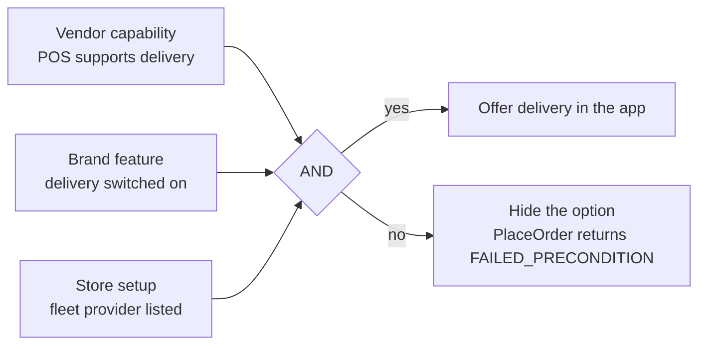
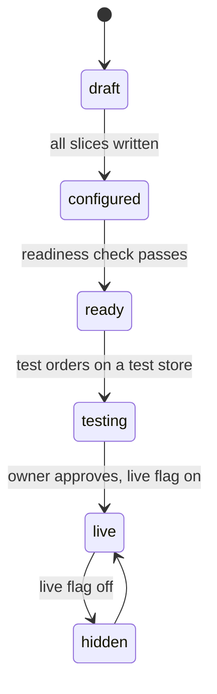

# Brand configuration and capabilities

**Status: first draft, proposed (P-37).** Nothing here is final. It is not yet refined by business requirements or brand limits. Rules that bind the design stay in [`architecture.md`](../architecture.md).

NEXA is one central platform. Every brand has its own needs, so the platform must handle every difference **by configuration, not by code per brand**. This file says what differs, who owns each setting, how capabilities decide what is allowed, and how a new brand plugs in.

Principle 6 stays: brands are rows. There are no per-brand services, topics or databases. This file adds the model for the rows.

Labels: **Assumption** is a working guess. **To verify** is unchecked.

---

## 1. What can differ per brand

This list comes from the baseline docs and the owner's chat. It is the starting set, not the final one. Brand requirements are not refined yet.

| Axis | Examples | Source |
| --- | --- | --- |
| POS vendor and setup | BSL, Promise, VIVI; routing values per store; promotion handling | [`pos-adapters.md`](pos-adapters.md) |
| Payment account | one Omise account per brand; later maybe several partners | Payment HLD, O-22 |
| Menu and prices | master feed, price book per channel, dayparts | Catalog |
| Ownership | owned or franchised; what a franchisor sees | O-26 |
| Aggregators | Grab, LINE MAN, Shopee Food on or off, per store | `partner-adapter` |
| Fulfillment | pickup, delivery, FAAS | POS capability and Delivery |
| Delivery fleet | ordered provider list per store | P-19 |
| Notification | channels, templates, sender settings | Notification (brand channel config) |
| Loyalty | earn rules, tiers, reward prices | Loyalty (D-11: per brand) |
| Wallet | limits, top-up rules | Wallet, O-10 |
| Campaigns | deal rules, budgets | Voucher & Campaign |
| Identity | brand app client, consent wording, whether the brand is enabled for a Minor ID | [`identity-model.md`](identity-model.md) |
| Legal and tax | invoice header, tax details | Payment Statement |
| Store facts | hours, zone, status, group | Brand & Store |
| Legacy | which capabilities still run on a legacy system | [`legacy-bridge.md`](legacy-bridge.md) |

If a brand needs something that is not on this list, add the axis here first, then decide the owner.

---

## 2. Who owns which setting

Each setting has one owning domain (principle 3). There is no central "config service" and no shared config table. Other domains read a setting from its owner, live, and keep no copy (D-07).

| Slice | Owner domain | Key | Written through | Read by |
| --- | --- | --- | --- | --- |
| Brand identity, live flag, feature switches, onboarding state | Brand & Store | `brand_id` | `admin-bff` | every domain that needs a switch, over gRPC |
| Store facts: hours, zone, status, group | Brand & Store | `brand_id:store_id` | `admin-bff` | as today (`ResolveStore`, `ListNearest`) |
| POS connection and capability overrides | Cart & Order | `brand_id:store_id` | `admin-bff` | Cart & Order |
| Aggregator mapping and enablement | Cart & Order | `brand_id:store_id:aggregator` | `admin-bff` | `partner-adapter` through Cart & Order |
| Gateway keys and provider choice | Payment & Billing | `brand_id` | `admin-bff` | Payment |
| Menu, price book, channel prices | Catalog | `brand_id` | `admin-bff` | as today |
| Provider list per store, quote scheme | Delivery & Dispatch | `brand_id:store_id` | `admin-bff` | Delivery |
| Channel config and templates | Notification | `brand_id` | `admin-bff` | Notification |
| Earn rules, tiers, reward prices | Loyalty & MemberCard | `brand_id` | `admin-bff` | Loyalty |
| Wallet limits | Wallet | `brand_id` | `admin-bff` | Wallet |
| Campaign rules | Voucher & Campaign | `brand_id` | `admin-bff` | Voucher & Campaign |
| Brand membership and consent | Identity & Profile | `customer_id:brand_id` | `customer-bff`, `admin-bff` | Identity |
| Legacy routing per capability | the domain that has the legacy adapter | `brand_id:capability` | `admin-bff` | that domain |

"Brand & Store owns feature switches" is a **proposal**. It does not make Brand & Store the owner of other domains' settings. It owns only the on/off switches that say which capabilities a brand has bought, and the onboarding state. Who owns brand config as a whole, and who approves changes, is open (O-27).

---

## 3. Capabilities and features

Two ideas, kept apart:

| Term | Meaning | Set by | Example |
| --- | --- | --- | --- |
| **Capability** | what a vendor or provider can do | the vendor profile, with a per-store override | the POS supports delivery tickets |
| **Feature** | what the brand has switched on | brand configuration | the brand offers delivery |

A shopper action is allowed when **capability AND feature AND store setup** all say yes. This is the **effective capability**.

Rules:

- **Default is off.** A capability or feature that is not set is false. A new brand starts with nothing on.
- **Most specific wins.** Store override, then brand, then vendor profile. Never the other direction.
- **A flag has a behavior for false.** A flag whose false case nobody handles is not added.
- **The app asks, it does not guess.** Whether to show an option comes from the owning domain, not from a hardcoded brand name. Proposed: Cart & Order exposes `GetFulfillmentOptions(brand, store)`. This gRPC method is not drawn yet.
- Capability names for POS are in [`pos-adapters.md`](pos-adapters.md#6-capability-flags). Provider capabilities for payment and fleet follow the same pattern when a second vendor appears.

---

## 4. Onboarding a new brand

A new brand is mostly configuration. The steps, with the owner of each:

| # | Step | Owner domain | Needs code? |
| --- | --- | --- | --- |
| 1 | Create the brand (`brand_id`, name, owned or franchised, live flag off) | Brand & Store | no |
| 2 | Create stores: address, hours, zone, group | Brand & Store | no |
| 3 | Choose the POS vendor and write a `pos_connection` per store (routing values, credentials in Vault) | Cart & Order | **yes**, only if the vendor has no adapter yet |
| 4 | Load the menu through the master feed or file, then publish | Catalog | no |
| 5 | Set up the payment account and keys | Payment & Billing | **yes**, only for a new provider |
| 6 | Turn on aggregators per store, with their mapping | Cart & Order | **yes**, only for a new aggregator |
| 7 | Set the delivery provider list per store, or leave delivery off | Delivery & Dispatch | no |
| 8 | Set notification channels and templates | Notification | no |
| 9 | Set loyalty rules, wallet limits, first campaigns | Loyalty, Wallet, Voucher & Campaign | no |
| 10 | Enable the brand for Minor ID and set consent wording | Identity & Profile | no |
| 11 | Run the readiness check | admin-bff, reading each owner | no |
| 12 | Place test orders on a test store, through every enabled channel | owner and QA | no |
| 13 | Turn the live flag on | Brand & Store | no |

**Readiness check (proposed).** `admin-bff` asks each owning domain one read-only question, "is this brand ready?", and shows the answers on one page. Examples: every store has a valid `pos_connection`; every enabled fulfillment has a capability; every store has a menu version; a gateway key exists. It is a set of gRPC reads. It adds no topic and no new service. The method name `CheckBrandReadiness` is a placeholder and is not drawn yet.

**When code is needed.** Only for a new kind of external thing: a POS vendor, a payment provider, an aggregator, a message provider, or a fleet provider. Each already sits behind a port, so the code is one adapter package plus (at the edge) one mapper. A new brand on an existing vendor needs no deploy.

---

## 5. Data or code

| Data (a row, changed by an admin) | Code (a deploy) |
| --- | --- |
| which POS vendor a store uses, and its routing values | a new POS adapter and mapper |
| capability overrides, feature switches | a new capability flag and its behavior |
| gateway account per brand | a new payment provider |
| aggregator on or off, SKU mapping | a new aggregator mapper |
| earn rules, tiers, deal parameters | a new type of rule in the deal engine |
| templates, channel settings | a new channel type |
| provider order per store | a new fleet provider |
| which capability runs on a legacy system | a new legacy adapter |

If a request is "make brand X behave differently" and the answer is code, check first whether the difference can be a typed setting that the existing code reads.

---

## 6. How configuration is stored and changed

- **Typed columns for what is queried or checked, JSONB for vendor-specific blobs.** A JSONB blob is validated against a JSON schema for that vendor on write. A bad blob is rejected at write time, not at order time.
- **Versioned.** Every config row has `version`, and every write carries the expected version (rulebook §6). A stale write returns `ABORTED`.
- **Audited.** Every change writes an audit row in the same transaction (rulebook §8). The audit says who, what, and the old and new values with secrets removed.
- **No secrets in rows.** A row holds a Vault path, never the secret.
- **Read live, cache by version.** A reader may cache in Valkey keyed by version, as the menu does. The cache is never the truth (D-04).
- **A change takes effect on the next read.** It does not rewrite an open cart or an order in flight. An order keeps the capabilities it was placed under.
- **No topic per setting.** Brand and store changes already travel on `brand.changed` and `store.changed`. Other settings are read by gRPC. A new topic needs the three answers ([`kafka-topics.md`](../kafka-topics.md#growth-policy)).
- **Platform defaults live in the vendor profiles and in code constants.** We do not use the group tenant `mfg` for defaults. `mfg` is the exception made for riders (P-23). Extending it would weaken principle 6.

---

## 7. Open items

| Id | Question |
| --- | --- |
| O-27 | Who owns brand configuration, who approves a change, and is there a maker-checker step for risky settings (a POS vendor change, a payment key)? |
| O-28 | The real capability matrix for each POS vendor (needs vendor input) |
| O-26 | What a franchisor sees (already open) |
| O-31 | Which capabilities run on a legacy system, per brand ([`legacy-bridge.md`](legacy-bridge.md)) |
