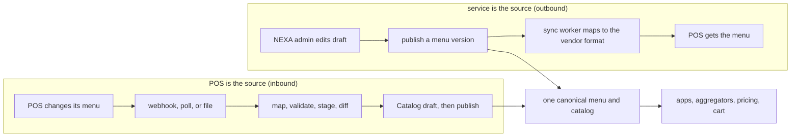

# Catalog sync and source of truth: service-as-SoT and POS-as-SoT

**Status: proposal, first draft, design phase (P-56 to P-58, 2026-10-28).** Nothing here is final. It answers a new requirement and is not yet refined by business answers or vendor limits. Rules that bind the design stay in [`architecture.md`](../architecture.md). Where this note and the rulebook disagree, the rulebook wins until a decision is signed off.

**The requirement** (owner, 2026-10-28): *"Menu and catalog can be setup and sync (outbound, service is SoT) and sync menu and catalog (inbound) from POS instead (POS is SoT). but there will convert to the same structure for menu and catalog."*

Labels used below: **Proposal** is what this note recommends. **Alternative** is a real choice that was not taken. **Assumption** is a working guess the owner will rewrite. **To confirm** is unchecked and needs a vendor, business, or DevOps answer. **Existing** is what the docs already say today. This note states no vendor capability as a fact: every menu capability of every POS vendor, BSL included, is **unknown, treat as false** until the vendor answers (O-53).

---

## 1. What changes, in one page

**Today** (baseline v3, [`catalog-menu-hld-script.md`](../../domains/catalog-and-menu/catalog-menu-hld-script.md)): a master feed (BSL, Excel, or an S3 file) is a worker inside Catalog. It writes the draft, and it owns `pos_code`, the POS name, and the base price. The admin owns the name, image, and category. A price from the feed waits for the next publish (D-08). Sold-out comes from the POS by a webhook through `partner-adapter` onto `catalog.requested`. Nothing goes from NEXA to the POS.

**Proposal, in eight sentences.**

1. Each brand has one setting, `catalog_sync_mode`, that says who the source of truth (SoT) for the menu and catalog is: `service` (NEXA) or `pos` (the POS vendor).
2. In `service` mode the NEXA admin is the only place a menu is edited, and NEXA syncs the published menu **out** to the store's POS (and, as today, to aggregators).
3. In `pos` mode the POS is the only place the menu structure and prices are edited, and NEXA syncs them **in**, through a staging step, into a Catalog draft.
4. Both modes end in the **same canonical structure** (items, modifiers, combos, categories, prices, availability, content, schedule), so apps, aggregators, pricing, and the cart never know which side is the source.
5. For every field group of every brand and store there is **exactly one writer**. Two writers for the same field are not allowed.
6. A brand may mix modes by field group (for example prices from the POS, images and translations from NEXA). That is an advanced option and is flagged. Today's feed split is already such a mix.
7. An inbound change never reaches shoppers by itself: it becomes a draft, and the normal publish rules apply (D-08). An outbound sync never blocks shoppers: a new item is only hidden at a store until that store's POS has it.
8. No new Kafka topic, no new service, no new database engine. One new variant on `catalog.requested`, a second vendor port owned by Catalog, and new tables in Catalog.



---

## 2. Where it lives

| Piece | Owner | Why |
| --- | --- | --- |
| The sync mode and the field-group owners | Catalog (`catalog_sync_mode`) | the menu is Catalog's. The setting is data owned by the domain it configures (P-37) |
| The canonical menu, drafts, versions, price book, availability | Catalog | unchanged |
| The mapping table (`pos_item_map`) | Catalog | it maps Catalog's SKU to a vendor reference |
| The vendor menu port (`PosMenuGateway`) and one Go adapter per vendor | Catalog | the order POS port belongs to Cart & Order and moves tickets. Menus are a different job with a different owner ([`pos-adapters.md` §15](pos-adapters.md#15-menu-sync-is-a-second-port-in-catalog-p-57)) |
| The vendor's webhook entry | `partner-adapter` | external callbacks enter once (rulebook §4). It maps the payload to one canonical command |
| Store and brand existence | Brand & Store | Catalog keeps no copy and checks live (D-07) |
| Switch (brand feature: "sync menu to POS" on or off) | Brand & Store, as for every feature switch | P-37 |
| Raw menu payloads | S3 with a pointer in Catalog's Postgres (proposal), or MongoDB (alternative) | section 8 |

**Why Catalog and not Cart & Order owns the vendor menu port.** Order would then call Catalog for prices and Catalog would call Order for menus: a cycle between two domains. Alternative: put menu operations on `PosGateway` and let Catalog call Order. Not taken, because the one-owner rule (principle 3) says the owner of the menu runs the menu sync, and Order's POS worker is a ticket worker. The cost is that vendor connection data is needed in two domains (O-54).

---

## 3. The source-of-truth setting

### Field groups

The unit of ownership is a **field group**, not the whole menu. This keeps the rule "one owner, one write path" true even when a brand mixes sources.

| Field group | What is in it | Typical owner in `service` mode | Typical owner in `pos` mode |
| --- | --- | --- | --- |
| `structure` | items (SKUs), categories, modifier groups and options, combos, which store offers which item | service | pos |
| `price` | base, store, and channel price entries | service | pos |
| `availability` | the sold-out or "86'd" flag per store and item | service | pos |
| `schedule` | dayparts, scheduled publish times | service | service (the POS has no NEXA publish schedule) |
| `content` | display names per language, descriptions, images, display order | service | **service** (**Assumption:** a POS does not hold translations and images. If a vendor does, the brand may set `content` to `pos`) |

So `pos` mode is "the POS is the SoT for what is sold and for how much", and presentation stays in NEXA. This matches today's split, where the feed owns the `pos_code`, the POS name and the price, and the admin owns the name, image, and category.

### Presets and the mixed option

| Preset | `structure` | `price` | `availability` | `schedule` | `content` | Notes |
| --- | --- | --- | --- | --- | --- | --- |
| **`service`** | service | service | service | service | service | outbound sync is on for stores with a POS |
| **`pos`** | pos | pos | pos | service | service | inbound sync is on |
| `mixed` (advanced, flagged) | any group may be set to `service` or `pos` | | | | | for example `price` = pos, the rest `service`. Needs a reason and is reviewed |
| *as built today* | pos (item ids only) | pos (base) | pos | service | service | the existing master feed split. It maps to `mixed`. It stays the behavior until a brand sets a mode |

**Default.** An unset `catalog_sync_mode` keeps today's behavior and syncs nothing outward (an unset setting is off, P-37). **Proposal:** the brand setting is `service`, `pos`, or `mixed`, and a store may override it (for example one franchise store whose POS is the source while the brand runs `service`). A store override applies only to field groups the brand has not locked.

### The rules

| # | Rule |
| --- | --- |
| S1 | **One writer per field group, per brand and store.** The write path enforces it. An admin edit of a `pos`-owned field is rejected (`FAILED_PRECONDITION`, `field_owned_by_pos`). An inbound import ignores a `service`-owned field, and the ignored change is logged |
| S2 | **Inbound never writes live.** It writes a draft (section 6). Outbound pushes only a published version (section 5) |
| S3 | **A mode change is an admin action** through `admin-bff`, with a dry run first (what would change on the next sync), an audit row, and the maker-checker step if O-27 is answered that way. It takes effect for the next sync. It never rewrites a published version |
| S4 | **A pos-owned availability flag is never auto-restored by NEXA.** Today a cron restores sold-out flags every five minutes. That cron skips flags owned by the POS |
| S5 | **The menu version stays immutable** and the publish path stays the same in both modes (D-08). The mode decides who fills the draft |
| S6 | **A field has an owner in exactly one place.** The setting row names the owner of each field group. A diagram or a sync run that writes another way is a bug |
| S7 | **A vendor answer is untrusted input** (the same posture as [`pos-adapters.md`](pos-adapters.md)): duplicated, late, partial, or wrong |

**Alternatives.** (1) Two-way merge with last writer wins: not taken, because two writers for one field is exactly what the one-owner rule forbids, and a silent price overwrite is a money bug. (2) A single global mode for the whole platform: not taken, because the owner said each brand has its own POS and its own requirements (P-37).

---

## 4. The canonical model and the id mapping

Keep this at the level of the existing Catalog design. This is the list of what the adapters must map, not a schema.

### Main entities

| Entity | Main fields the adapter must map | Notes |
| --- | --- | --- |
| Menu | `brand_id`, channel, version, `effective_at` | **Existing.** A menu is one brand and one channel. A version never changes after publish |
| Category | id, display names, order, parent | content group for names and order. Which items it holds is `structure` |
| Item (SKU) | `sku_id` (NEXA), kind (`single`, `combo`, `modifier_only`), `pos_code` (existing), POS name (existing), category, status (`active`, `retired`) | `sku_id` is stable and never reused |
| Modifier group | id, min, max, required, options | **Existing:** min, max, required, a price delta, checked at publish and at `PriceLines` |
| Modifier option | id, price delta (satang), optional item reference, default flag | |
| Combo | id, slots, and for each slot the allowed items and a price delta | **Not in the current Catalog docs.** Proposed here as a kind of item with slots. How a vendor models combos is **to confirm**. A construct that cannot be mapped is reported, not dropped |
| Price entry | scope (base, store, channel), `sku_id` or option id, amount in integer satang, currency | **Existing** price book, frozen into the version. Tax inclusive or not: **to confirm** |
| Availability | `store_id`, `sku_id`, available or not, reason (`sold_out`, `not_offered`, `pos_sync_pending`), owner (`service` or `pos`), optional restore time | **Existing** flag outside the version. The reason and the owner are new fields |
| Content | display name, description per language (Thai first), image key | stays in NEXA unless `content` is set to `pos` |
| Schedule | daypart, `effective_at` | **Existing** |

Money is integer satang (P-12). Times are UTC `timestamptz`. Names carry a language code. An unknown vendor field is kept in an `extras` blob for the log and is never shown or priced.

### The id mapping

`pos_item_map`, in Catalog's Postgres:

| Column | Meaning |
| --- | --- |
| `brand_id`, `vendor` | the brand and the POS vendor |
| `store_scope` | `all` (the item has one reference at every store) or a list or single `store_id` (a vendor that numbers items per store) |
| `entity` | `item`, `modifier_group`, `modifier_option`, `category`, `combo` |
| `nexa_id` | the canonical id (`sku_id` and so on) |
| `pos_ref` | the vendor's reference. For an existing item this is today's `pos_code` |
| `source` | `created_by_nexa` (outbound) or `seen_in_pos` (inbound) |
| `status` | `active`, `unmapped`, `retired`, `suspect` |
| `last_seen_at`, `last_version` | when the vendor last showed or accepted it |
| `version` | for optimistic writes |

Rules: unique `(brand_id, vendor, store_scope, entity, pos_ref)` and unique `(brand_id, vendor, store_scope, entity, nexa_id)`. **A mapping row is never reused for another item.** If a vendor reuses a reference for a different item (the name or kind changed a lot), the row goes to `suspect` and the change is held for review. A mapping is created in two ways: outbound, NEXA creates the item and either assigns the reference (`pos_code`) or reads back the reference the vendor assigned (`ids_assigned_by_pos`); inbound, an unknown reference creates a new draft SKU and a mapping row. A sellable item at a POS-bound store with no mapping blocks the publish in `service` mode (a publish check), and cannot occur in `pos` mode. A ticket line carries the POS reference it was priced with (as `pos_code` does today). **To verify** how `pos_code` reaches the ticket today in the Cart & Order LLD.

---

## 5. Outbound path: service is the source

Trigger: Catalog publishes a menu version, or changes availability, for a brand in `service` mode (or a `service`-owned field group).

```
 1  admin-bff ──gRPC PublishMenu──▶ Catalog          validates (modifier rules, mappings), commits the version and the outbox rows
 2  Catalog outbox ──▶ catalog.menu.published (thin) as today              aggregators, cache projector
 3  Catalog commits a sync_run per POS-bound store (the same commit)       status: pending
 4  sync worker (cron or outbox mode of Catalog) takes a run
 5  vendor mapper builds the vendor payload from the canonical version    PosMenuGateway.PublishMenu(target, menu version)
 6  the vendor answers per item (or per call)                              receipt: accepted, rejected with reason, or unclear
 7  Catalog commits the run: done, partial, or failed, and the mapping rows (refs the vendor assigned)
 8  items new in this version are shown at the store only after step 7 confirms them
```

| Rule | Detail |
| --- | --- |
| Versioned and idempotent | a run is keyed by `(brand_id, store_id, menu_version)`. A re-run sends the same version. The vendor payload carries the version as a reference where the vendor allows it |
| Sync before it is effective | a version with a scheduled `effective_at` is synced when it is scheduled, ahead of `effective_at`, so the 11:00 lunch menu is already at the POS at 11:00 (section 10 has the burst reason) |
| **New items wait for the POS** | an item that is new in the version, or newly mapped, is hidden at a store (availability reason `pos_sync_pending`) until that store's run confirms it. A price-only change applies at once and the POS is told in the same run. A mismatch is a reconciliation matter (O-32) |
| Partial failure | a run is `partial` when some items fail (a missing mapping, a vendor validation error). The good items stay done, the failures are listed, a retry with backoff runs for a window, then a staff alert goes to the admin console. The menu version stays published for shoppers either way |
| Alternative not taken: strict gate | the version goes live only when every POS-bound store has confirmed. Not taken: it couples publish to the slowest vendor and a vendor outage would block a brand's menu, against "sync when someone is waiting" (principle 2) |
| Drift detection | a nightly `menu_drift` cron per store, **only where the vendor allows a menu read** (`supports_menu_read`): it compares the vendor's menu with the last version NEXA pushed, per item hash, and raises a drift report. **It never overwrites by itself.** An admin chooses "push again" or "accept the POS value" (which is a mode or field change, not an edit). Without a read, drift is `unknown` |
| Availability out | a change of a `service`-owned flag is a small sync run for the item (`PublishAvailability`), needs `supports_availability_publish`, and otherwise stays in NEXA only (the POS then has to be told by staff). Aggregators are told through `catalog.availability.changed`, as today |
| No topic | steps 3 to 7 are Catalog's own background work: an outbox row and a worker. The rulebook says that is not a topic (topic rule 1) |

---

## 6. Inbound path: the POS is the source

Triggers (a store may use any of them, and **the vendor decides which exist**):

| Trigger | How it arrives |
| --- | --- |
| A menu-change webhook | the vendor calls `partner-adapter` on its route. The adapter checks the signature, maps the payload to a thin command, and publishes `catalog.requested{pos_menu_changed}` (vendor store reference and an external version or etag), keyed `brand_id:store_id:menu` |
| A poll | a Catalog cron per store (interval is an Assumption, section 10) calls `PosMenuGateway.ReadMenu` and compares the etag or hash |
| A file | the existing master feed form: an Excel or file dropped to S3, read by the same import worker |

```
 1  trigger ──▶ import worker (Catalog, worker mode) opens an import row: menu_import(status = fetching)
 2  fetch the raw menu through PosMenuGateway.ReadMenu (or read the file). Keep the raw payload (section 8). Skip if the etag or hash is unchanged
 3  vendor mapper converts it to the canonical form (items, modifiers, combos, prices, availability). Unknown fields go to extras
 4  validate: required names, price is an integer satang and not negative, modifier min and max, no orphan references, no duplicate references, combos complete
 5  stage: write import_item rows (one per entity) with the result: new, changed, unchanged, removed, unmapped, invalid
 6  diff against the current draft and the published version: counts and the list of changes
 7  publish gate: guard limits (section below) pass? ── yes, and inbound_publish = auto ──▶ write the draft and publish. Otherwise the draft waits for review
 8  review (default): staff open the diff in the admin console, approve or reject. Approve writes the draft and publishes through the normal PublishMenu
 9  the normal facts leave after the commit: catalog.menu.published (thin), as today
```

| Rule | Detail |
| --- | --- |
| Draft first | an import writes a draft or a staging row, never a live version (S2, D-08). A POS price change reaches shoppers at the next publish |
| `inbound_publish` | a setting per brand: `review` (default) or `auto`. `auto` applies only when the guard limits hold |
| Guard limits | an import is held for review when it changes more than a set share of items, removes more than a set share, changes a price by more than a set share, or leaves the menu with fewer than a set number of items. **All thresholds are Assumptions** (for example 20 percent of items, 5 percent removed, 50 percent price change). They protect against a bad export that would blank a live menu, in the spirit of the Brand & Store feed rule "a bad row is dead-lettered and does not blank a live store" |
| Conflict | a field the POS owns is overwritten by the import. A field NEXA owns (`content`, `schedule`) is untouched, and a change to it in the payload is logged and ignored (S1). There is no merge |
| Deletes | an item that is gone from the POS becomes `retired` (hidden from the menu, kept in history and in the price lines of past orders). A hard delete never happens, because orders, vouchers, and the price book may refer to it. The delete guard applies |
| New item | an unknown reference becomes a new draft SKU with a mapping row, placed in the category the POS says, with its `content` empty. A new item with no Thai name is flagged "needs content" and is not published until it has one (**Proposal**) |
| Per-store menus | a POS may offer different items at different stores. The canonical menu stays one per brand and channel, and the importer sets `not_offered` availability for the stores that do not offer an item. **The current Catalog docs have no per-store item set**, so this is new and flagged |
| Availability in | a POS-owned flag comes from the sold-out webhook as today (`catalog.requested{sold_out}`), or from the import. It never auto-restores by NEXA's cron (S4) |
| Idempotent | an import row has a unique `(brand_id, store_id, external_version or content hash)`. A webhook seen twice, or a poll after a webhook, does nothing the second time |
| Failure | a vendor timeout retries with backoff. A mapping failure marks the entity `invalid` and the rest of the import still stages. A total failure leaves the live menu as it was and raises a staff alert |
| Ordering | the key `brand_id:store_id:menu` keeps one store's menu changes in order. A stale import (an older external version than the last applied) is dropped |

---

## 7. Availability, both directions

| Mode | Who sets sold-out | Flow |
| --- | --- | --- |
| `service` | NEXA admin (and the auto-restore cron) | `SetSoldOut` writes the flag, then (if `supports_availability_publish`) a small sync run tells the POS. Aggregators hear `catalog.availability.changed` |
| `pos` | the POS | the sold-out webhook (`catalog.requested{sold_out}`, **existing**) or the import. NEXA's cron does not restore it. An admin may mark an item unavailable in NEXA only as a temporary NEXA-side hold with its own reason (`nexa_hold`), which never changes the POS flag (**Proposal**, to confirm) |

The existing topics carry it all: `catalog.availability.changed` is unchanged except for two optional fields, `reason` and `owner` (BACKWARD compatible).

---

## 8. Kafka, and where raw menu payloads live

### Topics: no new one

| Existing topic | Use |
| --- | --- |
| `catalog.requested` | **One new variant, `pos_menu_changed`** (vendor store reference, external version or etag, no menu body), beside `sold_out`. Producer: `partner-adapter`. Key `brand_id:store_id:menu`. A thin pointer, so no body rides on the topic (the 1 MB rule) |
| `catalog.menu.published` | unchanged. Thin version pointer, as today. Aggregators and the cache read it |
| `catalog.availability.changed` | unchanged, with the optional `reason` and `owner` |
| Outbound sync, import results | **not on a topic.** An outbox row and a worker inside Catalog, and Postgres rows the admin console reads |

The three-answers rule for a possible `catalog.sync.events`: the producer would be Catalog, the only consumer would be the admin console, and the console reads Postgres. Answer 3 is "an existing table covers it". **No topic.** A topic would be justified if a second domain needed to react to a sync result (a support tool or analytics).

### Raw menu payloads

An inbound import keeps the raw vendor payload, and an outbound run keeps what was sent and the answer, so a bad mapping can be debugged.

| Option | What | For | Against | Verdict |
| --- | --- | --- | --- | --- |
| **A. S3 with a pointer in Postgres** | `menu_import` and `sync_run` rows hold an S3 key, a hash, a size, and an expiry. S3 lifecycle deletes after the retention (Assumption: 30 days) | no second engine for this use. Menu payloads are large, whole documents that are read rarely. S3 is already Catalog's place for imports and images. Cheap | no query inside a payload without a tool. Unmasked vendor data in S3 needs an access rule | **Proposal (P-58)** |
| B. MongoDB, a `menu_payload` collection | the same pattern as the order payload log: schemaless, TTL, an async writer | one tool for "what did the vendor send?". The owner's partnership with MongoDB | the written reason in rulebook §6 limits MongoDB to **one** use, the order payload log in Cart & Order (P-38). Another use needs its own written reason and decision, and P-38 amended. A second domain would then write to Mongo. Principle 1 | Alternative. Needs the owner's answer (O-54) |

Menu payloads hold no personal data (principle 8 is not at risk), but vendor credentials never appear in them: headers and signatures are dropped before the store.

---

## 9. Settings, gRPC, and REST (proposals)

All names are proposals. **Align with the boilerplates when shared.**

### Settings (owner: Catalog, written through `admin-bff`, versioned and audited)

| Setting | Meaning | Default |
| --- | --- | --- |
| `catalog_sync_mode` | `service`, `pos`, or `mixed` per brand, with an optional store override | unset: today's behavior, nothing synced outward |
| `field_owner.<group>` | in `mixed`, the owner of each field group | n/a |
| `inbound_publish` | `review` or `auto` | `review` |
| `inbound_guard` | the guard limits | Assumptions in section 6 |
| `poll_interval` | per store, for a vendor with no webhook | an Assumption: 15 minutes |
| `sync_retry_window` | how long a failed outbound run retries before it alerts | an Assumption: 30 minutes |
| `pos_menu_connection` | vendor, a Vault reference, routing values | O-54 |

### gRPC

| Domain | Calls |
| --- | --- |
| Catalog (admin) | `SetSyncMode`, `GetSyncStatus` (per store: last run, drift, unmapped count), `StartImport` (one store, on demand), `ListImports`, `GetImportDiff`, `ApproveImport`, `RejectImport`, `ResyncStore`, `ListMappings`, `UpsertMapping`, `ListUnmapped` |
| Catalog (existing) | `PublishMenu` gains the mapping check and creates the sync runs. `SetSoldOut` is unchanged and gains the flag owner |
| `partner-adapter` | publishes `catalog.requested{pos_menu_changed}` after it checks the vendor signature |

### REST (admin, Elysia v2)

| Route | What |
| --- | --- |
| `GET /v1/admin/brands/{brand_id}/catalog/sync` | the mode and the field owners |
| `PUT /v1/admin/brands/{brand_id}/catalog/sync` | change the mode (a dry run first with `?dry_run=true`) |
| `GET /v1/admin/stores/{store_id}/catalog/sync` | status, last runs, drift, unmapped |
| `POST /v1/admin/stores/{store_id}/catalog/sync/resync` | push the current version again (outbound) |
| `POST /v1/admin/stores/{store_id}/catalog/imports` | start an import now (inbound) |
| `GET /v1/admin/stores/{store_id}/catalog/imports/{import_id}` | the diff and the guard result |
| `POST /v1/admin/stores/{store_id}/catalog/imports/{import_id}/approve` | approve, then publish through the normal path |
| `GET`, `PUT /v1/admin/brands/{brand_id}/catalog/mappings` | view and fix the mapping table |

Grants (on the P-30 model): `catalog.sync.view`, `catalog.sync.manage` (change a mode, resync), `catalog.import.approve`, `catalog.mapping.manage`.

### Tables (Catalog, Postgres)

`sync_setting` (brand, store override, mode, field owners, version), `pos_item_map` (section 4), `sync_run` (brand, store, menu version, status, counts, S3 key, timestamps, version), `sync_run_item` (run, entity, result, reason), `menu_import` (brand, store, external version or hash, status, S3 key, counts), `import_item` (import, entity, `nexa_id`, `pos_ref`, change kind, validation result). All keyed by `brand_id`, versioned, with an audit row in the same transaction.

---

## 10. Scale assumptions (recommended, to be rewritten)

These are **Assumptions** (P-66), not facts. The only existing figure is "a store menu is under 1,000 items" from the Catalog HLD script.

| Parameter | Assumed value |
| --- | --- |
| Items in one brand menu | 300 on average, up to 1,000 |
| Modifier groups and options | 40 groups and 200 options |
| Raw vendor payload | 300 KB |
| Stores in `pos` mode that poll | 1,000 |
| Poll interval | 15 minutes |
| Share of polls that find a change | 5 percent |
| Publishes per brand per day | 2 |
| Stores in `service` mode for one brand | 200 |
| Raw payload retention | 30 days |

| Derived | Value | Note |
| --- | --- | --- |
| Poll calls | 96,000 per day, about 1.1 per second | small. Add jitter so stores do not poll together |
| Raw payloads stored | about 4,800 per day, about 1.4 GB per day, about 43 GB at 30 days | storing only on change (an etag or hash compare) is what keeps it small. Storing every poll would be 96,000 payloads, about 29 GB per day |
| Outbound runs | 400 store syncs per day for such a brand (200 stores x 2) | trivial |
| A scheduled-menu burst | if every brand's lunch menu syncs at the minute it goes live, thousands of runs at once | sync at schedule time, ahead of `effective_at`, and rate-limit per vendor (O-53) |
| Import and diff size | a few hundred rows per store | trivial for Aurora |

---

## 11. Edge cases

| # | Case | What happens |
| --- | --- | --- |
| 1 | The POS changes its menu while an order is in flight | Orders keep the price lines and the POS references they were priced with. A later import changes the draft, and shoppers see it at the next publish. A ticket whose item the POS removed meanwhile returns `ErrRejected`, and the order follows the normal saga: reject and void for prepaid, a staff action for a postpaid round |
| 2 | An item has no mapping | `service` mode: the publish check blocks the version or hides the item at that store (a staff choice per brand), and lists it under "unmapped". `pos` mode: cannot happen, because new references create mappings. A ticket with an unmapped line is refused before sending (`mapping_missing`) |
| 3 | The POS price differs from the price the shopper saw | NEXA's order price wins (P-32). The ticket may carry the POS's price, so the POS total can differ: that is the reconciliation case of O-32. In `pos` mode the gap is small if imports publish quickly (O-55). In `service` mode a late sync is the cause, and the drift check finds it |
| 4 | Modifiers and combos | a modifier maps one to one to a vendor modifier where the vendor has the same idea. A combo may need a vendor-specific encoding. **To confirm** per vendor. A construct that cannot be mapped is reported as `unmapped` and the item is not published at that store. It is never dropped silently and never sent half-mapped |
| 5 | Multi-language | `content` holds names per language and stays in NEXA. A POS name is kept as the read-only `pos_name`. If the vendor sends translations and the brand sets `content` to `pos`, they are mapped by language code |
| 6 | Per-store menus | see section 6: availability `not_offered` per store. Prices already have a store level in the price book |
| 7 | An import would blank a live menu | the guard limits hold it for review and raise an alert. The live version stays |
| 8 | The vendor is down during an outbound run | the run retries with backoff, then alerts. New items stay hidden at that store. Shoppers still see the published version for items the POS already has |
| 9 | Two stores of one brand are in different modes | allowed through the store override, for field groups the brand has not locked. The brand-level menu stays one canonical menu |
| 10 | A mode change from `pos` to `service` | the dry run shows every field that changes owner. After the switch, the first outbound run pushes the whole menu. The old POS values are what NEXA holds, and staff check the diff before the switch (S3) |
| 11 | A vendor reuses a reference for a different item | the mapping goes to `suspect` and the change is held for review |
| 12 | The same import arrives twice | the unique key makes it a no-op |
| 13 | A scheduled menu goes live while a sync run is late | the version is live, and the new items are hidden at the late stores (`pos_sync_pending`) |
| 14 | The master feed from before this change | it is the `pos` side of the as-built `mixed` split and keeps working until a brand chooses a mode. The Excel and S3 sources are the file trigger of section 6 |

---

## 12. BSL: what the docs say, and what is not known

**Only what is already recorded.** The master feed (BSL, Excel, or an S3 file) feeds the Catalog draft and owns `pos_code`, the POS name, and the base price (Catalog HLD script, D-08). The BSL POS sends a sold-out webhook to `partner-adapter`, which publishes `catalog.requested`. The BSL proxy is the transport of the BSL order adapter ([`pos-adapters.md` §10](pos-adapters.md#10-bsl-as-the-first-adapter)).

**Not recorded, so unknown, treat as false until the vendor answers (O-53):** whether BSL can export a menu on request, whether it has a menu-change webhook, whether it accepts a menu from NEXA, how it models modifiers and combos, who assigns item ids, whether it can report availability back or accept it, and its rate limits. So the BSL profile has every menu flag false, and a BSL brand stays in the as-built split (feed in, nothing out) until the owner chooses a mode and the vendor confirms what it can do.

---

## 13. Conflicts and flags

| Rule or decision | How this design touches it | Handling |
| --- | --- | --- |
| Principle 3: one owner, one write path | Two systems can hold the menu | One writer per field group (S1). A mixed mode is flagged and reviewed |
| D-08: a POS price change waits for a publish | Inbound prices follow it | Imports write drafts. Nothing changes for shoppers until a publish. The wait is the cost (O-55) |
| D-07 and the "no copies" rule | `pos_item_map` stores vendor references | It holds ids, not another domain's data. Brand and store are still checked live |
| §6 MongoDB only for the order payload log | The owner suggested Mongo for raw POS menu payloads | Proposal: S3. Mongo is an alternative that needs P-38 amended (O-54) |
| Catalog "keeps no copy of Brand & Store data" | The v3 table lists `brand.changed` and `store.changed` as inputs | Unchanged. The sync reads the store reference live |
| Principle 1: simplest thing that works | A second port, a staging area, a diff | Needed to keep "inbound never writes live" true. No topic, service, or engine is added |
| The existing feed split | Today's split is already mixed | Kept as the default until a brand sets a mode |
| Per-store menus | The docs have per-store price and sold-out, not per-store item sets | New `not_offered` availability. Flagged |
| P-36 untrusted vendor input | Applies to menus | S7 |
| P-33 / D-11 | Not touched | |

---

## 14. Impact on other files

| File | Change | State |
| --- | --- | --- |
| [`architecture.md`](../architecture.md) | §3 (Catalog row), §13: P-56 to P-58, O-52 to O-55, §14 rows | Done in this pass |
| [`kafka-topics.md`](../kafka-topics.md) | the `catalog.requested` variant, a "no new topic" section | Done in this pass |
| [`pos-adapters.md`](pos-adapters.md) | section 15 (the second port) | Done in this pass |
| [`brand-configuration.md`](brand-configuration.md) | the sync mode, owner, and readiness check | Done in this pass |
| [Catalog description](../../domains/catalog-and-menu/description.md) | a v-next note | Done in this pass |
| Catalog HLD and LLD, and the HLD script | no sync worker, no port, no mapping table, no import or sync pages | **Diagram not updated.** Row added to [`architecture.md` §14](../architecture.md#14-known-drift) |
| [`diagrams/14-catalog-sync-and-source-of-truth.drawio`](../../diagrams/14-catalog-sync-and-source-of-truth.drawio) | four pages | Done in this pass |
| Diagrams 05, 07, 11 (Catalog page) | add the menu port and the new variant | **Not updated** |

---

## 15. Decisions and open questions

New ids continue the register in [`architecture.md` §13](../architecture.md#13-decision-register). The text there is the binding one.


| Id | Decision (proposed) | Section | Cost |
| --- | --- | --- | --- |
| P-56 | **Catalog source of truth is a per-brand setting.** A brand (and, where needed, one store) sets who is the source of truth for menu and catalog: `service` (the NEXA admin is the source, and NEXA syncs out to the POS and the channels) or `pos` (the POS is the source, and NEXA syncs in). The setting is per field group (structure, content, price, availability, schedule) with **exactly one writer per field group** for every brand and store. `service` and `pos` are the two presets. A `mixed` split (for example prices from the POS, content from NEXA) is an advanced option, flagged. A write to a field the other side owns is rejected. A mode change needs a dry run and an audit row. The owner is Catalog (setting `catalog_sync_mode`). The master feed of baseline v3 is the POS side of today's as-built split | [`catalog-sync-and-sot.md`](catalog-sync-and-sot.md#3-the-source-of-truth-setting) | a mode switch needs a full re-sync and a diff review; mixed mode doubles the rules to test; who approves a switch is open (O-52, O-27) |
| P-57 | **One canonical menu and catalog structure, with a mapping per vendor.** Both directions convert to the same canonical structure (menu, category, item, modifier group and option, combo, price, availability, content, schedule), so apps, aggregators, pricing, and the cart never see which side is the source. A vendor mapper sits in Catalog's own `PosMenuGateway` port (a Go adapter per vendor, a new port beside `PosGateway`). A mapping table (`pos_item_map`) links the NEXA SKU id to the vendor's item reference, per brand, vendor, and store scope. Anything that cannot be mapped is reported and not published, and is never dropped silently. No vendor menu capability is asserted: every flag is unknown until the vendor answers | [`catalog-sync-and-sot.md`](catalog-sync-and-sot.md#4-the-canonical-model-and-the-id-mapping) | a mapper per vendor; combos and modifiers may not map one to one; the mapping table is data that has to be kept right (O-53, O-54) |
| P-58 | **Sync pipelines: staged inbound, versioned outbound.** Inbound: a webhook, a poll, or a file, then the raw payload is kept, mapped, validated, staged, and diffed, and only then written to a Catalog **draft**. It reaches shoppers through the normal publish (D-08), by review (the default) or by auto-publish inside guard limits. A delete retires an item and never removes history. Outbound: a publish creates a sync run, worked by Catalog's own outbox worker (no topic). An item new in a version stays hidden at a store until that store's sync confirms it. Failures are retried and alerted. A nightly drift check compares the vendor menu where the vendor allows a read, and never overwrites by itself. A POS-owned availability flag is never auto-restored by NEXA. **No new topic:** `catalog.requested` gains a thin `pos_menu_changed` variant. Raw menu payloads are kept in S3 with a pointer in Postgres (the alternative, MongoDB, needs P-38 amended, O-54) | [`catalog-sync-and-sot.md`](catalog-sync-and-sot.md#5-outbound-path-service-is-the-source), [`catalog-sync-and-sot.md`](catalog-sync-and-sot.md#6-inbound-path-the-pos-is-the-source) | a staging area and a diff screen to build; a new item can be hidden at a store while its sync is late; a POS price change waits for a publish (D-08, O-55) |
| P-65 | **No new Kafka topic for the four updates of 2026-10-28.** The three-answers rule was applied to each. Postpaid: there is no POS status, so fewer events. Catalog sync: one thin `pos_menu_changed` variant on `catalog.requested`, and the outbound push is Catalog's own outbox worker. The basket: each child uses `order.events`, and the parent has no events. Payment-method sharing: no event. The registry stays at twelve. Candidates, not registered: `catalog.sync.events` (if a second consumer wants sync results) and `basket.events` (if a consumer needs the parent) | [`../kafka-topics.md`](../kafka-topics.md#growth-policy) | a candidate waits for a named consumer; the two candidates may be promoted sooner if analytics or support tools need them |
| P-66 | **The numbers of the 2026-10-28 features are assumptions.** Menu sizes, sync intervals, payload sizes, basket sizes, the gate window, and the send retry window are recommended assumptions for the owner to rewrite, the same status as P-43 and P-52 | [`catalog-sync-and-sot.md`](catalog-sync-and-sot.md#10-scale-assumptions-recommended-to-be-rewritten), [`multi-brand-cart.md`](multi-brand-cart.md#9-scale-assumptions-recommended-to-be-rewritten) | sync schedules and the gate window depend on the answers to O-01, O-04, and O-53 |

| Id | Open question (needs a business answer) | Blocks |
| --- | --- | --- |
| O-52 | Catalog source of truth: which brands and stores run in which mode (`service`, `pos`, or a mixed split), which field groups the POS owns when a brand mixes, and who approves a mode switch (with O-27) | the sync setting (P-56) |
| O-53 | Per POS vendor: can it export its menu, take a menu from us, push a menu-change webhook, and report or accept availability? Who assigns item ids? How does it model modifiers and combos, and what are its rate limits? Extends O-28. For BSL the docs record only the master feed and the sold-out webhook | the menu flags and mappers (P-57), the sync schedule |
| O-54 | Where Catalog keeps vendor connection data and secrets (its own row, or a Vault reference shared with Cart & Order's `pos_connection`), and the home of raw menu payloads (S3, recommended, or MongoDB, which needs P-38 amended and a new written reason) | the `PosMenuGateway` setup, the import worker (P-57, P-58) |
| O-55 | Inbound publish policy: review or auto-publish, the guard limits (share of items changed or deleted), how fast a POS price change may reach shoppers (D-08), and the rule when the POS price differs from the price shown at checkout (with O-32) | the import publish step (P-58) |

Related and already open: O-27 (who approves a risky setting), O-28 (vendor limits), O-32 (POS total differs), O-36 (who creates topics and ACLs), and O-42 and O-49 for postpaid.
