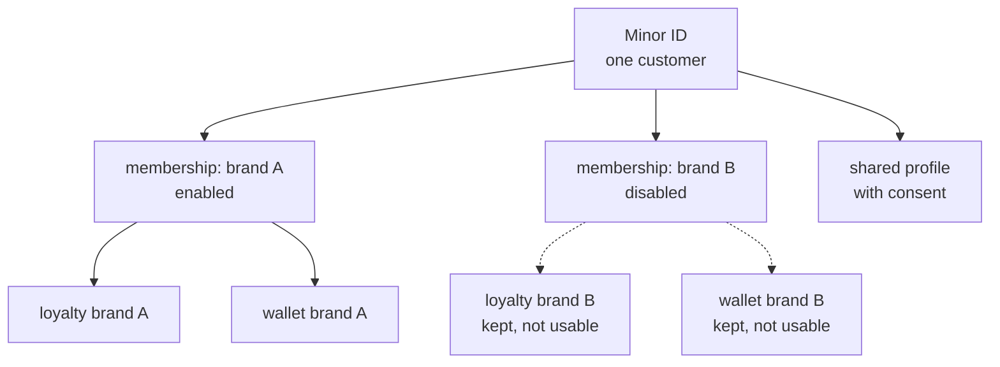

# Identity model — Minor ID across brands

**Status: first draft, proposed (P-40).** Nothing here is final. Rules that bind the design stay in [`architecture.md`](../architecture.md).

Owner decision, 2026-10-24:

- One customer has **one user, the Minor ID**. It can sign in across all brands.
- The Minor ID can be **enabled or disabled for each brand**. A customer can stay in just one brand.
- The **profile is shared** across brands, with consent (P-33, PDPA).
- The **loyalty profile and the e-wallet stay separate per brand**, for marketing conditions. D-11 stands, confirmed 2026-10-24.
- The 2029 idea of one wallet and one points balance across brands stays a **later option** (O-19, O-20: deferred).

Labels: **Assumption** is a working guess. **To verify** is unchecked.

---

## 1. What is shared and what is not

| Thing | Scope | Owner | Rule |
| --- | --- | --- | --- |
| Account (the Minor ID): login identifier, sign-in methods, status | one per person, all brands | Identity & Profile | one record per customer |
| Brand membership: is this customer enabled in this brand | per `(customer_id, brand_id)` | Identity & Profile | enabled or disabled. New: this status |
| Profile: name, birthday, preferences, addresses | shared across brands **with consent** | Identity & Profile | see section 3 |
| Consent records | per customer and purpose | Identity & Profile | withdraw at any time (P-33) |
| Loyalty profile, points, tier, member card | per `(brand_id, customer_id)` | Loyalty & MemberCard | D-11. Not shared |
| E-wallet and its ledger | per `(brand_id, customer_id)` | Wallet | D-11. Not shared |
| Vouchers and redemptions | per brand (as built) | Voucher & Campaign | unchanged |
| Orders and carts | per brand | Cart & Order | unchanged. One open cart per `(brand_id, customer_id)` (P-31) |

---

## 2. Enabling and disabling a brand

`JoinBrand` already exists in the Identity LLD (page 3). It creates the membership. Membership gets a status.

| Status | Meaning |
| --- | --- |
| `enabled` | the customer can sign in to this brand and use it |
| `disabled` | the customer cannot sign in to this brand. Their data in that brand is kept, not usable |

| Question | Proposal | Status |
| --- | --- | --- |
| Who can change it | the customer, through `customer-bff`; support, through `admin-bff` with a grant | Proposed |
| How the brand is known on a request | Kong sets `X-Brand-Id` from the brand app (its host or client id), not from a list in the token | Proposed. This partly answers O-06; it stays open until the owner confirms |
| How a disabled brand is enforced | Identity issues a customer token for one brand only (a `brand_id` claim), and only when the membership is `enabled`. Kong rejects a token whose `brand_id` differs from the route. `RefreshToken` re-checks the membership | Proposed |
| How fast a disable takes effect | at the next token refresh. Access tokens live 5 minutes ([§8](../architecture.md#8-edge-identity-and-security)), so the lag is up to 5 minutes. Same cost as revocation | Proposed |
| Notifications for a disabled brand | Notification reads reachability from Identity at send time (`BatchGetContacts`), so Identity can answer "not reachable for this brand". No topic | Proposed |
| Is a join or a disable announced | no. Identity publishes nothing (as today). Loyalty learns from `order.events` | Unchanged |

A customer who stays in one brand is simply a Minor ID with one `enabled` membership. This replaces the concept's "keep a Bonchon-only account" idea inside one model. **Assumption:** the old per-brand accounts are merged into a Minor ID when the customer first signs in. How to match old accounts is part of [`legacy-bridge.md`](legacy-bridge.md) (O-31).

---

## 3. Shared profile and consent

P-33 says sharing a profile across brands is a PDPA consent purpose owned by Identity, the customer can withdraw it, and without it a brand sees only its own rows.

| Rule | Detail | Status |
| --- | --- | --- |
| Provenance | Every profile attribute and address row carries `origin_brand_id` (the brand where the customer entered it) | Proposed |
| Without consent | A brand reads only rows with its own `origin_brand_id`, plus the minimum an account needs to sign in | Proposed (follows P-33) |
| With consent | A brand reads the shared profile rows, for the purposes the customer agreed to | Proposed |
| Where it is checked | In Identity, on every cross-brand read (P-33 already says this). Other domains never decide it | Decided (P-33) |
| Contact details | Still read live from Identity at send time. Never on the bus (D-05) | Decided |
| Withdrawing | Stops cross-brand reads at once. It does not delete rows. Deleting is `DeleteCustomer` | Proposed |
| Franchise brands | Whether a franchisor can see shared data is open (O-26) | Open |

**Assumption:** the minimum an account needs is the login identifier and sign-in methods. Which fields count as the minimum is for the owner and legal to settle (O-33).

---

## 4. Loyalty and wallet stay per brand

D-11 stands. One customer across brands means many loyalty profiles and many wallets. Nothing in this model moves a balance between brands.

| Case | Result |
| --- | --- |
| Customer is `enabled` in brand A and B | two loyalty profiles, two wallets, one Minor ID |
| Membership in B is `disabled` | B's loyalty profile and wallet are kept, but cannot be used while disabled. What happens to a remaining balance is open (O-33) |
| Customer wants one balance across brands | not supported. This is the 2029 option (O-19, O-20: deferred). If it is ever built, the group tenant `mfg` is the likely home, as for riders (P-23) |

---

## 5. What changes in the docs and diagrams

| Item | Change | State |
| --- | --- | --- |
| [`architecture.md`](../architecture.md) | Identity row in §3, D-11 confirmed, P-40, O-33 | Done in this pass |
| [Identity description](../../domains/identity-and-customer/description.md) | short note on membership status | Done in this pass |
| Identity HLD and LLD page 3 (`JoinBrand`) | add the membership status and the brand-scoped token | **Diagram not updated.** In "Diagrams to update next" |
| Kong route rule | `X-Brand-Id` from the brand app, and a token claim check | Not specified yet. O-06 |

---

## 6. Open items

| Id | Question |
| --- | --- |
| O-06 | How Kong sets `X-Brand-Id` for a customer in more than one brand. The proposal above awaits confirmation |
| O-26 | What a franchisor sees (already open) |
| O-33 | Default consent state and when it is asked. Which fields are the sign-in minimum. What happens to a wallet balance, points and notifications when a membership is disabled. How a delete works across brands |
