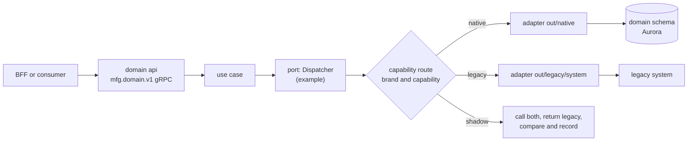
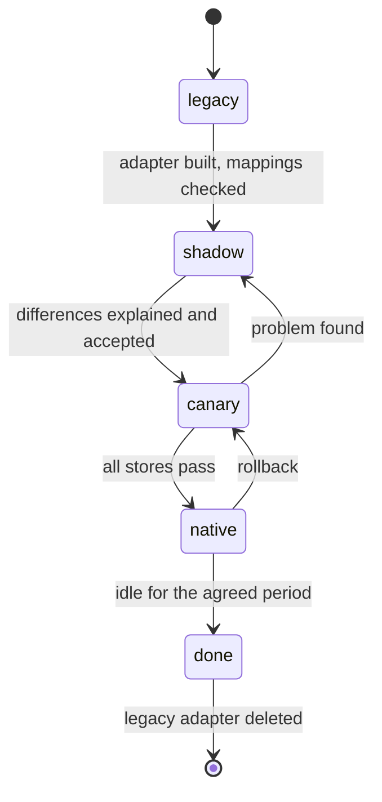

# Legacy bridge

**Status: first draft, proposed (P-39).** Nothing here is final. Rules that bind the design stay in [`architecture.md`](../architecture.md).

Not everything is rebuilt from scratch. Some parts are too complex, and there is no time. So some domains will run on legacy code for some brands, for some time. The design must allow that **without** letting legacy shapes leak into the platform.

The approach is an **anti-corruption layer** (ACL) with a **strangler** migration, per capability and per brand.

Labels: **Assumption** is a working guess. **To verify** is unchecked. **To confirm** needs the owner.

---

## 1. Terms

| Term | Meaning here |
| --- | --- |
| Capability | One thing a domain does for a brand, for example "dispatch a delivery", "send a ticket to the kitchen", "earn points" |
| Port | The interface in the domain's core that the use cases call (see [hexagonal layout](tech-stack.md#3-core-go-with-a-hexagonal-structure)) |
| Native adapter | The new implementation behind the port |
| Legacy adapter | An adapter that calls an old system and translates to and from the domain's model |
| ACL | The translation rules inside a legacy adapter. Legacy concepts stop there |
| Strangler | Moving traffic from legacy to native one capability and one brand at a time, until legacy is unused and removed |

---

## 2. How a legacy system sits behind the same port

The domain's rules and its gRPC contract do not change. Only the adapter behind the port changes.

The hexagonal layout already has a home for it: `adapters/out/legacy/<system>/` next to `adapters/out/<vendor>/`. A POS vendor adapter and a legacy adapter are the same kind of thing: both are an outside system behind a port.

---

## 3. The capability route

A small table, owned by the domain that has the legacy adapter.

| Column | Meaning |
| --- | --- |
| `brand_id`, `capability` | what is routed |
| `mode` | `legacy`, `shadow`, `canary`, or `native` |
| `canary` | for `canary`: a list of stores, or a percentage. **Assumption:** by store, not by percentage, so one store behaves the same way all day |
| `version`, audit | same rules as other configuration ([`brand-configuration.md`](brand-configuration.md#6-how-configuration-is-stored-and-changed)) |

| Mode | What happens | Source of truth for that brand and capability |
| --- | --- | --- |
| `legacy` | every call goes to the legacy adapter | legacy |
| `shadow` | the call goes to legacy, and also to native. The legacy answer is returned. A difference is recorded | legacy |
| `canary` | listed stores use native, the rest use legacy | native for the listed stores, legacy for the rest |
| `native` | every call goes to native. The legacy adapter is idle | native |

**One source of truth at a time.** There is exactly one writer for a capability and brand at any moment. `shadow` writes to native only in a scratch area that no reader uses, or does a read-only dry run. Two live writers are not allowed: that is the failure the rulebook's "one owner, one write path" rule exists to prevent.

---

## 4. ACL rules

| Rule | Why |
| --- | --- |
| Translate at the adapter. The domain and its protos (`mfg.<domain>.v1`) never carry a legacy field name, status code, or id format | one clean model, so legacy can be deleted later |
| Keep the legacy id beside ours in a `legacy_ref` table in the domain schema (`system`, `legacy_id`, `entity_id`) | lookups both ways, and a clean migration |
| Map legacy errors to the gRPC codes in [`architecture.md` §4](../architecture.md#grpc-contract). A legacy timeout is `UNAVAILABLE` | one error language |
| Convert units at the adapter: money to integer satang, times to UTC `timestamptz` (P-12) | the legacy system may use other units |
| No other domain reads a legacy database or calls a legacy API. Only the domain's adapter does | the same ownership rule as for any domain |
| Legacy calls have a deadline, a circuit breaker, and metrics per system | a slow legacy system must not take the platform down |
| No personal data on the bus, whatever legacy sends (principle 8) | the bridge publishes ids only |

---

## 5. Facts that legacy does not publish

A legacy system does not write to our outbox or to Kafka. A **bridge worker** (the `worker` mode of the domain) detects changes and publishes the domain's facts through the normal outbox, **on the existing topics**. For example, a legacy delivery status becomes a `provider_update` on `delivery.requested`, like any fleet update (P-18).

| How the worker detects a change | Notes |
| --- | --- |
| The legacy system calls a webhook | enters through `partner-adapter`, like a vendor |
| The worker polls an API or a table | simplest. Polling interval is an **Assumption** per system |
| Change data capture (CDC) from the legacy database | the rulebook says there is no Debezium and no Kafka Connect cluster of our own (§5). If a legacy database needs CDC, treat it as a new-tool request to DevOps. **To confirm** |

No topic is added for the bridge (see [`kafka-topics.md`](../kafka-topics.md#growth-policy)).

---

## 6. Old clients (backward compatibility on the way in)

Some brand apps or partners call old APIs. They keep working through **compat routes** at the edge:

- Kong routes the old paths to a `compat/<brand>` route group inside the existing BFF. **No new app** is added (D-03 fixes four BFFs and two adapters).
- A compat route translates the old request to the current gRPC call. It sits in the edge's mapper layer, like the vendor mappers.
- A compat route has an end date. It is listed in the brand's onboarding record, so it is removed when the brand moves to the current API.

---

## 7. Moving one capability for one brand

| Step | Check before moving on |
| --- | --- |
| legacy to shadow | the legacy adapter passes the same contract tests as the native one (**Assumption:** one shared test suite per port) |
| shadow to canary | the recorded differences are explained, and the owner accepts the rest |
| canary to native | every store has run on native through a full trading day, including a peak |
| native to done | no calls to legacy for the agreed period. **Assumption:** 30 days |

**Rollback.** Going back is safe only while the data written by native can still be read by legacy, or while no native-only data exists. If native has written data that legacy cannot read, rollback means a reverse sync or a freeze window. This is the main cost of the strangler approach, and each capability must say which it is before the canary step. Open item O-31.

---

## 8. Where legacy is likely, domain by domain

This table uses only what the docs and the owner have said. Anything else is **To confirm**.

| Domain | Known or likely legacy | Notes |
| --- | --- | --- |
| Delivery & Dispatch | Fleet Management, FAAS, Driver Management | O-18: the cutover plan is not written. Per brand is possible with this design |
| Cart & Order | the SDM order flow, with the move to BSL for `mfg-tpc-api` | O-18 is related. The BSL adapter ([`pos-adapters.md`](pos-adapters.md)) is the native side. **To confirm** the legacy order API and its owner |
| Identity & Profile | each brand's own account system | A Minor ID merges accounts. Linking needs `legacy_ref` and a matching rule. See [`identity-model.md`](identity-model.md) |
| Loyalty & MemberCard | the existing loyalty platform (the Loyalty target architecture on Confluence is the source of the HLD) | **To confirm** what exists today |
| Catalog & Menu | the POS master feed | Already modelled as a worker (D-08). Not a legacy system in the bridge sense |
| Payment, Wallet, Voucher, Notification, Admin, Brand & Store | unknown | **To confirm.** Not assumed |

Which domains reuse legacy, and in what order they cut over, is not decided (O-31).

---

## 9. Flags against the rulebook

| Rule | Tension | How this design handles it |
| --- | --- | --- |
| Principle 3, one owner, one write path | While a capability is on legacy, the old system holds the state | The domain port is still the only door. The route table says who is the owner for each brand and capability. Two live writers are never allowed |
| D-07 and "no copies" | A shadow run compares results | Only the difference record is kept, not a copy of the other domain's data |
| Principle 1, simplest thing | A bridge adds code that is later deleted | Build a legacy adapter only for a capability with a named brand and a date. Delete it at `done` |

---

## 10. Open items

| Id | Question |
| --- | --- |
| O-31 | Which capabilities run on legacy, per brand, in what order they cut over, and the rollback rule for each |
| O-18 | The cutover from Fleet Management, FAAS and Driver Management (already open). The route table lets it run per brand |
