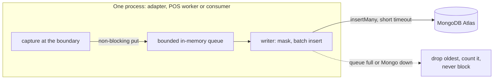

# Order payload log (MongoDB)

**Status: first draft, proposed (P-38).** Nothing here is final. Rules that bind the design stay in [`architecture.md`](../architecture.md).

Order requests differ per brand, per POS vendor and per aggregator, and they change without notice. OMS (the Cart & Order domain) converts each one into its own canonical order. The Postgres order stays the system of record. Beside it, a **parallel log in MongoDB** keeps every raw request and response from each outside party, before and after conversion, plus every later webhook update. With it, the whole data transformation of one order can be traced and replayed by eye.

Labels: **Assumption** is a working guess. **To verify** is unchecked. **To confirm with DevOps** is infrastructure we do not own.

---

## 1. What it is, and what it is not

| It is | It is not |
| --- | --- |
| An append-only trace of what each party sent and what we sent back | A source of truth. Postgres is |
| Schemaless: each document holds the payload as received (after masking) | A place to query orders by business fields. It is read by `order_id` or correlation id only |
| Linked to the Postgres order by `order_id` | Read on the shopper path. Never |
| Best effort. A missed record is a gap in the trace, not a failed order | An audit record of legal weight, unless O-30 says completeness is required |
| Free of personal data on the bus (principle 8): payloads are masked before they are stored | A topic, or anything that puts a payload on Kafka |

---

## 2. Why a second database engine (the written reason)

[`architecture.md` §6](../architecture.md#6-state-and-data-rules) says a second database engine needs a written reason in that domain's Decisions lane. This is the reason for Cart & Order. It is also P-38. The Cart & Order HLD Decisions lane still has to receive it at the next diagram update (listed under "Diagrams to update next" in [`CHANGELOG.md`](../CHANGELOG.md)).

| Question | Answer |
| --- | --- |
| What does it store? | Raw and converted payloads of every external order message, and later updates |
| Why not Aurora? | Payload shapes differ per vendor and change without notice. A fixed table needs a migration for each change. JSONB columns would work but put a large, write-heavy, expiring, never-joined data set on the same cluster as the order, with its vacuum and size cost, and share one blast radius with checkout |
| Why does the shape suit MongoDB? | Documents of any shape, one write per record, indexes on a few id fields, TTL expiry per document, no cross-collection joins |
| Why is it safe? | It is never the truth and never read on the shopper path. If it is down, orders still work |
| What does it cost? | A second engine to run and monitor, a second place with personal-data rules, a second restore story, and a link by id that no foreign key protects |
| Business context | The owner's company is partnering with MongoDB, so MongoDB is the chosen engine. That is context, not the technical reason: the reasons above stand on their own |
| Honest alternative | Postgres JSONB with partition drops would be simpler to run at Tier S. If the Mongo cost proves higher than its value, revisit this decision (P-38) |

**Flags against the rulebook** (not silent overrides):

- **Principle 1, simplest thing that works.** A second engine is more to run. Accepted for the reasons above, and the log stays optional on the order path.
- **Principle 3, one owner, one write path.** Several writers (adapters and Order) insert into this log. The compromise: the log is owned by Cart & Order, writes are insert-only through one shared writer library and one insert-only Mongo role, and only Cart & Order reads. The adapters still own no business state ([§3](../architecture.md#3-components)). Open item O-30 asks whether this is acceptable.

---

## 3. What is captured

Capture happens at the boundary where a payload enters or leaves, as an adapter-level step. It does not happen in the middle of business logic.

| Capture point | Who captures | Records |
| --- | --- | --- |
| Inbound webhook or API call from an aggregator, POS or partner | `partner-adapter`, `partner-bff` (order creation) | the raw body (and the headers without secrets), then the canonical command after mapping |
| Outbound ticket to a POS | the POS adapter in Cart & Order | the canonical ticket, the vendor request, and the vendor response |
| POS status webhook | `partner-adapter` vendor mapper | the raw webhook, then the canonical `PosUpdate` |
| Result of applying a command or update | Order consumer | the outcome (`applied`, `duplicate`, `stale`, `anomaly`), with `order_id` |
| Reconciliation | Order cron | the vendor read-back and the result |

Own-app orders already arrive in canonical form, so only the outbound POS records and the outcomes exist for them. Payment gateway payloads are not in scope for v3: Payment keeps its own attempt records. Adding them is a later choice.

---

## 4. Linking to the Postgres order

The adapters see an order before Order has committed it, and a webhook often carries only the vendor reference. So `order_id` is not always known at capture time.

| Field | Used for |
| --- | --- |
| `correlation_id` | the trace id from `traceparent`. The same value is in gRPC metadata and Kafka headers, so it follows the message to Order. No change to the Kafka envelope |
| `external_ref` | the aggregator order id or the POS ticket reference |
| `order_id` | the Postgres order id. Set by Order's own records. Empty on adapter records written before the order exists |

Order's outcome record carries `order_id`, `correlation_id` and `external_ref` together, which links the adapter records to the order. A reader asks for an order's trace like this:

1. Find the records with this `order_id`.
2. Collect their `correlation_id` and `external_ref` values.
3. Fetch every record with any of those values, in `seq` order.

That is a two-step lookup. It is the price of not blocking the adapters on Order.

---

## 5. Document shape

One collection, `order_payload_log`. This is a proposal. The fields are a starting set.

```json
{
  "_id": "ObjectId",
  "brand_id": "string",
  "store_id": "string or null",
  "order_id": "uuid string or null (Postgres order id)",
  "correlation_id": "trace id",
  "external_ref": "aggregator order id or POS reference, or null",
  "source": "own_app | grab | lineman | shopeefood | pos:<vendor> | partner",
  "party": "who sent or received it, for example pos:bsl",
  "direction": "inbound | outbound",
  "stage": "raw_request | raw_response | converted | webhook | outcome | reconcile",
  "seq": "number, increasing within one capturing process and correlation id",
  "captured_at": "date",
  "http": { "method": "string", "path": "string", "status": "number", "latency_ms": "number" },
  "adapter": { "name": "string", "version": "string" },
  "schema_version": "string, the version of the vendor payload shape",
  "payload": "any shape, after masking",
  "payload_hash": "sha256 of the payload before masking",
  "masked_fields": ["paths that were masked or tokenized"],
  "truncated": false,
  "size_bytes": "number",
  "ttl_at": "date, when this document may be deleted"
}
```

| Index | Purpose |
| --- | --- |
| `{ order_id: 1, seq: 1 }` | read an order's trace |
| `{ correlation_id: 1, seq: 1 }` | read the adapter side of a trace |
| `{ external_ref: 1 }` | find by aggregator or POS reference |
| `{ brand_id: 1, captured_at: -1 }` | support and clean-up by brand |
| `{ ttl_at: 1 }` with `expireAfterSeconds: 0` | expire each document at its own date |

`seq` is ordered within one capturing process only. Records from different processes are ordered by `captured_at`, which can be skewed. The trace is for reading by a person, not for exact replay. **Assumption.**

The `ttl_at` pattern (an index on a date field with `expireAfterSeconds: 0`) expires a document at a specific clock time. Verified in the [MongoDB TTL index docs](https://www.mongodb.com/docs/manual/core/index-ttl/). The same page says deletion is not immediate: the background task runs about every 60 seconds and can lag under load.

A payload over a size cap is stored truncated with `truncated: true`, the hash of the original and the original size. The cap is an **Assumption**: 256 KB. MongoDB also has a per-document limit (16 MiB, **To verify** for the version used).

---

## 6. Write path: how it gets written without breaking "commit, then the fact"

Postgres plus the outbox is the truth ([principle 4](../architecture.md#2-principles)). The log must not change that. So the log is **never part of the Postgres transaction and never on the order's critical path.**

### Recommended: adapter-level capture, async writer, best effort



| Rule | Detail |
| --- | --- |
| Capture is non-blocking | A put on a bounded queue. If the queue is full, drop the oldest record and increment a counter. The request never waits |
| The writer is async | A goroutine in `worker` mode (Go) or an async task (Bun). It masks the payload, batches inserts, and uses a short timeout |
| A log failure never fails an order | No log error is returned to a caller, and none rolls back anything. A circuit breaker pauses writes while Mongo is down |
| No new Kafka topic | The payload does not go on the bus (principle 8, and the 1 MB record limit) |
| Visibility | Metrics: queue depth, dropped, written, write latency. An alert on a sustained drop rate |

**Cost of this choice.** A pod crash loses the records still in its queue. Mongo downtime loses records after the queue fills. So the trace can have gaps. For debugging and support this is acceptable. If the log must be complete (legal or dispute use), O-30 changes the design to one of the options below.

### Options considered

| Option | Complete? | Cost | Verdict |
| --- | --- | --- | --- |
| A. In-process queue, async writer (above) | No: gaps on crash or outage | lowest. No change to checkout | **Recommended for v3** |
| B. Capture row in Postgres in the same transaction, a worker ships it to Mongo | Yes for Order-side records | more Postgres writes, raw payloads sit in Aurora for a while (so masking must happen before the insert), a new purge job | Candidate, if O-30 requires completeness |
| C. A Kafka topic carrying payloads to a log writer | Mostly | payloads on the bus (breaks principle 8 unless masked), the 1 MB limit, a topic with one consumer in the same domain (breaks topic rule 1) | Not recommended. Listed as a candidate in [`kafka-topics.md`](../kafka-topics.md#candidates-not-registered) |
| D. Write to Mongo synchronously in the request | Yes | Mongo latency and downtime hit checkout | Rejected |

---

## 7. Personal data, masking, retention, encryption

| Topic | Rule |
| --- | --- |
| Principle 8 | No personal data on the bus. This log is not the bus, but the same care applies: PDPA has to be managed for one more store |
| Masking before insert | The writer masks in-process before anything leaves the pod. Rules are per `party` and `schema_version`. **Default is masking by key name:** any key that looks like a phone, email, name, address, coordinates, token, authorization, signature, or card number is masked. Unknown keys are kept, and a new vendor adapter must list its sensitive paths before go-live |
| Tokenize, not just remove | A masked value is replaced by an HMAC token (key in Vault, scoped by `brand_id`), so the same value correlates across records without being readable. Key rotation is a runbook item |
| Headers | Signatures, `Authorization` and cookies are dropped, not tokenized |
| Original hash | `payload_hash` is the hash of the unmasked payload. It proves a payload matched without storing it |
| Retention | Each document gets `ttl_at`. **Assumption:** 90 days for all parties, shorter if PDPA requires. The real value is open (O-07 for the policy, O-30 for this log). MongoDB Atlas also offers Online Archive to S3 for older data (named in the TTL docs); **To verify** whether we want it |
| Encryption | In transit and at rest, with keys managed with DevOps. **To confirm with DevOps:** Atlas encryption at rest and key management through AWS KMS. Field-level encryption exists in MongoDB (Queryable Encryption, [docs](https://www.mongodb.com/docs/manual/core/queryable-encryption/)). It is not needed if masking works; keep it in reserve for any field we must store recoverable |
| Access | A writer role with insert only. One read role, used only by Cart & Order. No direct human access in production except by a break-glass role with an audit trail (**Assumption**) |
| Right to delete | A PDPA delete of one customer cannot find that customer's payloads by name, because they are masked. Tokens are HMACs under a brand-level key, so one customer's tokens cannot be removed alone. Records leave by TTL expiry. This is a limit to confirm with the owner in O-30 |

---

## 8. Reading the log

| Item | Detail |
| --- | --- |
| Who reads | Support and engineers, through `admin-bff` |
| Door | Proposed: `GetOrderPayloadTrace(order_id)` on Cart & Order, with a grant such as `order.payload.read`. The method is not drawn yet |
| Never | The shopper path. No other domain reads it. The BFFs do not read Mongo directly |
| Output | The records in the order described in section 4, with payloads already masked |

---

## 9. Hosting

| Item | Detail |
| --- | --- |
| Likely host | MongoDB Atlas on AWS. **To confirm with DevOps** |
| Region | Atlas lists AWS `ap-southeast-7` (Thailand) as a supported region (Atlas region `AP_SOUTHEAST_7`). Verified in [Atlas AWS regions](https://www.mongodb.com/docs/atlas/reference/amazon-aws/). **To confirm with DevOps** which AWS region our infrastructure uses |
| Connectivity | Private connectivity from EKS. **To confirm with DevOps** |
| Cluster tier | Not chosen. Sizing numbers are in [`scale-assumptions.md`](scale-assumptions.md#5-payload-log-volume) and are assumptions |
| Backup | Not needed for the shopper path. Whether to back up the log at all is part of O-30 |

---

## 10. Where it touches other files

| File | Change |
| --- | --- |
| [`architecture.md`](../architecture.md) | §6 (the reason), §10 (guardrail row), P-38, O-29, O-30 |
| [`pos-adapters.md`](pos-adapters.md) | outcomes and `payload_ref` |
| Cart & Order HLD | needs a Mongo box in the Data lane, and the reason in Decisions. **Diagram not updated** |
| Platform HLD and overview | need the MongoDB infrastructure box. **Diagram not updated** |

---

## 11. Open items

| Id | Question |
| --- | --- |
| O-29 | MongoDB Atlas hosting: region, private connectivity, backup, encryption keys, and who owns it (DevOps) |
| O-30 | Is the log a debugging aid or an audit record? That decides completeness (option A or B), retention, the right to delete, and whether several writers are acceptable |
| O-07 | Retention under PDPA (already open) |
