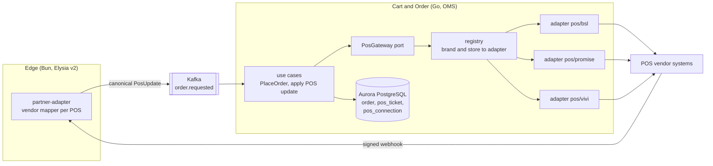
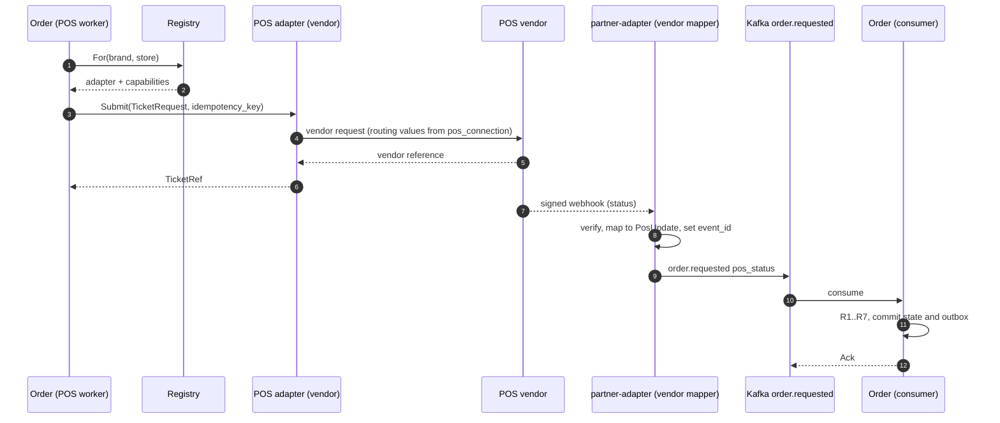
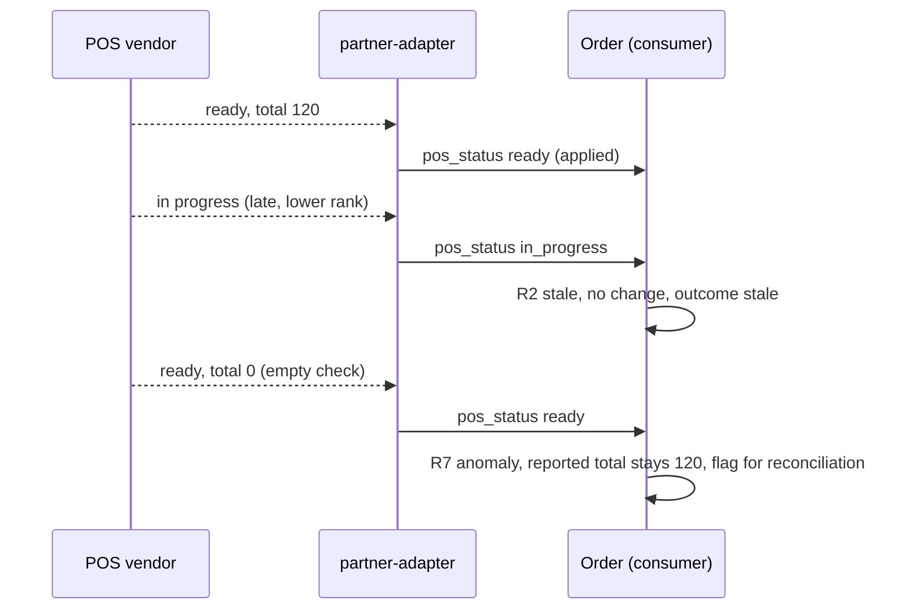

# POS adapters — the multi-vendor POS port in OMS

**Status: first draft, proposed (P-36).** Nothing here is final. Rules that bind the design stay in [`architecture.md`](../architecture.md).

The Order Management System (OMS) is the Cart & Order domain ([description](../../domains/cart-and-order/description.md)). It sends each order to the store's point-of-sale (POS) and reads the POS answer. The POS is the one layer we do not control: it is vendor software and hardware, and each brand may use a different vendor. BSL is the first and main POS. Promise and VIVI may follow. Others may come.

So OMS talks to a POS through one **port** with one **adapter per vendor**. The design learns from BSL but is not tied to it.

Labels: **Assumption** is a working guess. **To verify** is unchecked. **Observed** means seen in the owner's UAT testing of BSL (October 2026); it is not from vendor documentation.

---

## 1. Goals and non-goals

| Goal | Non-goal |
| --- | --- |
| Add a new POS vendor by writing one Go adapter package and one Bun mapper, with no change to checkout rules | A common POS database or a copy of POS data |
| Treat POS answers as untrusted input: duplicated, late, out of order, or wrong | Fixing the vendor's bugs |
| Keep per-brand and per-store POS settings as data | Making every vendor look identical. Differences are declared as capability flags |
| Detect when the POS disagrees with what we priced | Auto-correcting the shopper's price without a rule (open item O-32) |

---

## 2. Where things live



| Piece | Where | What it does |
| --- | --- | --- |
| `PosGateway` port | Cart & Order, `ports/out` | The only way OMS sends a ticket, cancels it, polls it, or reads a bill back. See [Go layout](tech-stack.md#3-core-go-with-a-hexagonal-structure) |
| Outbound adapter per vendor | Cart & Order, `adapters/out/pos/<vendor>` | Turns the canonical ticket into the vendor request, calls the vendor, and turns the answer into a canonical result |
| Registry | Cart & Order | Reads `pos_connection` for a `(brand_id, store_id)` and returns the adapter plus its capability flags |
| Inbound mapper per vendor | `partner-adapter` (Bun), `mappers/<vendor>` | Checks the vendor signature, maps the vendor webhook to a canonical `PosUpdate`, and publishes `order.requested{pos_status}` |
| `pos_ticket`, `pos_connection` | Cart & Order, Aurora | The ticket state, and the per-store POS settings |

**Per-vendor mapping lives in two small places**: a Go package (outbound) and a Bun mapper (inbound). This is the same shape as fleet providers in P-18. Vendor knowledge does not leak into the state machine, the BFFs, or other domains.

`partner-adapter` stays the only webhook entry (rulebook §4). A domain never exposes a webhook to the internet. Kong routes `/pos/<vendor>/...` to the matching mapper.

The existing BSL proxy stays as the transport the BSL adapter uses until it is replaced. The adapter hides it: callers see the port, not the proxy. **To verify** with the owner whether the BSL adapter should call the vendor directly later.

---

## 3. The port

A sketch, not compiled code. Names are placeholders. **Align with the boilerplate when shared.**

```go
// ports/out/pos.go
type PosGateway interface {
    // Capabilities returns the effective flags for this store (vendor flags merged with store overrides).
    Capabilities(ctx context.Context, t PosTarget) (Capabilities, error)

    // Submit sends a ticket. It must be safe to call twice with the same IdempotencyKey.
    Submit(ctx context.Context, req TicketRequest) (TicketRef, error)

    // Cancel asks the POS to cancel a ticket. May return ErrNotSupported or ErrTooLate.
    Cancel(ctx context.Context, ref TicketRef, reason string) error

    // Status polls the vendor. Used when the vendor has no status webhook, and by reconciliation.
    Status(ctx context.Context, ref TicketRef) (PosUpdate, error)

    // ReadBack returns what the vendor holds as the bill. Optional: ErrNotSupported when absent.
    ReadBack(ctx context.Context, ref TicketRef) (ReportedBill, error)
}

type PosTarget struct{ BrandID, StoreID string }
```

`Replace` is not on the port. A replace is `Cancel` then `Submit` for vendors with `supports_modify = false`, as the Cart & Order HLD already describes. A vendor with a native modify call can get a method later.

Errors are typed so the use case can choose: `ErrNotSupported`, `ErrTooLate`, `ErrRejected{reason}`, `ErrUnavailable` (retry), `ErrAmbiguous` (the request may or may not have reached the POS: read the status before sending again).

---

## 4. Canonical shapes

### Ticket request (OMS to adapter)

| Field | Meaning |
| --- | --- |
| `order_id`, `brand_id`, `store_id` | identity. `order_id` is the Postgres order id |
| `idempotency_key` | `order_id` plus `ticket_version`. The same key must not create two tickets |
| `fulfillment` | `pickup` or `delivery`, with the requested time. Delivery only if the effective capability allows it |
| `lines[]` | `sku_id`, `pos_code`, quantity, unit price, modifiers. `pos_code` comes from Catalog |
| `discounts[]` | the deals Order agreed with the shopper, as price lines (rulebook §6) |
| `totals` | agreed total in minor units (satang) |
| `payment` | tender kind and "prepaid" flag. No card data |
| `external_ref` | the aggregator order id, when there is one |
| `notes` | kitchen notes |

The request carries `customer_id` at most, never a phone or an address (principle 8).

### POS update (adapter to OMS)

| Field | Meaning |
| --- | --- |
| `vendor`, `vendor_ref` | which POS, and its ticket reference |
| `vendor_event_id` | the vendor's event id, if it has one |
| `vendor_version` | a version or sequence number from the vendor, if it has one |
| `observed_at` | the vendor's event time, or our receive time when the vendor sends none |
| `vendor_status`, `status` | the raw status, and the canonical status (below) |
| `rank` | the rank of the canonical status |
| `reported` | optional: reported total, line count, discount total, check id |
| `payload_ref` | pointer to the raw record in the [payload log](order-payload-log.md) |

`order.requested{pos_status}` carries this shape as Protobuf. It does not add a topic, only defines the existing variant.

The adapter sets `event_id` as a deterministic id: a UUIDv5 of `(vendor, vendor_ref, vendor_status, vendor_version)`. A vendor duplicate and a Kafka redelivery then get the same `event_id`, and the existing command dedupe (P-06) drops both.

### Canonical ticket status and rank

| Rank | Status | Meaning | Maps to `order.events` |
| --- | --- | --- | --- |
| 1 | `submitted` | we sent it, no answer yet | none |
| 2 | `received` | the POS has accepted the ticket | `accepted` |
| 3 | `in_progress` | the kitchen is working | none |
| 4 | `ready` | ready for pickup or hand-off | `ready` |
| 5 | `completed` | handed over and closed | `completed` |
| terminal | `rejected` | the POS refused it | `rejected` |
| terminal | `cancelled` | cancelled at the POS | `cancelled` |

This is an **Assumption**. Each vendor mapper owns its table from vendor status to canonical status. A vendor with fewer states skips ranks. The set of canonical states can grow, and ranks are config of the state machine, not of the vendor.

---

## 5. Applying an update: order, duplicates, and totals

OMS never applies a POS update blindly. The rules, in the order they run:

| # | Rule | Effect |
| --- | --- | --- |
| R1 | **Dedupe.** A command with a seen `event_id` is a no-op, then Ack (P-06). | duplicates do nothing |
| R2 | **Rank.** Apply a status only if its rank is higher than the stored rank. Equal rank is a no-op. Lower rank is stale: record it, do not apply it. | out-of-order updates cannot move a ticket backward |
| R3 | **Terminal.** `rejected`, `cancelled`, `completed` never change. | a late update cannot reopen a ticket |
| R4 | **Skipped ranks are fine.** A jump from `submitted` to `ready` is applied. | a lost middle update does no harm |
| R5 | **Reported totals are separate from agreed totals.** A POS update never writes the order's price lines. It writes `reported_*` columns on `pos_ticket`. | a vendor bug cannot rewrite what the shopper agreed to pay |
| R6 | **Reported totals apply by version.** Overwrite `reported_*` only if `vendor_version` is newer, or when the vendor sends none, if `observed_at` is newer. | a late update cannot overwrite a newer total |
| R7 | **Regression guard.** If an update reports a zero or empty total after a non-zero total was stored, do not apply it. Store it as an anomaly and flag the ticket for reconciliation. The guard is a per-vendor setting (`guard_total_regression`, default on). | the "net total reset to 0" race cannot blank the reported total |

R2 to R7 run inside the same Postgres transaction as the change and the outbox row (principle 4). Every update gets an outcome (`applied`, `duplicate`, `stale`, `anomaly`), recorded on the ticket history and sent to the payload log.

A status that is applied moves the order exactly as the saga already does: `received` is `accepted` and triggers capture, `rejected` triggers void ([§7](../architecture.md#reference-flow-own-app-checkout) steps 10 to 12).

---

## 6. Capability flags

Capabilities say what a POS vendor (and a given store setup) can do. They are data, not code. They live on the vendor profile and can be overridden per store in `pos_connection`.

| Flag | Meaning | If false |
| --- | --- | --- |
| `supports_pickup` | accepts pickup tickets | the brand cannot offer pickup on this POS |
| `supports_delivery` | accepts delivery tickets | `PlaceOrder` for delivery returns `FAILED_PRECONDITION` (`fulfillment_not_supported`), and the app hides the option |
| `supports_promotions_passthrough` | keeps our discount lines and shows them on the bill | OMS uses `promo_mode` below instead |
| `supports_modify` | can change a ticket in place | replace is cancel then submit |
| `supports_cancel_after_accept` | can cancel after `received` | a late cancel goes to CSC |
| `supports_status_webhooks` | pushes status | OMS polls with `Status` on a schedule |
| `status_updates_ordered` | updates arrive in order | not set for any vendor by default: R2 and R6 always run |
| `supports_idempotent_submit` | the same idempotency key cannot create two tickets | OMS reads `Status` before any re-send (`ErrAmbiguous`) |
| `supports_bill_readback` | `ReadBack` works | reconciliation reports `unknown` |
| `supports_sold_out_push` | pushes sold-out changes | sold-out comes from the master feed only |

More flags are added when a vendor needs one. A flag needs a reason and a behavior for `false`; a flag nobody reads is not added (principle 1).

**Effective capability** for a shopper action is the AND of three things: the vendor supports it, the store's POS setup allows it, and the brand has the feature switched on (see [`brand-configuration.md`](brand-configuration.md)). Delivery, for example, also needs a fleet provider for the store (P-19).

### Promotions

| `promo_mode` | What OMS sends | When |
| --- | --- | --- |
| `passthrough` | the discount lines as agreed | `supports_promotions_passthrough` is true |
| `flatten` | net line prices, with the deal named in the notes | default when passthrough is false. **Assumption** |
| `discount_line` | full prices plus one negative discount line | when the vendor shows a discount line but not per-line deals. **To verify** per vendor |

The mode is set per brand and vendor. Whatever the mode, the price the shopper pays is the one Order agreed (P-32). Reconciliation checks the POS ticket against it.

---

## 7. Per-brand and per-store POS settings

`pos_connection` is one row per `(brand_id, store_id)`, owned by Cart & Order and written through `admin-bff` with a versioned write.

| Column | Meaning |
| --- | --- |
| `vendor` | `bsl`, `promise`, `vivi`, and so on |
| `endpoint_ref` | which vendor endpoint or proxy route to use |
| `routing` | the per-store routing values the vendor needs, as key and value. Example: an enterprise unit and an organization sent as request headers. Validated against the vendor's JSON schema on write |
| `credentials_ref` | a Vault path. The secret is never in the table |
| `capability_overrides` | per-store flags that differ from the vendor profile |
| `promo_mode` | see above |
| `timeouts` | submit and status timeouts. Defaults per vendor |
| `enabled`, `version` | on or off, and the version for optimistic writes |

A store with no valid `pos_connection` cannot take orders: `ResolveStore` still says it is open, but checkout fails with `FAILED_PRECONDITION` and the brand readiness check fails ([`brand-configuration.md`](brand-configuration.md#4-onboarding-a-new-brand)). A missing routing value must never send a ticket to a default unit. **Observed** with BSL: a ticket sent with the wrong default unit never reached the POS.

---

## 8. Flows

### Order out, status back



### A bad update



---

## 9. Reconciliation

The POS can disagree with the order Order priced: a promotion dropped, a total reset, a line missing. The shopper has already paid, so the disagreement must be found, not hidden.

| Step | Detail |
| --- | --- |
| When | When a ticket reaches `received` plus a settle delay, again at `completed`, and for every ticket flagged by R7. A cron in Order runs it (same sweeper pattern as P-10). The settle delay is an **Assumption**: 2 minutes |
| What it compares | agreed total against reported total, the set of SKUs, and whether the discount total is present. Uses the last good `reported_*`, and `ReadBack` when the vendor supports it |
| Result | `match`, `mismatch_total`, `mismatch_lines`, `promo_dropped`, or `unknown` (vendor cannot read back) |
| Where it goes | a `pos_reconciliation` row, a metric, and the CSC queue for any mismatch. It is not a Kafka topic: nobody else consumes it (principle 1) |
| What it never does | change price lines, change the capture amount, or send a message to the shopper. What to do about a mismatch is O-32 |

---

## 10. BSL as the first adapter

BSL is the first adapter and the best-known POS. The table lists behaviors the owner saw in UAT testing, and which general mechanism above covers each. None of it is hardcoded as "BSL logic": it is vendor profile data and generic rules.

Source: the owner's UAT testing, October 2026. **Observed**, not vendor documentation. To confirm with the vendor in O-28.

| Observed with BSL | Mechanism in this design |
| --- | --- |
| Status webhooks arrive within about a second, and some are duplicated | R1 and the deterministic `event_id` |
| Updates can arrive out of order | R2, R3, R4. `status_updates_ordered` is false |
| A late update can overwrite the total, and an empty check can reset the net total to 0. The till bill itself stayed correct | R5, R6, R7, and reconciliation with `ReadBack` if the vendor supports it |
| Some promotions are silently dropped, so the POS total can differ from our priced order | `promo_mode`, reconciliation result `promo_dropped` |
| The vendor needs per-store routing values (an enterprise unit and an organization). A ticket with the wrong default unit never reached the POS | `pos_connection.routing`, validated per vendor schema |
| Pickup works. Delivery is not available yet | `supports_pickup = true`, `supports_delivery = false` in the BSL profile. Flip the flag when the vendor ships delivery |
| Status names run `OrderPlaced`, then `ReceivedForFulfillment`, `InFulfillment`, `ReadyForPickup` | the BSL mapper's table to canonical `submitted`, `received`, `in_progress`, `ready` |
| A short reference on the till slip matches the vendor's reference | stored as `vendor_ref`, shown to CSC |

A starting BSL profile (all values are **Assumptions** until the vendor confirms):

| Flag | Value |
| --- | --- |
| `supports_pickup` | true |
| `supports_delivery` | false |
| `supports_promotions_passthrough` | false |
| `supports_modify` | false |
| `supports_status_webhooks` | true |
| `status_updates_ordered` | false |
| `supports_idempotent_submit` | unknown, treat as false |
| `supports_bill_readback` | unknown, treat as false |
| `guard_total_regression` | true |

---

## 11. Failure table

| Failure | What happens |
| --- | --- |
| No `pos_connection` or invalid routing | `PlaceOrder` returns `FAILED_PRECONDITION`. Nothing is committed |
| Submit returns `ErrUnavailable` | the POS worker retries from the outbox. The sweeper rejects the ticket after the POS window and voids (P-10, O-04) |
| Submit returns `ErrAmbiguous` | read `Status` before any re-send, unless the vendor `supports_idempotent_submit` |
| Vendor rejects the ticket | `rejected`: commit, then void (rulebook §7 step 11) |
| Duplicate update | R1: no-op, Ack |
| Late or lower-rank update | R2: stale, recorded, no change |
| Zero total after a good total | R7: anomaly, flagged, not applied |
| Vendor has no status webhook | poll with `Status` |
| Delivery order on a vendor without delivery | `FAILED_PRECONDITION` (`fulfillment_not_supported`) |
| POS and priced order disagree | reconciliation row and CSC queue. No automatic change |

---

## 12. Impact on other files

| File | Change needed | State |
| --- | --- | --- |
| [`architecture.md`](../architecture.md) | §3, §7, §10, P-36 | Done in this pass |
| [`kafka-topics.md`](../kafka-topics.md) | `order.requested` note. No new topic | Done in this pass |
| Cart & Order HLD and LLD page 3 | show the port, the registry, the rules R1 to R7, and the reconcile cron | **Diagram not updated.** Listed in [`CHANGELOG.md`](../CHANGELOG.md) under "Diagrams to update next" |
| Cart & Order HLD script | still says "BSL only" | Marked as v2 at the top of the script |

---

## 13. Open items

| Id | Question |
| --- | --- |
| O-28 | Vendor contract limits per POS: rate limits, webhook guarantees (retries, signatures, ordering), versioning, delivery support dates, and the real capability matrix. Needed to replace the Assumptions above |
| O-32 | When the POS disagrees with our priced order (dropped promotion, wrong total), what is the rule: keep the shopper's price, adjust, or send to CSC? |
| O-04 | The POS answer window (already open) |
