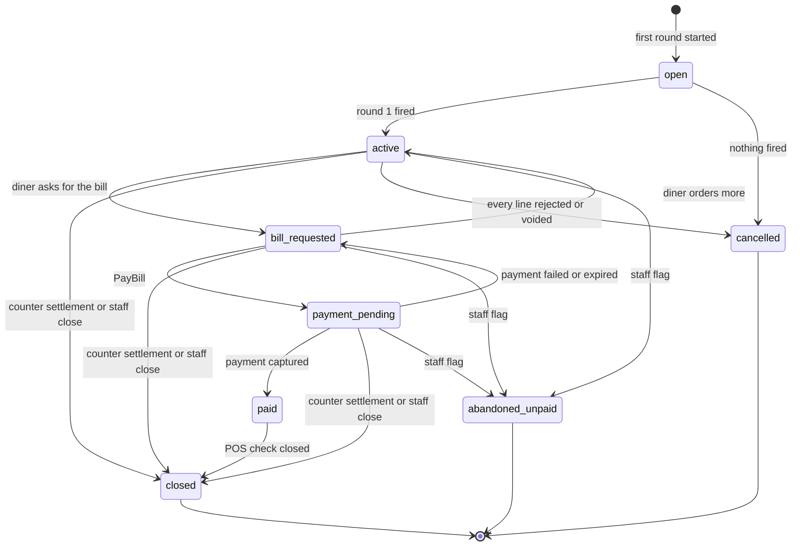
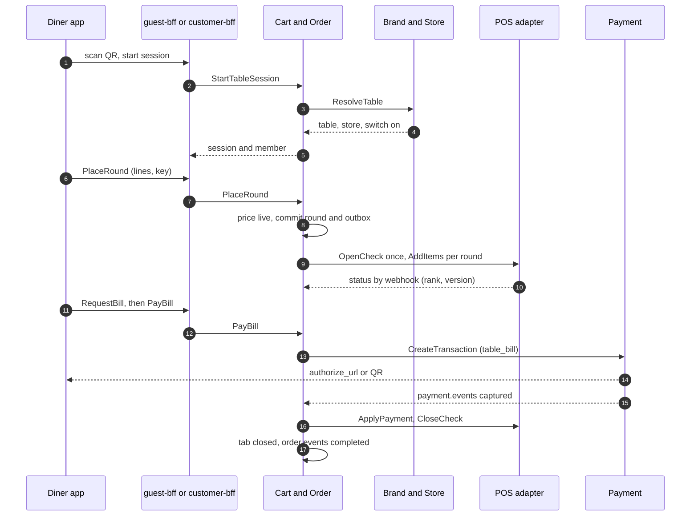

# Postpaid QR table ordering — the open tab

**Status: proposal, first draft, design phase (P-44 to P-52, 2026-10-25).** Nothing here is final. It answers a new business requirement and is not yet refined by business answers or brand limits. Rules that bind the design stay in [`architecture.md`](../architecture.md). Where this note and the rulebook disagree, the rulebook wins until a decision is signed off.

**The requirement** (owner, 2026-10-25): *"Postpaid solution: business want to have QR ordering at store that customer can scan and order from table and paid after finish up. Order have to stay and deliver to table until customer paid after eat."*

Labels used below: **Proposal** is what this note recommends. **Alternative** is a real choice that was not taken. **Assumption** is a working guess that the owner will rewrite. **To confirm** is unchecked, and needs a vendor, finance, legal, or DevOps answer. **Observed** means seen in the owner's UAT testing of BSL in October 2026, as recorded in [`pos-adapters.md`](pos-adapters.md#10-bsl-as-the-first-adapter). It is not vendor documentation.

This note does not state legal or tax facts. Anything about Thai VAT, service charge, tips, tax invoices, or consent wording is marked **To confirm** with finance and legal.

---

## 1. What changes, in one page

Today's reference checkout ([`architecture.md` §7](../architecture.md#reference-flow-own-app-checkout)) is **prepaid**: the payment is authorized first, the order reaches the kitchen only after that, and the money is captured after the POS accepts. Postpaid **inverts** this: the order goes to the kitchen first, and the money moves at the end.

**Proposal, in ten sentences.**

1. Each table has a signed QR code that holds only the brand, store, table, and a key version. It holds no personal data.
2. Scanning it starts, or joins, the one open **table session** for that table. A guest needs no login. A diner may sign in with Minor ID to collect points and use vouchers.
3. Cart & Order owns the session and the **tab**. The tab is an order with `order_type = dine_in_postpaid`. It lives from the first round until it is paid and closed.
4. Every time a diner sends food, that is a **round**. A round goes to the kitchen at once, through the `PosGateway` port, as an add-on to the same check. A diner may send many rounds.
5. Brand & Store owns the table registry and the QR keys. It has no part in the tab, so the one-owner rule holds.
6. "Deliver to table" is table service by staff, not the Delivery domain. NEXA shows each round's status (sent, accepted, preparing, ready, served) from the POS or kitchen screen, and from a staff tap.
7. The diner asks for the bill when done. Cart & Order builds it from the prices agreed at each round, applies vouchers, service charge, and a tip, then asks Payment to charge it.
8. Payment charges the final amount and captures at once, like a wallet top-up does (P-17). The money moves first, and then Order closes the POS check.
9. A brand may switch on an optional card hold at the first round, to reduce walk-outs. The hold is released at close. This waits on gateway confirmation.
10. If a diner pays at the counter instead, staff settle in the POS, and the POS update closes the tab. Staff can also close or flag a tab from the admin console, with a reason and an audit row.

**What it adds, and what it does not.** Zero new services. Zero new Kafka topics: new event types ride on `order.events`. New tables in Cart & Order and in Brand & Store. New gRPC calls and REST routes (all proposals). New POS port operations and capability flags. It changes no accepted decision. It extends P-09, P-01, and the guest-bff scope, and it flags where it bends P-16 and the "Notification never sees an unpaid order" cost in P-09 ([section 15](#15-conflicts-and-flags)).

**Switchable per brand and per store.** The feature is off until the brand switch is on, the store has registered tables, the POS setup allows it, and a payment method is available. This is the effective-capability rule from [`brand-configuration.md`](brand-configuration.md#3-capabilities-and-features).

---

## 2. Where it lives

| Piece | Owner | Why |
| --- | --- | --- |
| Table registry (`store_table`), QR key version, the brand and store switch for postpaid | Brand & Store | static store facts, written only by `admin-bff`, read live (D-07). Shoppers only read |
| Table session, tab, rounds, bill, POS check reference | Cart & Order | it is the order's life. Order already owns the order, the POS ticket, and the saga |
| Guest token (a customer-family token with a dine-in scope) | Identity & Profile | Identity already signs the customer family. See section 4 |
| Table-bill transaction, optional card hold, receipt and tax invoice | Payment & Billing | it already owns the transaction and Statement mode |
| Bill discounts | Voucher & Campaign | `EvaluateBasket` and `ReserveRedemptions` already exist |
| Points earned at close | Loyalty & MemberCard | it already consumes `order.events` |
| Customer messages | Notification | it already turns facts into messages |

### Who owns the session: the choice

| Option | What it is | For | Against | Verdict |
| --- | --- | --- | --- | --- |
| **A. Cart & Order owns session and tab** | the tab is an order with rounds. Brand & Store holds only the table and QR facts | one owner and one write path (principle 3). Reuses the POS port, the sweeper, the payment link, the payload log. No new service (principle 1) | Order's aggregate gets bigger. The "order is one ticket" idea changes to "order is a tab with many tickets" | **Proposal (P-44)** |
| B. Brand & Store owns the session | session is a store fact | table facts and session sit together | Brand & Store is a read-heavy facts domain. It would own a hot, order-like write path, and it knows nothing about POS or payment. Order would then need a second owner for the tab's money | Alternative, not taken |
| C. A new Dining (table service) domain | its own service for session, tab, table staff tools | clean home if dine-in grows (waitlist, reservations, kitchen screens) | a new service, new gRPC, a second order-like aggregate beside Order. Breaks principle 1 for a first draft | Alternative, revisit if dine-in grows beyond tabs |
| D. Use the Delivery domain for "deliver to table" | table as a delivery destination | none that matter | Delivery is quote, fleet, rider, ledger, and `delivery.events`. A table has no address, fee, rider, or provider job. It would mix two aggregates | Not taken ([section 5](#5-lifecycle-tab-rounds-and-deliver-to-table)) |

---

## 3. Vocabulary

| Term | Meaning |
| --- | --- |
| Table | one row in the store's table registry. Has an id, a label, and an active flag |
| Table session | the period when one party of diners uses one table. Many diners can be members. One open session per table at a time |
| Tab | the order of that session (`order_type = dine_in_postpaid`). It stays open until paid. Called the "open check" on the POS side |
| Round | one "send to kitchen" action by one diner: a set of lines. A tab has round 1, 2, 3, and so on |
| Bill | the amount asked at the end. Built from the agreed prices of the non-voided lines, plus charges and minus discounts |
| Check | the POS's own open bill. `pos_check_id` is its reference |
| Guard | the measure that stops a remote person from ordering to an empty table ([section 4](#4-table-qr-and-session)) |

---

## 4. Table, QR, and session

### The QR code

- **Contents:** `v1`, `brand_id`, `store_id`, `table_id`, `key_version`, and a signature. The URL is `https://<brand app host>/t/<token>`. The brand app host is how Kong knows `X-Brand-Id` ([`identity-model.md`](identity-model.md)).
- **No personal data** is in the URL or the token. Nothing in it identifies a person or a device.
- **Signing key:** held in Vault, per brand. Brand & Store verifies the signature in `ResolveTable`. The algorithm (MAC or public-key signature) is for security and DevOps to choose.
- **Revoking:** `RotateTableKey` bumps `key_version` for one table or one store. Old stickers stop working. A new sticker is printed from the admin console.
- A QR that passes the signature check only proves "this sticker was ours". It does not prove "the person is at the table". The guard below handles that.

### Guard levels (against remote or abusive ordering)

A photo of a QR code can be scanned from anywhere. The risk is food made for nobody, or a bill on a table that is empty. Guard levels are configuration per store (`qr_guard`). **Proposal:** every level includes G1.

| Level | What it adds | Staff effort | Cost or risk |
| --- | --- | --- | --- |
| G0 `none` | only the signed QR | none | anyone with a photo can order |
| **G1 `limits` (always on)** | edge rate limit and bot challenge on session start (Cloudflare and Kong). A cap on the open amount, on rounds per 10 minutes, and on lines per round | none | does not stop one determined person |
| **G2 `table_code` (proposed default)** | a 4-digit table code the diner types at session start. The code is made by Order for each new session and shown to staff on the table board. Staff say it or print it on the table card | low, per seating | friction for the diner. A code can be shared. **Assumption:** 4 digits is enough with the rate limit |
| G3 `staff_confirm` | the first round of a new session waits until staff tap "confirm table" in the admin console | medium, per seating | a slower first order |
| G4 `dynamic_qr` | the QR token changes every few minutes and is shown on a table device or screen | hardware per table | the most cost. Only if abuse is shown |

A soft **location check** (browser location) is **not** in the first draft: accuracy and privacy cost are high and it is easy to fake. It may be added as a signal later.

Which level the business wants is open (O-39).

### Starting a session

1. The diner scans the QR. The app or browser opens the brand's table page.
2. `POST /v1/dine-in/sessions` carries the QR token and, for G2, the table code. A signed-in diner calls it on `customer-bff`. A guest calls it on `guest-bff`.
3. The BFF calls Order `StartTableSession`. Order calls Brand & Store `ResolveTable` to verify the signature, check that the table is active, and check that postpaid is on for the brand and store.
4. Order finds the one open session on that table and joins the diner to it, or creates a new session. Order returns `session_id` and a `member_id`.
5. For a guest, the BFF asks Identity for a guest token (below). The response also carries the table label, so the diner confirms it is the right table.

### Guest or Minor ID

| | Guest | Minor ID |
| --- | --- | --- |
| How they start | scan, no login | scan, with the customer token of the brand |
| Token | a **guest token**: a customer-family JWT issued by Identity, with claims `scope = dine_in`, `sid` (session), `mid` (member), `store_id`, and a short life (5 minutes, as in [§8](../architecture.md#8-edge-identity-and-security)). It is renewed while the session is open | the normal customer JWT |
| What Order stores | a random member id, no name, no contact | the member id plus `customer_id` |
| Loyalty, vouchers | none, unless they sign in during the session | points are earned at close for the tab's beneficiary. Vouchers are applied at the bill |
| Wallet | not available | the brand's wallet (D-11), if the membership is enabled (P-40) |

**Signing in mid-session.** The diner signs in, then scans or reopens the table link again. `customer-bff` calls `StartTableSession`, and Order joins the diner as a second member with a `customer_id`. The guest member's earlier rounds stay as they are. The **beneficiary** of points is the signed-in member who pays the bill (Assumption, O-45). Nothing links two tokens, so no token is checked twice (principle 7).

**Why a guest token, not a new family.** Alternatives for who signs a guest's proof:

| Option | What | Trade-off |
| --- | --- | --- |
| **A. Guest variant of the customer family, signed by Identity (proposal)** | Identity gets one new call, `IssueGuestToken`, callable only by `guest-bff`. It keeps no guest state | Kong already trusts the customer JWKS. Three token families stay three. Identity signs something with no customer behind it, so this **extends the meaning of the customer family**. Flagged in [section 15](#15-conflicts-and-flags) |
| B. A fourth token family signed by Cart & Order | Order signs, Kong reads its JWKS | Order would need an HTTP door for the JWKS (a domain exposes none today), and [§8](../architecture.md#8-edge-identity-and-security) says three families. A larger change |
| C. An opaque session cookie that Order checks on every call | no JWT at all | something behind Kong re-validates a credential, against principle 7 |

Order still checks, on every call, that the member belongs to an open session. The token proves who the call is from. The session says what it may touch.

### Several diners on one tab

- **Join:** a second diner scans the same QR (and types the table code if G2) and joins the same session. Each diner is a member.
- **Draft rounds are per diner.** A diner builds a draft on the device, and sends it as a round. Nobody edits another diner's draft. All members see the whole tab: every round, its status, and the running total. A shared live basket is a **later option**, because it needs a server-side basket and merge rules for edits.
- **Leave:** a member can leave. It ends only that member's access (their token is not renewed). The tab and its rounds stay. If the last member leaves while the tab is unpaid, the tab stays open for staff and the sweeper.
- **Who can pay:** any member can request the bill and pay the whole of it (first draft). Splitting is in [section 7](#7-payment-at-the-end).

### Move, merge, expiry, close

| Case | Rule |
| --- | --- |
| Table move | staff only, in the admin console (`MoveTab`). Order updates the table on the session, and calls `TransferTable` on the POS if the vendor supports it, or marks "move in the POS by hand". The token carries no table id, so diners see the new table at the next read. The old table's QR starts a new session once the old session is closed |
| Merge two tabs | staff only, **later** (not in the first draft). Needs a rule for two checks in the POS |
| Idle before ordering | a session with no round expires after an idle time. No tab is created, nothing to pay |
| Hard limit | a session open longer than a maximum is flagged to staff. It is never closed as paid by a timer |
| Store closes | tabs still open at closing time go to a staff queue. See the [edge cases](#12-edge-cases) |
| Staff close | `ForceCloseTab` with a reason ([section 7](#7-payment-at-the-end), P-50) |

All time values are **Assumptions** ([section 11](#11-scale-assumptions-recommended-to-be-rewritten), O-46).

---

## 5. Lifecycle: tab, rounds, and "deliver to table"

### Tab states



| State | Meaning |
| --- | --- |
| `open` | the tab exists but no round has been fired (for example while a card hold is being authorized) |
| `active` | at least one round is fired. Rounds move on their own. More rounds can be sent |
| `bill_requested` | the diner asked for the bill. The total is shown. Ordering more moves it back to `active` |
| `payment_pending` | a payment is in progress. The tab is **locked**: no new rounds, no change to the bill |
| `paid` | the payment is captured. Order now closes the POS check. The diner is already done |
| `closed` | the POS check is closed. A reason says how: `app`, `counter`, or `staff_override` |
| `cancelled` | no round was fired, or every line was rejected or voided. Nothing to pay |
| `abandoned_unpaid` | staff flagged that the diners left without paying. Never set by a timer alone |

**"Served" is derived, not stored** (principle: derive, don't store): the tab is "fully served" when no round is waiting. The bill can be requested before every round is served, and the app warns about rounds still in progress.

`placed` in [P-09](../architecture.md#proposed--the-default-until-signed-off) means "the kitchen may see it". For a postpaid tab it happens when the **first round** commits, with no payment gate. That is a third case beside own-app and aggregator orders (P-46).

### Round states

A round has the POS ticket ranks ([`pos-adapters.md` §4](pos-adapters.md#4-canonical-shapes)), renamed for table service, plus the two refusals:

| Round state | POS canonical status (rank) | Meaning | Source of the signal |
| --- | --- | --- | --- |
| `fired` | `submitted` (1) | sent to the POS, no answer yet | Order |
| `accepted` | `received` (2) | the POS took it. The kitchen has it | POS answer or webhook |
| `preparing` | `in_progress` (3) | the kitchen is working | POS or kitchen screen, if the vendor sends it |
| `ready` | `ready` (4) | ready to carry to the table | POS or kitchen screen |
| `served` | `completed` (5) | at the table | a staff tap in the admin console, the POS if it reports it, or the diner's tap (optional) |
| `rejected` | `rejected` (terminal) | the kitchen refused it (out of stock, closed). It is not billed | POS |
| `voided` | `cancelled` (terminal) | removed after the fact by staff, with a reason. Not billed | admin console (`VoidRound`) |

Rules are the existing ones: apply by rank and version, duplicates and lower ranks are dropped, terminal states never change ([`pos-adapters.md` §5](pos-adapters.md#5-applying-an-update-order-duplicates-and-totals)). A vendor with fewer states skips ranks. A POS that never says `served` is covered by the staff tap, or by no signal at all (the bill does not wait for it). Whether the business needs a served signal, and who settles a "never arrived" dispute, is open (O-48).

A line in a `rejected` or `voided` round is **kept in history and excluded from the bill**. The agreed price lines are never rewritten (R5 stands): the bill is computed from the lines that are not excluded.

### What "deliver to table" means

It is **table service**: staff carry food from the kitchen to the table. NEXA does three things for it.

1. It sends each round to the kitchen at once, through the POS, with the table label on the ticket.
2. It shows the diner each round's status (above). The signals are the POS or kitchen screen and a staff tap.
3. It shows staff a **table board** in the admin console: open tabs, rounds waiting, bill requests, unpaid ages.

It does **not** use the Delivery domain. Delivery owns the quote, the fee, the fleet provider job, the rider, and `delivery.events`. Delivery starts dispatch on `order.events{accepted}` (P-21), so the postpaid `accepted` event carries `fulfillment = dine_in`, and Delivery must act only on delivery orders. **To verify** in the Delivery LLD page 2 that it already filters on fulfillment.

**The status feed.** A guest or a member polls `GET /v1/dine-in/sessions/current` about every 10 seconds (Assumption). The answer is cached in Valkey by the tab's `version`, filled after commit (one of the four allowed Valkey uses, D-04), so the poll costs little. A signed-in member also gets a push or inbox message for `ready` and `rejected`, because Notification reads `order.events{round_updated}`. Push to a guest is not possible (no contact). Live push for guests (server-sent events on `guest-bff`) is a later option. Staff alerts are open (O-44).

---

## 6. The main flow, step by step

Steps 1 to 4 start the session. Steps 5 to 9 repeat for every round. Steps 10 to 18 settle the tab. The diner waits only on the gRPC steps that return an answer.

| # | Step | Detail |
| --- | --- | --- |
| 1 | Scan | the diner scans the table QR. The brand app host sets the brand |
| 2 | Start or join the session | `guest-bff` or `customer-bff` calls Order `StartTableSession` (QR token, table code). Order calls Brand & Store `ResolveTable`. A guest then gets a guest token from Identity |
| 3 | Read the menu | `GetMenu` for the store, channel `dine_in`. Catalog's availability applies live |
| 4 | Optional hold | if the brand needs a card hold, Order asks Payment for a `table_preauth` ([section 7](#7-payment-at-the-end)). The diner finishes 3DS at the gateway. The tab is `open` until it is `authorized` |
| 5 | Send a round | `PlaceRound` carries `idempotency_key`, `lines`, and the total the diner saw. Order checks: the session is open, the store is open for dine-in, prices live with Catalog `PriceLines` (channel `dine_in`), and the caps (open amount, rounds, lines). A different live total returns `FAILED_PRECONDITION` (`price_changed`) |
| 6 | Commit the round | Order commits the round with its price lines and the outbox row in one transaction. The tab becomes `active`. The first round publishes `order.events{placed}`. No payment is involved |
| 7 | Fire to the POS | the Order POS worker picks the store's adapter and sends the round: `OpenCheck` once, then `AddItems` (open-check mode), or one ticket per round (fallback). Each send has an idempotency key `order_id:round_no` |
| 8 | Status comes back | the POS webhook reaches `partner-adapter`. The vendor mapper builds a canonical `PosUpdate` with the round and check references and publishes `order.requested{pos_status}`. Order applies R1 to R7 and publishes `order.events{round_updated}` |
| 9 | Serve and watch | staff carry the food and tap "served". The diner sees each round move on. More rounds repeat from step 5 |
| 10 | Ask for the bill | `RequestBill`. The tab becomes `bill_requested`. The table board shows it. Order builds the bill preview: agreed lines (without rejected or voided ones), `EvaluateBasket` for deals, the service charge, and the tip choices |
| 11 | Choose how to pay | the diner picks a tip, adds a voucher code, signs in if they want points, and picks a method |
| 12 | Pay | `PayBill` carries `idempotency_key`, `bill_version`, and the total the diner saw. Order locks the tab (`payment_pending`), calls Voucher `ReserveRedemptions`, then Payment `CreateTransaction(purpose = table_bill)`. A changed bill returns `FAILED_PRECONDITION` (`bill_changed`) |
| 13 | The gateway | Payment calls the gateway. `authorize_url` or the PromptPay QR goes back to the app. The diner finishes at the gateway. From here nobody waits |
| 14 | Payment confirmed | the gateway webhook goes through `webhook-adapter` to `payment.requested{webhook}`. Payment commits `captured` and publishes `payment.events{captured}` (`purpose = table_bill`). Payment's Statement mode writes the receipt and invoice |
| 15 | Mark paid | Order consumes it, commits the tab `paid`, and the diner sees "paid" |
| 16 | Close the check | the POS worker calls `ApplyPayment` (a payment taken outside the POS) and `CloseCheck`. The POS confirms in the answer or by webhook |
| 17 | Close the tab | Order commits `closed` with `settlement = app` and publishes `order.events{completed}`. The session ends |
| 18 | After-effects | Voucher commits its hold on `completed`. Loyalty earns points on `completed`. Notification messages a signed-in diner with the receipt link. A guest sees the receipt on screen |



---

## 7. Payment at the end

### The bill

| Part | Rule |
| --- | --- |
| Items | the agreed price lines of each round, taken at the time the round was sent. A later menu price change does not change an old round. Lines in a `rejected` or `voided` round are left out |
| Deals | Voucher `EvaluateBasket` runs on the tab's lines at bill time. The diner may add a code. The result is discount lines. The hold is made only when the diner pays (step 12) |
| Service charge | a setting per brand and store, owned by Cart & Order (`service_charge_bps`, off by default). Whether it exists at each brand, whether it is taxable, and how it shows on the invoice is **To confirm** with finance (O-41) |
| Tip | optional, chosen at pay time, from presets or an amount. Off by default per brand. How the tip is paid out and shown on the invoice is **To confirm** (O-41) |
| VAT and tax invoice | Payment's Statement mode builds the invoice and receipt from the paid bill, as it does after a capture today. Rates, inclusive or exclusive display, a full tax invoice for a guest (who needs a taxpayer name, id, and address), and e-tax rules are **To confirm** with finance and legal (O-41). NEXA asks for taxpayer details only if the business needs them (O-47) |
| Money | integer satang, as always (P-12). The bill carries a `bill_version` that rises with any change, so a stale pay is rejected |

**The bill total is always NEXA's.** Order builds it from its own agreed lines. It never takes the total from the POS check. This is the same reasoning as R5 and R7 in [`pos-adapters.md`](pos-adapters.md#5-applying-an-update-order-duplicates-and-totals): **Observed** with BSL, a late update can overwrite a total, and an empty check can reset it to 0. If the POS check later disagrees with NEXA's bill, reconciliation raises it for staff. The diner pays what the app showed (the spirit of P-32). What staff do about the gap is O-32.

### Split bill

| Level | What | Scope |
| --- | --- | --- |
| **Whole bill** | any one member pays everything | **First draft** |
| Equal split | N shares of the total. Each share is its own payment | **Next step** (proposed) |
| By item or by person | each member claims items. Shares follow the claims | **Later**, needs a claim screen and a rule for shared dishes, service charge, and tip |
| Custom amount | pay any part, in any order | **Later**. Needs partial-payment states on the tab |

A split makes **several transactions on one order**, each with one tender. P-16 says one tender per order and no wallet-plus-card split. P-16 is about a single payment. A split bill is several payments, each with one tender. This reads as a clarification, but it is **flagged** because the words are close ([section 15](#15-conflicts-and-flags), O-40). The data model leaves room: a `bill_part` table with a payer and a transaction. The tab closes when all parts are paid.

### How Payment handles a pay-later transaction

| Option | What | For | Against | Verdict |
| --- | --- | --- | --- | --- |
| **A. Charge at close, capture at once (proposal)** | `CreateTransaction(purpose = table_bill, capture_mode = auto)` for the final amount. The charge is captured when authorized | simple. Matches the pattern of a wallet top-up, captured at authorize (P-17). Works for card, PromptPay QR, and wallet. The amount is exact | no protection against a walk-out before the bill. The POS check must be closed after the money moved | **Proposal (P-47)** |
| B. Card hold at the first round, then capture the bill | a `table_preauth` hold for up to `max_open_amount`, then a partial capture at close, and a release of the rest | the strongest walk-out cover for cards. One transaction | card only. A PromptPay QR cannot be held. The hold shows on the card statement. Needs gateway support. A hold has a time limit | **Optional per brand (P-48)** |
| C. Authorize at the bill, close the POS check, then capture | mirrors [§7](../architecture.md#7-sagas-and-long-running-flows) of the rulebook (capture only after the POS accepts) | the POS closes before the money moves, so a failed close voids with no refund | PromptPay QR has no authorize step. It would need a different path for QR. More states | Alternative, not taken |
| D. Card on file, charge later | saved card of a signed-in member | no hold at order time | needs card storage and consent, and a member. Not for guests | Later option |

**Why pay first, then close the check (option A).** The money is the thing that cannot be taken twice. The POS check can be retried safely (`CloseCheck` carries an idempotency key). If the check cannot be closed after the diner has paid, the diner is **not** charged again or refunded: the tab stays `paid`, the close is retried from the outbox, and after the POS window it goes to the staff queue ("settle in the POS: paid by NEXA, reference ..."). This is the postpaid form of the O-05 question (money taken, POS not closed).

**Public facts on gateway holds (verified 2026-10-25, public pages).** Omise's public help pages say a card charge can be created with `capture=false` and captured later, an authorization expires after 7 days (Thailand page), and single partial capture is on by default for a `pre_auth` authorization ([Authorize and hold](https://www.omise.co/does-omise-support-authorize-and-hold-only), [Capture](https://www.omise.co/capture)). They also say a hold shows on the cardholder's statement. Whether MFG's merchant accounts have these on, the fees, and whether an amount can be raised on an existing hold are **To confirm** with Omise (O-43). A hold is for cards only.

**Open amount.** `max_open_amount` stops a tab growing past what the hold (or the brand's risk) covers. With option B on, `max_open_amount` is the hold amount, and new rounds stop when the open total plus charges plus a tip margin would pass it. Staff can raise it (`tab.manage`), which asks for a new hold on top. The tip margin is an **Assumption**.

### Methods per brand

Whatever Payment already offers the brand for checkout, with these limits: PromptPay QR and card work for guests. The wallet needs a signed-in member and the brand's enabled membership (D-11, P-40). Payment calls Wallet `Hold` and `Capture` back to back, as D-09 says. Which methods are on for a table bill is a Payment per-brand setting. No brand name is in code.

### Pay at the counter (fallback)

The diner goes to the till. Staff open the check in the POS (by table) and take payment with any POS tender.

1. The POS reports the check as paid or closed, by webhook (or by `GetCheck` polling when the vendor has no webhook).
2. `partner-adapter` publishes `order.requested{pos_status}` with the check state.
3. Order applies it by rank and version (R1 to R7), commits the tab `closed` with `settlement = counter`, and publishes `order.events{completed}`.
4. Payment has no transaction for the tab. Voucher and Loyalty react to `completed` as usual.

If the vendor can neither push nor be polled for check state, staff press **Close tab** in the admin console (`ForceCloseTab`, `settlement = staff_override`, with a reason and an audit row). That is the universal minimum.

**Both at once.** If a diner starts paying in the app while staff are settling in the POS, the tab lock helps only in one direction. NEXA locks the tab (`payment_pending`). It cannot lock the POS. If the POS settles first, the later `captured` meets a closed tab: Order flags it, and CSC gets a refund task (Refund is an admin gRPC). The rule is spelled out in the [edge cases](#12-edge-cases).

### Unpaid and walk-out

| Control | What |
| --- | --- |
| Before | the guard levels, `max_open_amount`, and the optional hold (option B) |
| During | the table board shows each tab's age and amount. Rounds stop at the cap |
| After | staff set `abandoned_unpaid` (`MarkTabUnpaid`, needs `tab.override`, a reason, audit). The tab and its lines stay as the record. With option B on, capturing the hold for the unpaid amount is possible only if the diner agreed to that in the terms shown at the hold. Legal wording is **To confirm** (O-38). Without a hold or a signed-in member, NEXA holds no contact to chase |
| Never | no timer sets `closed`, `paid`, or `abandoned_unpaid` by itself. A sweeper only raises a queue entry for staff |

Whether to block a signed-in member who left an unpaid tab, and who bears the loss, are business policy (O-38).

---

## 8. POS adapter implications

The POS port today ([`pos-adapters.md` §3](pos-adapters.md#3-the-port)) sends a ticket, cancels it, polls it, and reads a bill back. It has no idea of a check that stays open. Postpaid needs it to.

### New capability flags (proposed, P-49)

| Flag | Meaning | If false |
| --- | --- | --- |
| `supports_dine_in` | accepts a ticket with fulfillment `dine_in` and a table reference | postpaid is not offered for this store |
| `supports_open_check` | can keep one check open per table and add items to it | use the `ticket_per_round` fallback |
| `supports_add_items` | can append a round to an open check | same fallback |
| `supports_get_check` | can return the check as the POS holds it | reconciliation reports `unknown`. A re-send after a timeout needs the vendor's idempotency (below) |
| `supports_external_payment` | can record a payment taken outside the POS and close the check | NEXA cannot close the check: use `staff_settle` |
| `supports_table_transfer` | can move a check to another table | staff move it in the POS by hand |
| `supports_check_webhooks` | pushes check paid, closed, and voided | OMS polls `GetCheck`, or staff close in the admin console |

Existing flags still apply: `supports_status_webhooks`, `status_updates_ordered`, `supports_idempotent_submit`, `supports_cancel_after_accept`, `supports_modify`. A flag still needs a reason and a behavior for `false` (principle 1).

### New port operations (sketch, names are proposals)

```go
// ports/out/pos.go — additions for postpaid (not compiled code)
OpenCheck(ctx, t PosTarget, req OpenCheckRequest) (CheckRef, error)   // order_id, table_ref, covers, idempotency_key
AddItems(ctx, ref CheckRef, rd RoundRequest) (RoundRef, error)        // idempotency_key = order_id:round_no
GetCheck(ctx, ref CheckRef) (ReportedCheck, error)                    // what the POS holds. May subsume ReadBack
ApplyPayment(ctx, ref CheckRef, p ExternalPayment) error              // amount, tender kind "nexa", reference, tip
CloseCheck(ctx, ref CheckRef, idempotencyKey string) error
TransferTable(ctx, ref CheckRef, toTable string) error                // optional
```

Errors are the existing typed ones: `ErrNotSupported`, `ErrTooLate`, `ErrRejected{reason}`, `ErrUnavailable`, `ErrAmbiguous`. A timeout on `AddItems` is `ErrAmbiguous`: read `GetCheck` before any re-send, unless the vendor has `supports_idempotent_submit`, or a double round reaches the kitchen.

The **ticket request** gains `fulfillment = dine_in`, `table_ref`, `round_no`, `check_ref`, and `payment.kind = pay_later`. The **POS update** gains `check_ref`, `round_ref`, and `check_state` (`open`, `payment_applied`, `closed`, `voided`) as a small second rank ladder with the same rules R1 to R7. A new `ReportedCheck` carries total, lines, and check state. R5 holds: reported values are stored separately and never rewrite the agreed lines.

### Degrade modes (`postpaid_pos_mode`, per store, in `pos_connection`)

| Mode | When | What NEXA does | Cost |
| --- | --- | --- | --- |
| **`open_check`** | the vendor supports open check, add items, and external payment | `OpenCheck` once, `AddItems` per round, `ApplyPayment` and `CloseCheck` at the end | the cleanest. Needs vendor confirmation |
| **`ticket_per_round`** | the vendor cannot append to an open check, but takes a table ticket | NEXA keeps the tab. Each round goes as its own ticket with table, round, and "pay later" in the ticket. At the end NEXA cannot close the checks itself | the POS has several tickets for one table. Staff settle them in the POS, or a vendor-specific close is added. **To confirm** how each vendor records an unpaid ticket and how the sale is posted |
| **`staff_settle`** | the vendor cannot record an outside payment | NEXA runs ordering and shows the bill, but payment is at the counter only (the counter path above) | no payment in the app. Still a QR ordering service |
| Whole order at close | the kitchen is fed from somewhere other than the POS | one ticket at close, already paid | only valid where the kitchen does not read the POS. **Unlikely, listed for completeness.** Needs a business answer (O-42) |

The mode is chosen as the AND of three things, the same as every capability: the vendor flags, the store's `postpaid_pos_mode`, and the brand switch.

### BSL: what is known, and what is not

**Do not assert what BSL supports.** The only recorded BSL facts ([`pos-adapters.md` §10](pos-adapters.md#10-bsl-as-the-first-adapter)) are about ticket orders, from the owner's UAT: webhooks arrive within about a second and some are duplicated, updates can arrive out of order, a late update can overwrite the total and an empty check can reset the net total to 0, some promotions are dropped, and the vendor needs per-store routing values. Pickup works and delivery is not available yet. **Nothing is recorded about open checks, adding items, outside payment, table transfer, or check webhooks.**

So the BSL profile gets every new flag as **unknown, treat as false**. Until the vendor answers (O-42, which extends O-28), BSL runs only in `ticket_per_round` or `staff_settle` mode, or postpaid stays off for BSL stores. These recorded behaviors are already covered by generic rules and are reused: R1 and the deterministic `event_id` for duplicate webhooks, R2 to R4 for out-of-order updates, R5 to R7 for a late or empty total, `ErrAmbiguous` for an unclear send, reconciliation for a POS that disagrees.

---

## 9. Data and contract changes

All names are **proposals**. Align with the boilerplates when shared.

### Cart & Order (Postgres)

| Table or field | What |
| --- | --- |
| `order.order_type` | `standard` (all existing orders) or `dine_in_postpaid` |
| `order.fulfillment` | gains `dine_in` |
| `order.table_id`, `order.session_id`, `order.pos_check_id` | the table, the session, and the POS check reference |
| `order.bill_version`, `order.settlement`, `order.closed_reason` | the bill version, and how it ended: `app`, `counter`, `staff_override`, or `unpaid` |
| `table_session` | `session_id`, `brand_id`, `store_id`, `table_id`, `status`, `table_code_hash`, `opened_at`, `last_seen_at`, `expires_at`, `version`. One open row per `(brand_id, store_id, table_id)` (a unique index on open rows) |
| `table_session_member` | `session_id`, `member_id` (random), `customer_id` (nullable), `joined_at`, `left_at`. No name and no contact |
| `order_round` and its lines | `order_id`, `round_no`, `member_id`, `status`, `fired_at`, price lines, `pos_round_ref`, `version`. `round_no` is unique per order |
| `tab_bill` | `order_id`, `bill_version`, the lines, discount, service charge, tip, total, `status`, and the voucher hold reference |
| `bill_part` (later, for split) | `bill_id`, `payer_member_id`, `amount`, `transaction_id`, `status` |
| `pos_ticket` | gains `round_no`. `pos_connection` gains `postpaid_pos_mode` and capability overrides for the new flags |
| `processed_event`, outbox | unchanged shape, new event types |

### Brand & Store (Postgres)

| Table or field | What |
| --- | --- |
| `store_table` | `brand_id`, `store_id`, `table_id`, `label`, `area`, `seats`, `active`, `qr_key_version`, `version`. Written only through `admin-bff` |
| Brand switch | `postpaid_table_ordering` on or off, per brand and per store (the feature switch of P-37) |

### Per-brand and per-store settings (one owner each)

An unset setting is off. A change takes effect on the next read and never rewrites a tab in progress.

| Setting | Owner | Meaning | Default |
| --- | --- | --- | --- |
| `postpaid_table_ordering` | Brand & Store | the brand or store offers it | off |
| `qr_guard` | Cart & Order | G1 to G4 ([section 4](#4-table-qr-and-session)) | G2 (proposal) |
| `postpaid_pos_mode` | Cart & Order (`pos_connection`) | `open_check`, `ticket_per_round`, `staff_settle` | unset, so off |
| `allow_guest` | Cart & Order | guests may order | on |
| `max_open_amount_satang` | Cart & Order | cap on the open tab | an Assumption: 300000 (3,000 baht) |
| `max_rounds_per_10min`, `max_lines_per_round` | Cart & Order | abuse caps | Assumption: 6 and 30 |
| `session_idle_ttl`, `session_max_ttl` | Cart & Order | expiry | Assumption: 30 minutes and 8 hours |
| `service_charge_bps` | Cart & Order | service charge on the bill | 0 |
| `tip_enabled`, `tip_presets` | Cart & Order | the tip choices | off |
| `split_mode` | Cart & Order | `whole`, later `equal`, `by_item` | `whole` |
| `preauth_required`, `preauth_amount` | Payment & Billing | card hold at the first round | off |
| `table_bill_methods` | Payment & Billing | methods allowed for a table bill | the brand's checkout methods |

The app asks `GetFulfillmentOptions(brand, store)` ([`brand-configuration.md`](brand-configuration.md#3-capabilities-and-features)), which gains the option `dine_in_postpaid`.

### gRPC (proposals)

| Domain | Calls |
| --- | --- |
| Cart & Order | `StartTableSession`, `GetTab`, `PlaceRound`, `CancelRound`, `RequestBill`, `GetBill`, `SetBillOptions`, `PayBill`, `LeaveTableSession`. Admin: `ListOpenTabs`, `MarkRoundServed`, `VoidRound`, `MoveTab`, `ForceCloseTab`, `MarkTabUnpaid` |
| Brand & Store | `ResolveTable`, `ListTables`, `UpsertTable`, `RotateTableKey` |
| Identity | `IssueGuestToken` (callable by `guest-bff` only) |
| Payment | `CreateTransaction` gets `purpose = table_bill` or `table_preauth` and `capture_mode`. A partial capture on a hold is `payment.requested{capture}` with an amount. That is **new**: partial capture was cut from the Wallet draft (see the overbuild check in [§11](../architecture.md#overbuild-check)) and Payment's capture is a full capture today |
| Voucher & Campaign | existing `EvaluateBasket` and `ReserveRedemptions`, with `channel = dine_in` |
| Catalog | existing `PriceLines` and `GetMenu`, with channel `dine_in` in the price book |

`PlaceRound`, `PayBill`, `ForceCloseTab`, and `MarkTabUnpaid` take an `idempotency_key` (extends P-01).

### REST at the edge (proposals)

Elysia v2, REST only (P-41). Guests use `guest-bff`. Signed-in diners use `customer-bff` on the same paths. Staff use `admin-bff`.

| Route | BFF | What |
| --- | --- | --- |
| `POST /v1/dine-in/sessions` | guest, customer | start or join (QR token, table code) |
| `GET /v1/dine-in/menu` | guest, customer | the dine-in menu of the session's store |
| `GET /v1/dine-in/sessions/current` | guest, customer | the tab: rounds, statuses, running total |
| `POST /v1/dine-in/rounds` | guest, customer | `PlaceRound`, with an `Idempotency-Key` header |
| `POST /v1/dine-in/rounds/{round_no}/cancel` | guest, customer | only while the round is `fired` and the POS can still cancel |
| `POST /v1/dine-in/bill/request` | guest, customer | `RequestBill`, returns the preview |
| `PUT /v1/dine-in/bill/options` | guest, customer | tip, voucher code |
| `POST /v1/dine-in/bill/pay` | guest, customer | `PayBill`, returns `authorize_url` or the QR |
| `GET /v1/dine-in/bill/payment` | guest, customer | payment status (poll) |
| `POST /v1/dine-in/sessions/current/leave` | guest, customer | leave the session |
| `GET /v1/admin/stores/{store_id}/tabs` | admin | the table board |
| `POST /v1/admin/stores/{store_id}/tabs/{order_id}/rounds/{round_no}/served` | admin | mark served |
| `POST /v1/admin/stores/{store_id}/tabs/{order_id}/rounds/{round_no}/void` | admin | void a round, with a reason |
| `POST /v1/admin/stores/{store_id}/tabs/{order_id}/move` | admin | move to another table |
| `POST /v1/admin/stores/{store_id}/tabs/{order_id}/force-close` | admin | close, with `settlement` and a reason |
| `POST /v1/admin/stores/{store_id}/tabs/{order_id}/mark-unpaid` | admin | flag a walk-out |
| `PUT /v1/admin/stores/{store_id}/tables/{table_id}` | admin | add or edit a table |
| `POST /v1/admin/stores/{store_id}/tables/{table_id}/rotate-key` | admin | new QR key version |
| `GET /v1/admin/stores/{store_id}/tables/{table_id}/qr` | admin | the printable QR |

New grants (proposals, on the existing grant model of P-30): `table.manage`, `tab.view`, `tab.serve`, `tab.manage` (move, void a round, force close), and `tab.override` (mark unpaid, waive). Store staff use the admin console with a store-manager grant, as today ([§10](../architecture.md#10-simplicity-guardrails)).

### Kafka: no new topic

| Existing topic | Use for postpaid |
| --- | --- |
| `order.requested` | the POS status variant carries the round, the check reference, and the check state. No new variant name is needed |
| `order.events` | existing `placed` (first round), `accepted` (first round accepted), `completed` (tab closed), `cancelled`. **One new variant:** `round_updated` (round number and status: `fired`, `accepted`, `preparing`, `ready`, `served`, `rejected`, `voided`). `completed` carries the totals, `customer_id` if any, and `settlement` |
| `payment.requested`, `payment.events` | existing variants. `purpose = table_bill` or `table_preauth` rides on the record. Wallet acts on `captured` with `purpose = top_up` only, so it ignores these |
| `notification.requested` | not used. Notification reads `order.events` |

The three-answers rule ([`kafka-topics.md`](../kafka-topics.md#growth-policy)) for a possible `tab.events` topic: the producer would be Order. The only consumer outside Order would be Notification, and it already reads `order.events`. An existing topic can carry the new variant, and the order key keeps the tab's events in order. So the answer to the third question is "an existing topic covers it". **No topic is added** (P-51). A topic would be justified only if a second, high-rate consumer of table events appears (for example a kitchen display service that is not the POS), or `round_updated` volume swamps `order.events`.

Consumers that act on `order.events`, and what they do with postpaid:

| Consumer | On | Behavior |
| --- | --- | --- |
| Voucher & Campaign | `completed` (new for postpaid), `cancelled` | commits or releases the hold made at `PayBill`. On `placed`, a postpaid tab has no hold, so it is a no-op. **A change to Voucher's consumer** |
| Loyalty | `completed` | earns points for the `customer_id` on the event, if there is one. No earn on `placed` or `round_updated` |
| Notification | `round_updated` (ready, rejected), `completed` | messages a signed-in diner. No contact for a guest |
| Delivery | `placed`, `accepted` | ignores them (`fulfillment = dine_in`) |
| `partner-adapter` | `order.events` | pushes to aggregators only for aggregator orders. Ignores these |

Partition effect: see the assumptions in [section 11](#11-scale-assumptions-recommended-to-be-rewritten).

### Mongo payload log

The log ([`order-payload-log.md`](order-payload-log.md)) records, for a tab, every `OpenCheck`, `AddItems`, `ApplyPayment`, and `CloseCheck` request and response, every `GetCheck` read-back, every check webhook and its canonical update, the outcome of each applied update, and each staff override as an outcome row. Documents are linked by `order_id` and gain `round_no`. Nothing is read on the shopper path. The payment gateway payloads are still out of scope (Payment keeps its own attempt records).

### Idempotency and dedupe

| Operation | Key |
| --- | --- |
| `StartTableSession` | natural: one open session per table, so a double scan returns the same session |
| `PlaceRound` | the client's `idempotency_key`, stored in a unique column. A double tap returns the same round |
| `AddItems` at the POS | `order_id:round_no` |
| `PayBill` and `CreateTransaction` | `order_id:bill_version:attempt` |
| `CloseCheck` | `order_id:close` |
| POS update events | the deterministic `event_id` (P-06) |
| Consumers | idempotent, as always. Facts dedupe on `version` |

### Sweeper (cron mode of Cart & Order)

It extends the sweeper of P-10. Every job is safe to run twice.

| Job | What it does | Never does |
| --- | --- | --- |
| Idle sessions | expires a session with no round after `session_idle_ttl` | closes a tab that has rounds |
| POS answer | a round the POS never answered becomes `rejected`, the diner is told to ask staff, and nothing is billed for it | voids a payment (there is none) |
| Stale payment | a `payment_pending` older than the payment window goes back to `bill_requested`, and the unpaid transaction is voided | re-charges |
| Close retry | a `paid` tab whose POS check is not closed retries `CloseCheck`, then raises a staff queue entry | refunds on its own |
| Store closing | tabs open past closing plus grace go to the staff queue | marks them paid or unpaid |
| Long tabs | a tab past `session_max_ttl` goes to the staff queue | closes it |

---

## 10. Security and privacy

| Topic | Rule |
| --- | --- |
| QR abuse | signed token, key versions, rotation per table or store, guard levels, rate limit and bot challenge at Cloudflare and Kong on session start, caps on open amount and rounds |
| Guest tokens | short life (5 minutes), scope `dine_in`, claims limited to `sid`, `mid`, `store_id`. They work on dine-in routes only. A closed session stops renewal. A leaked token lasts up to 5 minutes (the same cost as revocation in [§8](../architecture.md#8-edge-identity-and-security)) |
| Cross-table access | every call is checked against the session's table in Order. A token for session A cannot read session B |
| PDPA | guests give no personal data. A member id is random. A signed-in diner's `customer_id` is the only id on events (principle 8). A taxpayer name, id, and address, if needed, belong to Payment's Statement mode and are held under its rules (O-47) |
| No personal data on the bus | events carry `customer_id` at most. No name, phone, email, table code, or QR token |
| Table code | held as a hash. Never logged. Never in an event |
| Staff actions | each is a grant check, a reason code, and an audit row in the same transaction. Reasons are fixed lists, not free text with personal data |
| Logs | carry `brand_id`, `trace_id`, `order_id`, and `session_id`. Never a token, a code, or a contact |
| Card hold terms | the diner sees what may be captured and when, and agrees. Wording is **To confirm** with legal (O-38) |
| Retention | how long guest sessions and tab records are kept is open, together with O-07 (O-47) |

---

## 11. Scale assumptions (recommended, to be rewritten)

These are **Assumptions**, not facts (P-52, the same status as P-43). They give the design a shape to size against. The owner will rewrite them. The per-tier load in [`scale-assumptions.md`](scale-assumptions.md) is unchanged by this note.

| Parameter | Assumed value | Source of the guess |
| --- | --- | --- |
| Stores with postpaid on | 300 | an example. Not a plan |
| Concurrent open tabs per store at peak | 25 | an example for a full-service store |
| Concurrent open tabs, platform | 7,500 (300 x 25) | derived |
| Average tab life | 75 minutes | an example |
| Rounds per tab | 2.5 | an example |
| Devices polling per tab | 1.5, one poll every 10 seconds | an example |

| Derived at the peak | Value | Note |
| --- | --- | --- |
| New tabs per minute | about 100 (7,500 / 75) | |
| Rounds per minute | about 250 (about 4 per second) | small next to the order peaks in the tier table |
| Status polls per second | about 1,100 (7,500 x 1.5 / 10) | the largest load. Served from the Valkey cache keyed by tab `version`. On its own it is about the Tier M edge figure of 1,000 requests per second, so adaptive polling (slower when idle) or server-sent events on `guest-bff` should come before Tier M |
| Extra `order.events` records | about 22 per second (13 per tab x 100 tabs per minute) | the Tier L need for `order.events` was already above the registered 12 ([`scale-assumptions.md` §6](scale-assumptions.md#6-kafka-partitions-how-they-follow-from-the-numbers)). Re-check it when O-01 is answered |
| Open tab rows | thousands, not millions | trivial for Aurora |

The dine-in peak is the same lunch and dinner peak as the other channels, so no discount is taken for it.

---

## 12. Edge cases

| # | Case | What happens |
| --- | --- | --- |
| 1 | The customer leaves without paying | Staff flag the tab (`MarkTabUnpaid`, grant `tab.override`, reason). It becomes `abandoned_unpaid` and the lines stay as the record. A card hold, if there was one, may be captured only under the consent shown at the hold. No timer closes it. The loss policy is O-38 |
| 2 | The POS is offline when a round is sent | `AddItems` or `Submit` returns `ErrUnavailable`. The POS worker retries from the outbox. The diner sees the round as `fired`, not `accepted`. After the POS window the sweeper marks the round `rejected` and tells the diner to ask staff. Nothing is billed. The tab stays open |
| 3 | An item is out of stock | At `PlaceRound`, Catalog availability is checked live and the line is refused with a clear message. If the kitchen refuses it after the fire, the line or round is `rejected` and excluded from the bill. The diner gets a message (signed in) or sees it on the tab (guest) |
| 4 | The kitchen rejects or voids after the fire | `rejected` is applied from the POS update (a terminal status). A void after the food is `ready` is **not** applied from the POS: it is flagged for reconciliation, and only staff can void it (`VoidRound`, reason, audit). The agreed lines are never rewritten (R5) |
| 5 | A price changes during the tab | Each round keeps the prices it was sent at. A new round uses the live price. The bill is the sum of agreed lines |
| 6 | Staff add items at the table | Preferred: in the admin console (`PlaceRound` as staff, one write path). If staff add items in the POS directly, `GetCheck` reconciliation shows lines NEXA does not know. They are not billed by NEXA by default. Staff see them in the queue, and the POS check will not match the paid bill. Whether to include POS-added lines in the bill is O-45 and O-42 |
| 7 | The table is moved | `MoveTab` by staff. Order updates the table, and calls `TransferTable` if supported, else staff move the check in the POS. Diners see the new table at the next read |
| 8 | The bill is disputed | A diner cannot change the bill. Staff void a line or round with `VoidRound` (reason, audit) before payment, which raises `bill_version`, so a stale `PayBill` is rejected. After payment, a refund is an admin action (Refund is an admin gRPC). The dispute policy is O-48 |
| 9 | Partial payment | Not in the first draft. The tab accepts a whole-bill payment only. A shortfall at the counter is a POS matter. Custom and equal split are later ([section 7](#7-payment-at-the-end), O-40) |
| 10 | Payment fails at close | `payment.events{failed}` returns the tab to `bill_requested` and unlocks it. The diner can retry (a new attempt key) or choose another method. The voucher hold stays for the retry and is released on `cancelled` or when it expires |
| 11 | Duplicate scans | Order returns the same open session. A double tap on `PlaceRound` returns the same round (same `idempotency_key`). A second diner is a new `member_id` on the same session |
| 12 | The customer closes the browser | The tab lives in Order. The diner scans again (and, at G2, types the code again) and resumes as a member. A guest who lost the browser starts as a new member and sees the whole tab. Guest tokens expire in 5 minutes anyway |
| 13 | A voucher is not valid at close | `EvaluateBasket` or `ReserveRedemptions` returns the reason. The bill preview shows the deal as not applied, and the diner can pay without it or remove it. `PayBill` fails with `FAILED_PRECONDITION` (`voucher_not_valid`) if the hold fails after the diner has chosen it |
| 14 | The store closes with tabs open | At closing plus grace, the sweeper puts every open tab on the staff queue. No auto-close. New sessions are refused by `ResolveStore` and the store hours |
| 15 | The POS check cannot be closed after the diner paid | The tab stays `paid`. `CloseCheck` is retried. After the window it goes to the staff queue with the payment reference. No second charge and no automatic refund. Staff close the check in the POS |
| 16 | The diner pays in the app while staff settle at the till | The first one to commit wins. If the POS settled first, the later `captured` finds a closed tab: Order records it, and CSC gets a refund task. If NEXA's `paid` came first, the POS update is a duplicate settlement and goes to reconciliation |
| 17 | A diner sends a round while the bill is being paid | The tab is `payment_pending` and locked. `PlaceRound` returns `FAILED_PRECONDITION` (`tab_locked`). The diner waits for the result, or the payment window ends |
| 18 | Someone orders from a photo of a QR, from far away | Guard levels G1 and G2 limit it. At G3, the first round does not reach the kitchen without staff confirmation. A round sent to a table nobody sits at is visible on the table board |
| 19 | The POS reports a different total than NEXA's bill | R5 and R7 apply. NEXA's bill is what the diner pays. Reconciliation writes a `pos_reconciliation` row and a queue entry. The rule for the gap is O-32 |
| 20 | Two tabs are open on one table | Not possible: one open session per table, enforced by a unique index. A merge request is a staff action and is later |

---

## 13. Impact on other files

| File | Change | State |
| --- | --- | --- |
| [`architecture.md`](../architecture.md) | header note, §3 (guest-bff, Brand & Store, Cart & Order, the port), §7 subsection, P-44 to P-52, O-37 to O-48, §14 rows, glossary | Done in this pass |
| [`kafka-topics.md`](../kafka-topics.md) | the `order.events` variant, `payment` purposes, one "already covered" row. No new topic | Done in this pass |
| [`pos-adapters.md`](pos-adapters.md) | the new flags, port operations, degrade modes, BSL unknowns | Done in this pass |
| [`brand-configuration.md`](brand-configuration.md) | the new switches and owners | Done in this pass |
| Domain descriptions | Cart & Order, Brand & Store, Payment & Billing, Notification, Identity, Delivery, Voucher & Campaign | Done in this pass |
| [`diagrams/13-postpaid-table-ordering.drawio`](../../diagrams/13-postpaid-table-ordering.drawio) | six pages | Done in this pass |
| Existing diagrams (04 checkout, 05 POS adapters, 07 Kafka topic map, 10 domain map, 11 other domains, 03 identity) | add the postpaid path | **Not updated.** Listed in [`CHANGELOG.md`](../CHANGELOG.md) |
| Cart & Order HLD and LLD, Brand & Store HLD, Payment HLD, Identity HLD | show the tab, tables, the table-bill purpose, the guest token | **Diagram not updated.** Rows added to [`architecture.md` §14](../architecture.md#14-known-drift) |

---

## 14. Decisions and open questions

New ids continue the register in [`architecture.md` §13](../architecture.md#13-decision-register). The text there is the binding one.

| Id | Decision (proposed) |
| --- | --- |
| P-44 | A postpaid table order is one tab in Cart & Order: an order with `order_type = dine_in_postpaid` and many rounds, owned and written only by Cart & Order |
| P-45 | Brand & Store owns the table registry and QR key versions. The QR is signed and holds no personal data. A session starts through `guest-bff` or `customer-bff`. A guest uses a guest token (a customer-family JWT with scope `dine_in`, issued by Identity). Guard levels G1 to G4 are per-store settings |
| P-46 | The tab has the states of [section 5](#5-lifecycle-tab-rounds-and-deliver-to-table). `placed` happens at the first round (it extends P-09). `completed` is the close. "Served" is derived. "Deliver to table" is table service, shown from POS and staff signals, and does not use the Delivery domain |
| P-47 | The bill is built from agreed lines. Payment charges it with `purpose = table_bill`, captured at authorize (as P-17). The money moves first, then Order closes the POS check. The voucher hold is made at pay time and committed on `completed`. The first draft pays the whole bill. Split is the next step |
| P-48 | An optional card hold (`table_preauth`) at the first round, per brand, up to `max_open_amount`, released or partly captured at close. It depends on gateway confirmation |
| P-49 | The POS port gains open-check operations and capability flags. Adapters degrade to `ticket_per_round` or `staff_settle`. NEXA's bill never comes from POS totals. BSL's new flags are unknown and treated as false |
| P-50 | A counter settlement closes the tab from the POS update. Staff can close, void a round, move a tab, or flag a walk-out from the admin console, with new grants, a reason, and an audit row. No timer ever closes a tab as paid or unpaid |
| P-51 | No new Kafka topic. `order.events` gains one variant, `round_updated`. `payment` records carry a `purpose`. The payload log records the postpaid POS traffic. `PlaceRound`, `PayBill`, `ForceCloseTab`, and `MarkTabUnpaid` take an `idempotency_key` |
| P-52 | The dine-in numbers (time limits, caps, defaults, load) are recommended assumptions, the same status as P-43 |

| Id | Open question (needs a business answer) | Blocks |
| --- | --- | --- |
| O-37 | Which brands and stores, and which formats: full table service only, or also order-at-counter with a table number? Which store is the pilot? | the scope, the guard defaults |
| O-38 | The walk-out policy: is a card hold required, who bears an unpaid loss, may a signed-in member be blocked, and what wording may be shown when a hold can be captured? | P-48, the hold terms, `max_open_amount` |
| O-39 | Which QR guard level, and how much staff effort is acceptable at seating (a table code, a staff confirm)? | `qr_guard` default (P-45) |
| O-40 | Split bill: which of equal, by item, by person, custom is needed, and in which release? Is several payments on one order accepted next to P-16? | the split model, `bill_part` |
| O-41 | Service charge, tip, VAT display, and the tax invoice for a guest: the rules per brand, finance and legal confirmation, and e-tax | the bill, Statement mode |
| O-42 | The real open-check capability of each POS vendor (BSL, Promise, VIVI): open check, add items, outside payment, table transfer, check webhooks, table reference. Extends O-28. Also whether any brand feeds its kitchen from outside the POS | the flags and degrade mode per vendor (P-49) |
| O-43 | The gateway: card hold and partial capture on MFG's merchant accounts, the hold time limit, fees, a hold amount increase, and PromptPay QR for a tab | P-48, the Payment port |
| O-44 | How staff learn of a bill request or a call for help: the admin board only, a POS-side alert, or a staff channel in Notification (which needs a staff recipient type it does not have)? Which devices? | the table board, Notification |
| O-45 | Points and vouchers at the table: who earns points when several diners share a tab, may a voucher be used after rounds were sent, may points be spent, may POS-added lines be billed? | Loyalty and Voucher behavior, the bill |
| O-46 | The values: idle and maximum session time, payment window, caps, tip margin, polling versus push | P-52, the sweeper |
| O-47 | A guest receipt: on screen only, or an email path (which needs a Notification call that keeps no address), taxpayer details, and how long guest tab records are kept (PDPA, with O-07)? | Statement, retention |
| O-48 | Who confirms "served", how a "never arrived" dispute and a bill dispute are settled, and the table move and merge rules | the served signal, staff tools |

---

## 15. Conflicts and flags

This design does not override an accepted decision. These are the places where it extends or bends something, so nobody finds them by surprise.

| Rule or decision | How this design touches it | Handling |
| --- | --- | --- |
| P-09: `placed` means the kitchen may see it, after `authorized` | A postpaid tab is `placed` at the first round with no payment. P-09's cost, "Notification never sees an unpaid order", no longer holds for postpaid | An extension for a third order type (P-46). Flagged. Notification must not message an unpaid tab as if it were paid |
| [§7](../architecture.md#7-sagas-and-long-running-flows): food is authorized first and captured later | Postpaid is the one exception: it charges and captures at the end | Written as the postpaid subsection in §7 |
| P-16: one tender per order, no wallet-and-card split | A split bill is several payments on one order | Read as one tender per payment. Flagged (O-40) |
| P-01: `idempotency_key` required on `PlaceOrder`, `CreateTransaction`, `Refund` | New calls need it too | Extended (P-51) |
| `guest-bff`: `ListNearest` and `GetMenu` only, "anything that needs a principal" is out | Dine-in adds routes that need a table-bound principal | A narrow extension. The routes are limited to the guest token's scope. Flagged (P-45) |
| [§8](../architecture.md#8-edge-identity-and-security): three token families | A guest token is a customer-family token with no customer behind it | The family is extended, not added (P-45). **§8 text is left unchanged** until this is signed off. Alternative B (a fourth family) is written down |
| Principle 7: nothing behind Kong re-validates the token | Order checks session membership on each call | That is authorization on the aggregate, not token validation. The token is still checked only by Kong |
| Principle 3: one owner, one write path | Several diners and staff write the tab | All writes go through Order's gRPC. Staff use `admin-bff`. The POS never writes the tab's price lines (R5) |
| §5 partition counts | `order.events` volume rises | Flagged in [section 11](#11-scale-assumptions-recommended-to-be-rewritten) against [`scale-assumptions.md`](scale-assumptions.md) |
| Delivery acts on `accepted` (P-21) | The postpaid `accepted` event must not start dispatch | The event carries `fulfillment = dine_in`. To verify in the Delivery LLD |
| Voucher commits on `placed` | A postpaid tab commits on `completed` | A change to Voucher's consumer. Written in [section 9](#9-data-and-contract-changes) |
| The simplicity guardrails ([§10](../architecture.md#10-simplicity-guardrails)) | None reversed | Zero new topics, services, or engines |
