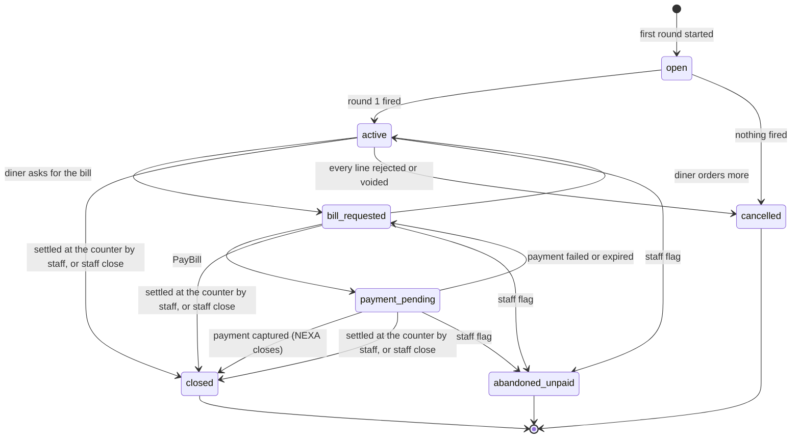
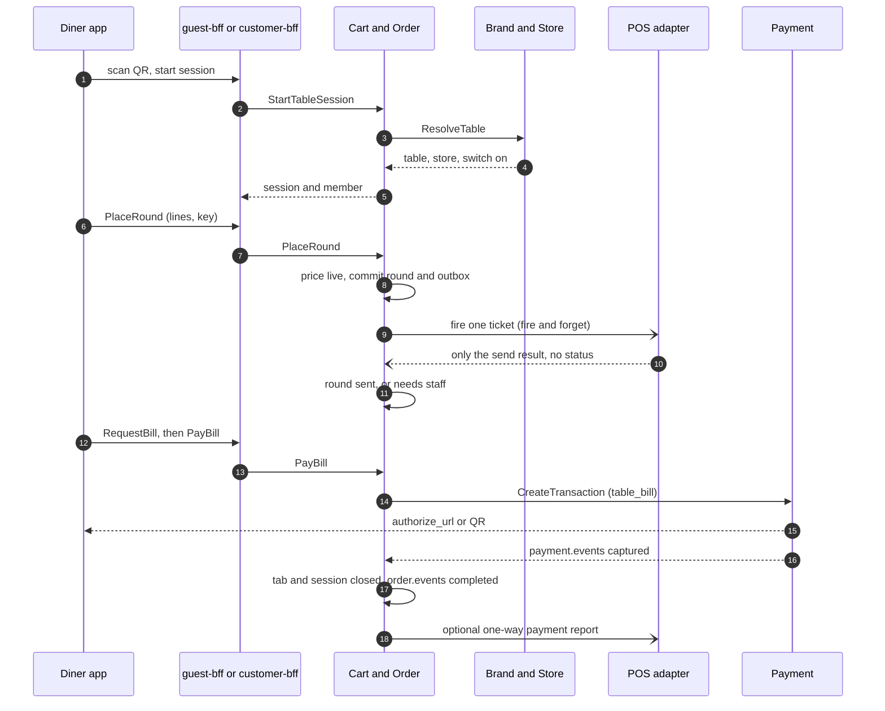

# Postpaid QR table ordering — the open tab

**Status: proposal, first draft, design phase (P-44 to P-52, 2026-10-25; amended 2026-10-28 by P-53 to P-55).** Nothing here is final. It answers a new business requirement and is not yet refined by business answers or brand limits. Rules that bind the design stay in [`architecture.md`](../architecture.md). Where this note and the rulebook disagree, the rulebook wins until a decision is signed off.

**The requirement** (owner, 2026-10-25): *"Postpaid solution: business want to have QR ordering at store that customer can scan and order from table and paid after finish up. Order have to stay and deliver to table until customer paid after eat."*

**Amended 2026-10-28: no action and no callback from the POS (P-53 to P-55).** The 2026-10-25 version assumed that the POS keeps an open check, sends status webhooks, takes an outside payment, and closes the check. The owner has now said (*"For postpaid flow there will not have any action or callback from POS. It gonna be like fire the order without pay many time until customer make payment to that session bills (order) and then close session."*) that the POS does none of this. NEXA **fires** each round to the POS and forgets it. NEXA keeps the whole tab (the session bill is the order, and the rounds add up on it), takes the payment against that bill, and closes the session itself. Sections 1, 5 to 9 and 11 to 15 were rewritten for this, and [section 16](#16-amendment-log-2026-10-28) lists every statement that was superseded. The ids P-46, P-47, P-49, P-50 and P-51 keep their numbers and are marked "amended by" in the register.

Labels used below: **Proposal** is what this note recommends. **Alternative** is a real choice that was not taken. **Assumption** is a working guess that the owner will rewrite. **To confirm** is unchecked, and needs a vendor, finance, legal, or DevOps answer. **Observed** means seen in the owner's UAT testing of BSL in October 2026, as recorded in [`pos-adapters.md`](pos-adapters.md#10-bsl-as-the-first-adapter). It is not vendor documentation.

This note does not state legal or tax facts. Anything about Thai VAT, service charge, tips, tax invoices, or consent wording is marked **To confirm** with finance and legal.

---

## 1. What changes, in one page

Today's reference checkout ([`architecture.md` §7](../architecture.md#reference-flow-own-app-checkout)) is **prepaid**: the payment is authorized first, the order reaches the kitchen only after that, and the money is captured after the POS accepts. Postpaid **inverts** this: the order goes to the kitchen first, and the money moves at the end. Since 2026-10-28 it also **inverts who knows the state**: the POS is told, and never asked.

**Proposal, in ten sentences.**

1. Each table has a signed QR code that holds only the brand, store, table, and a key version. It holds no personal data.
2. Scanning it starts, or joins, the one open **table session** for that table. A guest needs no login. A diner may sign in with Minor ID to collect points and use vouchers.
3. Cart & Order owns the session and the **tab**. The tab is an order with `order_type = dine_in_postpaid`. It is the **session bill**: it lives from the first round until it is paid and closed, and the rounds add up on it.
4. Every time a diner sends food, that is a **round**. NEXA commits the round, then **fires** it to the POS as its own ticket through the `PosGateway` port (fire and forget). The diner can fire as many rounds as they like without paying.
5. The POS gives nothing back that NEXA relies on: no status webhook, no open check, no payment step, no close. The only answer NEXA reads is the result of its own send call.
6. Brand & Store owns the table registry and the QR keys. It has no part in the tab, so the one-owner rule holds.
7. "Deliver to table" is table service by staff, not the Delivery domain. NEXA shows each round as `sent` (the POS accepted the call) and `served` (a staff tap on the NEXA table board). Rejections, voids and "the kitchen cannot make it" are staff actions on the same board.
8. The diner asks for the bill when done. Cart & Order builds it from the prices agreed at each round, applies vouchers, service charge, and a tip, then asks Payment to charge it. Payment charges the final amount and captures at once, like a wallet top-up does (P-17).
9. When the payment is captured, **NEXA closes the tab and the session itself**. Nothing is closed in the POS by NEXA. What the POS learns about the payment is a separate, per-vendor choice ([section 8](#8-pos-adapter-implications-fire-only-mode)).
10. A diner who pays at the counter is settled by staff pressing "settled at the counter" in the NEXA admin console (tender and reference). Staff can also close, void or flag a tab there, always with a reason and an audit row. A brand may switch on an optional card hold at the first round to reduce walk-outs (this waits on gateway confirmation).

**What it adds, and what it does not.** Zero new services. Zero new Kafka topics: new event types ride on `order.events`. New tables in Cart & Order and in Brand & Store. New gRPC calls and REST routes (all proposals). **No new POS port operation is required** beyond a dine-in ticket on the existing `Submit` call and an optional one-way payment report. It changes no accepted decision. It extends P-09, P-01, and the guest-bff scope, and it flags where it bends P-16 and the "Notification never sees an unpaid order" cost in P-09 ([section 15](#15-conflicts-and-flags)).

**Switchable per brand and per store.** The feature is off until the brand switch is on, the store has registered tables, the POS setup allows it, and a payment method is available. This is the effective-capability rule from [`brand-configuration.md`](brand-configuration.md#3-capabilities-and-features).

---

## 2. Where it lives

| Piece | Owner | Why |
| --- | --- | --- |
| Table registry (`store_table`), QR key version, the brand and store switch for postpaid | Brand & Store | static store facts, written only by `admin-bff`, read live (D-07). Shoppers only read |
| Table session, tab, rounds, bill, POS check reference | Cart & Order | it is the order's life. Order already owns the order, the POS ticket, and the saga |
| Guest token (a customer-family token with a dine-in scope) | Identity & Profile | Identity already signs the customer family. See section 4 |
| Table-bill transaction, optional card hold, receipt and tax invoice | Payment & Billing | it already owns the transaction and Statement mode |
| Bill discounts | Voucher & Campaign | `EvaluateBasket` and `ReserveRedemptions` already exist |
| Points earned at close | Loyalty & MemberCard | it already consumes `order.events` |
| Customer messages | Notification | it already turns facts into messages |

### Who owns the session: the choice

| Option | What it is | For | Against | Verdict |
| --- | --- | --- | --- | --- |
| **A. Cart & Order owns session and tab** | the tab is an order with rounds. Brand & Store holds only the table and QR facts | one owner and one write path (principle 3). Reuses the POS port, the sweeper, the payment link, the payload log. No new service (principle 1) | Order's aggregate gets bigger. The "order is one ticket" idea changes to "order is a tab with many tickets" | **Proposal (P-44)** |
| B. Brand & Store owns the session | session is a store fact | table facts and session sit together | Brand & Store is a read-heavy facts domain. It would own a hot, order-like write path, and it knows nothing about POS or payment. Order would then need a second owner for the tab's money | Alternative, not taken |
| C. A new Dining (table service) domain | its own service for session, tab, table staff tools | clean home if dine-in grows (waitlist, reservations, kitchen screens) | a new service, new gRPC, a second order-like aggregate beside Order. Breaks principle 1 for a first draft | Alternative, revisit if dine-in grows beyond tabs |
| D. Use the Delivery domain for "deliver to table" | table as a delivery destination | none that matter | Delivery is quote, fleet, rider, ledger, and `delivery.events`. A table has no address, fee, rider, or provider job. It would mix two aggregates | Not taken ([section 5](#5-lifecycle-tab-rounds-and-deliver-to-table)) |

---

## 3. Vocabulary

| Term | Meaning |
| --- | --- |
| Table | one row in the store's table registry. Has an id, a label, and an active flag |
| Table session | the period when one party of diners uses one table. Many diners can be members. One open session per table at a time |
| Tab | the order of that session (`order_type = dine_in_postpaid`). It stays open until paid. It is the session bill. The POS has one ticket per round, and no open check that NEXA depends on |
| Round | one "send to kitchen" action by one diner: a set of lines. A tab has round 1, 2, 3, and so on |
| Bill | the amount asked at the end. Built from the agreed prices of the non-voided lines, plus charges and minus discounts |
| Fire | send a round to the POS as one ticket and not wait for anything back. Fire and forget |
| Session bill | the tab seen as the amount owed. NEXA's own record, never a POS check |
| Guard | the measure that stops a remote person from ordering to an empty table ([section 4](#4-table-qr-and-session)) |

---

## 4. Table, QR, and session

### The QR code

- **Contents:** `v1`, `brand_id`, `store_id`, `table_id`, `key_version`, and a signature. The URL is `https://<brand app host>/t/<token>`. The brand app host is how Kong knows `X-Brand-Id` ([`identity-model.md`](identity-model.md)).
- **No personal data** is in the URL or the token. Nothing in it identifies a person or a device.
- **Signing key:** held in Vault, per brand. Brand & Store verifies the signature in `ResolveTable`. The algorithm (MAC or public-key signature) is for security and DevOps to choose.
- **Revoking:** `RotateTableKey` bumps `key_version` for one table or one store. Old stickers stop working. A new sticker is printed from the admin console.
- A QR that passes the signature check only proves "this sticker was ours". It does not prove "the person is at the table". The guard below handles that.

### Guard levels (against remote or abusive ordering)

A photo of a QR code can be scanned from anywhere. The risk is food made for nobody, or a bill on a table that is empty. Guard levels are configuration per store (`qr_guard`). **Proposal:** every level includes G1.

| Level | What it adds | Staff effort | Cost or risk |
| --- | --- | --- | --- |
| G0 `none` | only the signed QR | none | anyone with a photo can order |
| **G1 `limits` (always on)** | edge rate limit and bot challenge on session start (Cloudflare and Kong). A cap on the open amount, on rounds per 10 minutes, and on lines per round | none | does not stop one determined person |
| **G2 `table_code` (proposed default)** | a 4-digit table code the diner types at session start. The code is made by Order for each new session and shown to staff on the table board. Staff say it or print it on the table card | low, per seating | friction for the diner. A code can be shared. **Assumption:** 4 digits is enough with the rate limit |
| G3 `staff_confirm` | the first round of a new session waits until staff tap "confirm table" in the admin console | medium, per seating | a slower first order |
| G4 `dynamic_qr` | the QR token changes every few minutes and is shown on a table device or screen | hardware per table | the most cost. Only if abuse is shown |

A soft **location check** (browser location) is **not** in the first draft: accuracy and privacy cost are high and it is easy to fake. It may be added as a signal later.

Which level the business wants is open (O-39).

### Starting a session

1. The diner scans the QR. The app or browser opens the brand's table page.
2. `POST /v1/dine-in/sessions` carries the QR token and, for G2, the table code. A signed-in diner calls it on `customer-bff`. A guest calls it on `guest-bff`.
3. The BFF calls Order `StartTableSession`. Order calls Brand & Store `ResolveTable` to verify the signature, check that the table is active, and check that postpaid is on for the brand and store.
4. Order finds the one open session on that table and joins the diner to it, or creates a new session. Order returns `session_id` and a `member_id`.
5. For a guest, the BFF asks Identity for a guest token (below). The response also carries the table label, so the diner confirms it is the right table.

### Guest or Minor ID

| | Guest | Minor ID |
| --- | --- | --- |
| How they start | scan, no login | scan, with the customer token of the brand |
| Token | a **guest token**: a customer-family JWT issued by Identity, with claims `scope = dine_in`, `sid` (session), `mid` (member), `store_id`, and a short life (5 minutes, as in [§8](../architecture.md#8-edge-identity-and-security)). It is renewed while the session is open | the normal customer JWT |
| What Order stores | a random member id, no name, no contact | the member id plus `customer_id` |
| Loyalty, vouchers | none, unless they sign in during the session | points are earned at close for the tab's beneficiary. Vouchers are applied at the bill |
| Wallet | not available | the brand's wallet (D-11), if the membership is enabled (P-40) |

**Signing in mid-session.** The diner signs in, then scans or reopens the table link again. `customer-bff` calls `StartTableSession`, and Order joins the diner as a second member with a `customer_id`. The guest member's earlier rounds stay as they are. The **beneficiary** of points is the signed-in member who pays the bill (Assumption, O-45). Nothing links two tokens, so no token is checked twice (principle 7).

**Why a guest token, not a new family.** Alternatives for who signs a guest's proof:

| Option | What | Trade-off |
| --- | --- | --- |
| **A. Guest variant of the customer family, signed by Identity (proposal)** | Identity gets one new call, `IssueGuestToken`, callable only by `guest-bff`. It keeps no guest state | Kong already trusts the customer JWKS. Three token families stay three. Identity signs something with no customer behind it, so this **extends the meaning of the customer family**. Flagged in [section 15](#15-conflicts-and-flags) |
| B. A fourth token family signed by Cart & Order | Order signs, Kong reads its JWKS | Order would need an HTTP door for the JWKS (a domain exposes none today), and [§8](../architecture.md#8-edge-identity-and-security) says three families. A larger change |
| C. An opaque session cookie that Order checks on every call | no JWT at all | something behind Kong re-validates a credential, against principle 7 |

Order still checks, on every call, that the member belongs to an open session. The token proves who the call is from. The session says what it may touch.

### Several diners on one tab

- **Join:** a second diner scans the same QR (and types the table code if G2) and joins the same session. Each diner is a member.
- **Draft rounds are per diner.** A diner builds a draft on the device, and sends it as a round. Nobody edits another diner's draft. All members see the whole tab: every round, its status, and the running total. A shared live basket is a **later option**, because it needs a server-side basket and merge rules for edits.
- **Leave:** a member can leave. It ends only that member's access (their token is not renewed). The tab and its rounds stay. If the last member leaves while the tab is unpaid, the tab stays open for staff and the sweeper.
- **Who can pay:** any member can request the bill and pay the whole of it (first draft). Splitting is in [section 7](#7-payment-at-the-end).

### Move, merge, expiry, close

| Case | Rule |
| --- | --- |
| Table move | staff only, in the admin console (`MoveTab`). Order updates the table on the session. Later rounds are fired with the new table label. Tickets already fired keep the old label, and staff tell the kitchen, because the POS is not asked to move anything. The token carries no table id, so diners see the new table at the next read. The old table's QR starts a new session once the old session is closed |
| Merge two tabs | staff only, **later** (not in the first draft). Needs a rule for two bills and their rounds |
| Idle before ordering | a session with no round expires after an idle time. No tab is created, nothing to pay |
| Hard limit | a session open longer than a maximum is flagged to staff. It is never closed as paid by a timer |
| Store closes | tabs still open at closing time go to a staff queue. See the [edge cases](#12-edge-cases) |
| Staff close | `ForceCloseTab` with a reason ([section 7](#7-payment-at-the-end), P-50) |

All time values are **Assumptions** ([section 11](#11-scale-assumptions-recommended-to-be-rewritten), O-46).

---

## 5. Lifecycle: tab, rounds, and "deliver to table"

### Tab states



| State | Meaning |
| --- | --- |
| `open` | the tab exists but no round has been fired (for example while a card hold is being authorized) |
| `active` | at least one round is fired. Rounds move on their own. More rounds can be sent |
| `bill_requested` | the diner asked for the bill. The total is shown. Ordering more moves it back to `active` |
| `payment_pending` | a payment is in progress. The tab is **locked**: no new rounds, no change to the bill |
| `closed` | the tab and the session are finished. A reason says how: `app` (payment captured), `counter` (staff settled it), or `staff_override`. *The 2026-10-25 state `paid`, "captured, POS check closing", is removed: there is no POS check to close, so a captured payment closes the tab in the same commit (P-53).* |
| `cancelled` | no round was fired, or every line was rejected or voided. Nothing to pay |
| `abandoned_unpaid` | staff flagged that the diners left without paying. Never set by a timer alone |

**"Served" is derived, not stored** (principle: derive, don't store): the tab is "fully served" when no round is waiting. The bill can be requested before every round is served, and the app warns about rounds still in progress. A staff tap is the only source of `served`, so a store that never taps still works: the bill never waits for it.

`placed` in [P-09](../architecture.md#proposed--the-default-until-signed-off) means "the kitchen may see it". For a postpaid tab it happens when the **first round** commits, with no payment gate. That is a third case beside own-app and aggregator orders (P-46).

### Round states

*Amended by P-53.* A round no longer follows the POS ticket ranks, because the POS does not report a status. NEXA owns the round state, and only two things move it: the result of NEXA's own send call, and a staff action on the table board.

| Round state | What it means | What moves it there |
| --- | --- | --- |
| `fired` | committed in NEXA, not yet accepted by the POS call | `PlaceRound` commit |
| `sent` | the POS call returned success. As far as NEXA can know, the kitchen has the ticket. It does **not** prove the ticket was printed or read | the send result, in the POS worker |
| `served` | at the table | staff tap in the admin console (`MarkRoundServed`). Optionally a diner tap later |
| `rejected` | the send was refused (`ErrRejected`), or staff marked "the kitchen cannot make it". Not billed | the send result, or staff (`VoidRound` with reason `kitchen_refused`) |
| `voided` | removed after the fact by staff, with a reason. Not billed | staff (`VoidRound`) |

Besides the state, a round has a flag `needs_staff` with a reason (`send_failed`, `send_ambiguous`). It puts the round on the table board with buttons: **resend**, **confirm the kitchen has it**, or **void**. The diner sees "we are confirming your order with the staff" and not an error.

Rules: a state moves forward only (`fired` to `sent` to `served`), and `rejected` and `voided` are terminal. A send retry never moves a round backward. Duplicate or repeated taps are no-ops. There is no POS rank, no R1 to R7 for rounds, and no `accepted`, `preparing` or `ready` state: **a kitchen that is ready is told to staff verbally or on the kitchen screen, and NEXA does not track it.** If a vendor pushes status anyway, the update is stored in the payload log and does not move a round or the tab ([section 8](#8-pos-adapter-implications-fire-only-mode)). Whether the business wants a "ready" tap too, and who settles a "never arrived" dispute, is open (O-48, O-50).

A line in a `rejected` or `voided` round is **kept in history and excluded from the bill**. The agreed price lines are never rewritten: the bill is computed from the lines that are not excluded.

### What "deliver to table" means

It is **table service**: staff carry food from the kitchen to the table. NEXA does three things for it.

1. It fires each round to the kitchen at once, through the POS, with the table label and the round number on the ticket.
2. It shows the diner each round's status (above): `sent`, then `served`. The signals are NEXA's own send result and a staff tap. The POS reports nothing.
3. It shows staff a **table board** in the admin console: open tabs, rounds waiting to be served, rounds that need staff (a failed or unclear send), bill requests, unpaid ages. The board is also where staff reject, void, resend, settle and close.

It does **not** use the Delivery domain. Delivery owns the quote, the fee, the fleet provider job, the rider, and `delivery.events`. Delivery starts dispatch on `order.events{accepted}` (P-21). A postpaid tab publishes `placed` at the first round but, with no POS status, **no `accepted`**: Delivery has nothing to react to, and every postpaid event carries `fulfillment = dine_in` as well. **To verify** in the Delivery LLD page 2 that it already filters on fulfillment.

**The status feed.** A guest or a member polls `GET /v1/dine-in/sessions/current` about every 10 seconds (Assumption). The answer is cached in Valkey by the tab's `version`, filled after commit (one of the four allowed Valkey uses, D-04), so the poll costs little. A signed-in member also gets a push or inbox message for `rejected`, because Notification reads `order.events{round_updated}`. Push to a guest is not possible (no contact). Live push for guests (server-sent events on `guest-bff`) is a later option. Staff alerts are open (O-44).

---

## 6. The main flow, step by step

Steps 1 to 4 start the session. Steps 5 to 9 repeat for every round. Steps 10 to 17 settle the tab. The diner waits only on the gRPC steps that return an answer. **The POS appears in one place only: step 7, where NEXA sends a ticket and reads the result of that call.**

| # | Step | Detail |
| --- | --- | --- |
| 1 | Scan | the diner scans the table QR. The brand app host sets the brand |
| 2 | Start or join the session | `guest-bff` or `customer-bff` calls Order `StartTableSession` (QR token, table code). Order calls Brand & Store `ResolveTable`. A guest then gets a guest token from Identity |
| 3 | Read the menu | `GetMenu` for the store, channel `dine_in`. Catalog's availability applies live |
| 4 | Optional hold | if the brand needs a card hold, Order asks Payment for a `table_preauth` ([section 7](#7-payment-at-the-end)). The diner finishes 3DS at the gateway. The tab is `open` until it is `authorized` |
| 5 | Send a round | `PlaceRound` carries `idempotency_key`, `lines`, and the total the diner saw. Order checks: the session is open, the store is open for dine-in, prices live with Catalog `PriceLines` (channel `dine_in`), and the caps (open amount, rounds, lines). A different live total returns `FAILED_PRECONDITION` (`price_changed`) |
| 6 | Commit the round | Order commits the round (state `fired`) with its price lines and the outbox row in one transaction. The tab becomes `active`. The first round publishes `order.events{placed}`. No payment is involved |
| 7 | Fire to the POS | the Order POS worker picks the store's adapter and sends **one ticket for the round** with `Submit`: table label, round number, a pay-later marker, and the idempotency key `order_id:round_no`. The result of the call is the only answer: success, `ErrRejected`, `ErrUnavailable` (retry from the outbox), or `ErrAmbiguous` ([section 8](#8-pos-adapter-implications-fire-only-mode)) |
| 8 | Mark it sent | on success Order commits the round `sent` and publishes `order.events{round_updated}`. No webhook is awaited. A refusal marks the round `rejected` and tells the diner. A failure after the retries, or an unclear answer, sets `needs_staff` and raises the table board |
| 9 | Serve and watch | staff carry the food and tap "served" on the table board. The diner sees each round move from `sent` to `served`. More rounds repeat from step 5 |
| 10 | Ask for the bill | `RequestBill`. The tab becomes `bill_requested`. The table board shows it. Order builds the bill preview: agreed lines (without rejected or voided ones), `EvaluateBasket` for deals, the service charge, and the tip choices |
| 11 | Choose how to pay | the diner picks a tip, adds a voucher code, signs in if they want points, and picks a method |
| 12 | Pay | `PayBill` carries `idempotency_key`, `bill_version`, and the total the diner saw. Order locks the tab (`payment_pending`), calls Voucher `ReserveRedemptions`, then Payment `CreateTransaction(purpose = table_bill)`. A changed bill returns `FAILED_PRECONDITION` (`bill_changed`) |
| 13 | The gateway | Payment calls the gateway. `authorize_url` or the PromptPay QR goes back to the app. The diner finishes at the gateway. From here nobody waits |
| 14 | Payment confirmed | the gateway webhook goes through `webhook-adapter` to `payment.requested{webhook}`. Payment commits `captured` and publishes `payment.events{captured}` (`purpose = table_bill`). Payment's Statement mode writes the receipt and invoice |
| 15 | Close the tab | Order consumes it and, **in one commit, closes the tab** (`settlement = app`) and the session, and publishes `order.events{completed}`. The diner sees "paid". The POS is not involved in this step |
| 16 | Tell the POS (optional, one way) | if the store's vendor and the brand choose it, the POS worker sends a one-way payment report and does not wait for a result. A failure raises an info entry, never an error for the diner, and never reopens the tab ([section 8](#8-pos-adapter-implications-fire-only-mode)) |
| 17 | After-effects | Voucher commits its hold on `completed`. Loyalty earns points on `completed`. Notification messages a signed-in diner with the receipt link. A guest sees the receipt on screen |



---

## 7. Payment at the end

### The bill

| Part | Rule |
| --- | --- |
| Items | the agreed price lines of each round, taken at the time the round was sent. A later menu price change does not change an old round. Lines in a `rejected` or `voided` round are left out |
| Deals | Voucher `EvaluateBasket` runs on the tab's lines at bill time. The diner may add a code. The result is discount lines. The hold is made only when the diner pays (step 12) |
| Service charge | a setting per brand and store, owned by Cart & Order (`service_charge_bps`, off by default). Whether it exists at each brand, whether it is taxable, and how it shows on the invoice is **To confirm** with finance (O-41) |
| Tip | optional, chosen at pay time, from presets or an amount. Off by default per brand. How the tip is paid out and shown on the invoice is **To confirm** (O-41) |
| VAT and tax invoice | Payment's Statement mode builds the invoice and receipt from the paid bill, as it does after a capture today. Rates, inclusive or exclusive display, a full tax invoice for a guest (who needs a taxpayer name, id, and address), and e-tax rules are **To confirm** with finance and legal (O-41). NEXA asks for taxpayer details only if the business needs them (O-47) |
| Money | integer satang, as always (P-12). The bill carries a `bill_version` that rises with any change, so a stale pay is rejected. **The bill is the only record of what is owed:** the POS holds loose tickets for the table and its totals are never read |

**The bill total is always NEXA's.** Order builds it from its own agreed lines, and in the no-callback model it has nothing else to compare with: it never reads a POS total. This is the same reasoning as R5 and R7 in [`pos-adapters.md`](pos-adapters.md#5-applying-an-update-order-duplicates-and-totals) (**Observed** with BSL: a late update can overwrite a total). A gap between the POS tickets and NEXA's bill is found only by the end-of-day comparison ([section 8](#8-pos-adapter-implications-fire-only-mode)), by finance or staff. The diner pays what the app showed (the spirit of P-32). What staff do about a gap is O-32.

### Split bill

| Level | What | Scope |
| --- | --- | --- |
| **Whole bill** | any one member pays everything | **First draft** |
| Equal split | N shares of the total. Each share is its own payment | **Next step** (proposed) |
| By item or by person | each member claims items. Shares follow the claims | **Later**, needs a claim screen and a rule for shared dishes, service charge, and tip |
| Custom amount | pay any part, in any order | **Later**. Needs partial-payment states on the tab |

A split makes **several transactions on one order**, each with one tender. P-16 says one tender per order and no wallet-plus-card split. P-16 is about a single payment. A split bill is several payments, each with one tender. This reads as a clarification, but it is **flagged** because the words are close ([section 15](#15-conflicts-and-flags), O-40). The data model leaves room: a `bill_part` table with a payer and a transaction. The tab closes when all parts are paid.

### How Payment handles a pay-later transaction

| Option | What | For | Against | Verdict |
| --- | --- | --- | --- | --- |
| **A. Charge at close, capture at once (proposal)** | `CreateTransaction(purpose = table_bill, capture_mode = auto)` for the final amount. The charge is captured when authorized | simple. Matches the pattern of a wallet top-up, captured at authorize (P-17). Works for card, PromptPay QR, and wallet. The amount is exact. NEXA closes the tab by itself, so nothing waits on the POS | no protection against a walk-out before the bill | **Proposal (P-47, amended by P-53)** |
| B. Card hold at the first round, then capture the bill | a `table_preauth` hold for up to `max_open_amount`, then a partial capture at close, and a release of the rest | the strongest walk-out cover for cards. One transaction | card only. A PromptPay QR cannot be held. The hold shows on the card statement. Needs gateway support. A hold has a time limit | **Optional per brand (P-48)** |
| C. Authorize at the bill, wait for the POS, then capture | mirrors [§7](../architecture.md#7-sagas-and-long-running-flows) of the rulebook (capture only after the POS accepts) | none now: **there is no POS answer to wait for** (P-53) | PromptPay QR has no authorize step. It would need a different path for QR. More states | Not possible in the no-callback model |
| D. Card on file, charge later | saved card of a signed-in member | no hold at order time | needs card storage and consent, and a member. Not for guests | Later option |

**Why NEXA closes the tab itself (option A, amended by P-53).** The money is the thing that cannot be taken twice, so the payment is the last step that matters. Once it is captured, nothing outside NEXA has to succeed: Order closes the tab and the session in the same commit that reads `payment.events{captured}`, and a replay of that event is a no-op. There is no POS check to close, so the 2026-10-25 failure "the diner paid but the POS check cannot be closed" is gone. What remains is the POS's own bookkeeping (it holds tickets that NEXA never marks paid). That is a reporting and tax question for each vendor, not a state in NEXA's flow ([section 8](#8-pos-adapter-implications-fire-only-mode), O-49).

**Public facts on gateway holds (verified 2026-10-25, public pages).** Omise's public help pages say a card charge can be created with `capture=false` and captured later, an authorization expires after 7 days (Thailand page), and single partial capture is on by default for a `pre_auth` authorization ([Authorize and hold](https://www.omise.co/does-omise-support-authorize-and-hold-only), [Capture](https://www.omise.co/capture)). They also say a hold shows on the cardholder's statement. Whether MFG's merchant accounts have these on, the fees, and whether an amount can be raised on an existing hold are **To confirm** with Omise (O-43). A hold is for cards only.

**Open amount.** `max_open_amount` stops a tab growing past what the hold (or the brand's risk) covers. With option B on, `max_open_amount` is the hold amount, and new rounds stop when the open total plus charges plus a tip margin would pass it. Staff can raise it (`tab.manage`), which asks for a new hold on top. The tip margin is an **Assumption**.

### Methods per brand

Whatever Payment already offers the brand for checkout, with these limits: PromptPay QR and card work for guests. The wallet needs a signed-in member and the brand's enabled membership (D-11, P-40). Payment calls Wallet `Hold` and `Capture` back to back, as D-09 says. Which methods are on for a table bill is a Payment per-brand setting. No brand name is in code.

### Pay at the counter (fallback)

*Amended by P-55.* The diner goes to the till and pays staff with any tender (cash, a card terminal, or another). **The POS does not tell NEXA.** NEXA learns of it from staff.

1. Staff open the table board and press **Settled at the counter** on the tab (`SettleTabAtCounter`). They pick the tender (`cash`, `card_terminal`, `other`), enter the amount received and a reference (receipt number, optional), and a reason code if the amount differs from the bill.
2. Order checks the grant (`tab.settle`), locks the tab, writes the settlement and an audit row in the same transaction, and commits the tab `closed` with `settlement = counter`. It publishes `order.events{completed}`. The amount and tender are on the tab, and nothing about a card or a person is kept.
3. Payment has no transaction for the tab, so there is no gateway record. Voucher and Loyalty react to `completed` as usual (for a signed-in member who is linked to the tab).
4. In the POS, staff record the sale as they do for any counter sale. **That is outside NEXA.** It is the same double entry as a paper bill today, and it is covered by the end-of-day comparison.

**The universal minimum is unchanged:** staff can still press **Close tab** (`ForceCloseTab`, `settlement = staff_override`, with a reason and an audit row), for a comp, a mistake, or a payment taken in a way that has no tender in the list.

**Both at once.** If a diner starts paying in the app while staff settle at the till, the tab lock decides it, because **NEXA is the only authority on the tab**. The first commit wins. If staff settled first, a later `captured` meets a closed tab: Order flags it, and CSC gets a refund task (Refund is an admin gRPC). If the app payment was first, the staff button fails with `FAILED_PRECONDITION` (`tab_closed`) and staff see "paid in the app". The old text, where the POS settled first and NEXA reconciled it afterwards, no longer applies (there is no POS signal).

### Unpaid and walk-out

| Control | What |
| --- | --- |
| Before | the guard levels, `max_open_amount`, and the optional hold (option B) |
| During | the table board shows each tab's age and amount. Rounds stop at the cap |
| After | staff set `abandoned_unpaid` (`MarkTabUnpaid`, needs `tab.override`, a reason, audit). The tab and its lines stay as the record. With option B on, capturing the hold for the unpaid amount is possible only if the diner agreed to that in the terms shown at the hold. Legal wording is **To confirm** (O-38). Without a hold or a signed-in member, NEXA holds no contact to chase |
| Never | no timer sets `closed` or `abandoned_unpaid`, or marks a tab paid, by itself. A sweeper only raises a queue entry for staff |

Whether to block a signed-in member who left an unpaid tab, and who bears the loss, are business policy (O-38).

---

## 8. POS adapter implications (fire-only mode)

*Rewritten 2026-10-28 (P-53, P-54). The 2026-10-25 version of this section (open check, add items, external payment, check webhooks, three degrade modes) is superseded; the old names are listed in [section 16](#16-amendment-log-2026-10-28).*

The POS port today ([`pos-adapters.md` §3](pos-adapters.md#3-the-port)) already has what a postpaid round needs: `Submit` sends a ticket, and `Cancel` may withdraw one. **Postpaid adds no required operation.** It adds fields on the ticket and one optional one-way call.

### What the POS does and does not do in this flow

| The POS | Fire-only model |
| --- | --- |
| Gets a ticket per round | yes. Each round is its own ticket with the table label, the round number and a pay-later marker |
| Keeps a check open for the table | **no**, or if it does, NEXA does not depend on it. The POS sees separate tickets |
| Reports status (accepted, ready, served) | **not used.** A vendor may push it anyway (BSL pushes status for tickets, **Observed**). NEXA stores it in the payload log and does not apply it to a round or the tab |
| Takes the payment | **no.** The payment is taken in NEXA (Payment) or by staff (counter), and recorded in NEXA |
| Closes the check or the table | **no.** NEXA closes the tab and the session |
| Is asked for the bill | **no.** The bill is NEXA's |

### Capability flags (proposed, P-54)

| Flag | Meaning | If false |
| --- | --- | --- |
| `supports_dine_in` | accepts a ticket with `fulfillment = dine_in` and a table label | postpaid is not offered for this store |
| `supports_pay_later_marker` | the ticket can carry a "paid in NEXA / pay later" marker, so staff do not treat it as an unpaid walk-out | the marker goes in the ticket note text. **To confirm** per vendor |
| `supports_idempotent_submit` | **existing.** The same idempotency key cannot create two tickets | an unclear send is never retried by itself. Staff decide ([below](#sending-one-round-and-how-nexa-knows-it-arrived)) |
| `supports_cancel_after_accept` | **existing.** A ticket can be cancelled after the POS took it | a void is NEXA-only, and staff tell the kitchen |
| `supports_payment_report` | accepts a one-way payment report for a table's tickets (option C below) | no report. Reconciliation is by the end-of-day comparison |

**Dropped from the first draft** (they were proposed on 2026-10-25 and are not used any more): `supports_open_check`, `supports_add_items`, `supports_get_check`, `supports_external_payment`, `supports_table_transfer`, `supports_check_webhooks`. They are kept as a **later upgrade** only: if the business ever wants the POS to hold one open check per table, the old design can come back as a second mode, and NEXA's tab would still be the record.

### The port: what is used

```go
// ports/out/pos.go: postpaid uses the existing calls (not compiled code)
Submit(ctx, req TicketRequest) (TicketRef, error)       // one ticket per round. IdempotencyKey = order_id:round_no
Cancel(ctx, ref TicketRef, reason string) error          // best effort on a void. Never required
ReportPayment(ctx, req PaymentReport) error              // OPTIONAL, one way, supports_payment_report. No result is read back
```

The **ticket request** gains `fulfillment = dine_in`, `table_label`, `round_no`, `session_ref` (a short NEXA reference for the tab) and `payment.kind = pay_later`. Nothing else changes in the canonical ticket. Not used for postpaid: `Status`, `ReadBack`, the POS update, and the second `check_state` rank ladder that was proposed on 2026-10-25 (it is dropped).

### Sending one round, and how NEXA knows it arrived

NEXA knows only what its own call returns. The worker keeps a send ledger (`pos_send`) per round with the attempts and the last result.

| Result of the call | What NEXA does |
| --- | --- |
| Success (the vendor accepted the call) | commits the round `sent`. **This means "the POS API accepted it", not "the kitchen printed it".** It is the best NEXA can know without a callback |
| `ErrRejected{reason}` (a clear refusal, for example a store routing problem or an unknown item) | marks the round `rejected` with the reason, tells the diner and shows it on the board. Not billed |
| `ErrUnavailable` | retries from the outbox with jittered backoff inside the POS window. After the window the round gets `needs_staff` (`send_failed`). **It is never marked `rejected` by a timer**, because it may still arrive |
| `ErrAmbiguous` (a timeout: the ticket may or may not have reached the POS) | if the vendor `supports_idempotent_submit`, retry with the same key. If not, **do not resend by itself**: set `needs_staff` (`send_ambiguous`). Staff look at the kitchen and press **Confirm the kitchen has it** (round becomes `sent`) or **Resend**. Without any read-back from the POS, this is the honest rule against a double round reaching the kitchen |
| A POS update that arrives anyway | stored in the payload log with the round and `order_id`, never applied |

**Duplicate-fire protection** has three layers. (1) The idempotency key `order_id:round_no` is deterministic, stored with the round, and reused on every retry, and the diner's `PlaceRound` key already makes a double tap return the same round. (2) The worker takes the round row with a lease, so one worker sends a round at a time. (3) A `sent` round is never sent again unless a staff member presses Resend, which writes an audit row. Where the vendor honors the key (`supports_idempotent_submit`, **to confirm** per vendor), layer 1 holds across the vendor too.

### Rejection, out of stock and void without a callback

The kitchen cannot refuse a ticket in the POS and have NEXA hear about it. So these go through staff, in NEXA.

| Case | What happens |
| --- | --- |
| Out of stock before the order | Catalog availability is checked live at `PlaceRound`. The line is refused with a clear message |
| The kitchen cannot make an item after the fire | the kitchen tells the waiter. Staff press **Kitchen cannot make it** on the line or round (`VoidRound`, reason `kitchen_refused`, optional "also mark sold out"). The round or line is excluded from the bill, the diner sees it and a signed-in diner gets a message. If the vendor `supports_cancel_after_accept`, a best-effort `Cancel` is also sent. NEXA never waits for it |
| Staff void after the food is out | the same button, a reason code, and an audit row (grant `tab.manage`). The lines stay in history |
| The diner cancels a round | only while it is `fired` and not yet `sent`. After that it is a staff action |

### What the POS learns about the payment (the choice)

A POS that never hears about the payment holds tickets that look unpaid, and its sales report will not match NEXA's. **This may matter for POS sales reporting, reconciliation, stock counts and the tax receipt, and it differs per vendor. To confirm with business and with each POS vendor (O-49).**

| Option | What it is | For | Against |
| --- | --- | --- | --- |
| A. Nothing, and an end-of-day comparison | NEXA tells the POS nothing. A daily NEXA report (paid table bills by store, with the ticket references, amount, tender, tip and settlement) goes to finance as a file, and staff or finance match it to the POS | no vendor feature needed. Works on any POS. Nothing can fail at the till | POS sales reports are wrong until matched. Unpaid-looking tickets pile up in the POS and can be mistaken for walk-outs. Manual work every day |
| B. Mark each ticket "paid in NEXA / pay later" when it is fired, plus the daily report | the pay-later marker is on the ticket (`supports_pay_later_marker`), so staff and the POS know the ticket is accounted for. The same daily report as A | cheap and one way. Fixes the walk-out confusion at the till | the marker is a promise made before payment. A tab that is never paid leaves a marked ticket that is not paid. The POS sales report still does not show the payment |
| C. A one-way payment report on close, per vendor | after NEXA closes the tab, the worker sends `ReportPayment` for the tab's tickets: amount, tender kind `nexa`, tip, reference. It does not read an answer. A failure is an info entry on the board and never changes the tab. Needs `supports_payment_report` | the POS shows the sale as paid, so its reports and receipts line up. The strongest | vendor-specific, and vendors may not offer it. It is an action toward the POS, so it must be accepted as "NEXA tells, the POS does nothing back". An unsent report must still be covered by the daily report |

**Proposal (P-54): B for every store, plus the daily report, and C added per vendor when the vendor offers it and the business asks.** A alone is the fallback if a vendor cannot even take the marker (the marker then goes into the ticket note). This keeps the postpaid flow independent of any POS feature, in line with the requirement. Whether the POS must carry the payment for tax and reporting is the business question behind O-49.

### Table move, merge and POS-added items

The POS is not asked to move or merge anything. A table move changes the label on later tickets only. If staff add an item in the POS directly, **NEXA does not know and does not bill it**: staff must add items through the NEXA board (`PlaceRound` as staff, one write path) or settle the extra at the counter. The end-of-day comparison shows any POS sale that has no NEXA round (O-49).

### Degrade modes

*Replaces the three modes of 2026-10-25.* `postpaid_pos_mode` in `pos_connection` has one value in the first draft, `fire_only`. An unset value means off. `open_check` stays as a later option. `ticket_per_round` is now just `fire_only`. `staff_settle` is no longer a POS mode: whether the diner may pay in the app is a Payment setting for the brand (`table_bill_methods`), and the counter path is always there.

### BSL: what is known, and what is not

**Do not assert what BSL supports.** The recorded BSL facts ([`pos-adapters.md` §10](pos-adapters.md#10-bsl-as-the-first-adapter)) are about ticket orders, from the owner's UAT: webhooks arrive within about a second and some are duplicated, updates can arrive out of order, a late update can overwrite the total and an empty check can reset the net total to 0, some promotions are dropped, and the vendor needs per-store routing values. Pickup works and delivery is not available yet. **Nothing is recorded about a dine-in ticket, a table label, a pay-later marker, idempotent submit, cancel after accept, or a payment report.**

So the BSL profile gets `supports_dine_in`, `supports_pay_later_marker` and `supports_payment_report` as **unknown, treat as false**, and `supports_idempotent_submit` stays unknown (already treated as false). In practice, until the vendor answers (O-42, which extends O-28): the ticket is a normal ticket with the table in the note, an unclear send always goes to staff, and the daily report is the only reconciliation. BSL's behaviors above are covered by generic rules and reused where they still apply: the deterministic `event_id` for a duplicate webhook that is logged, `ErrAmbiguous` for an unclear send, and the payload log for everything a POS pushes.

---

## 9. Data and contract changes

All names are **proposals**. Align with the boilerplates when shared.

### Cart & Order (Postgres)

| Table or field | What |
| --- | --- |
| `order.order_type` | `standard` (all existing orders) or `dine_in_postpaid` |
| `order.fulfillment` | gains `dine_in` |
| `order.table_id`, `order.session_id` | the table and the session. *`order.pos_check_id` of 2026-10-25 is dropped: there is no POS check.* |
| `order.bill_version`, `order.settlement`, `order.closed_reason` | the bill version, and how it ended: `app`, `counter`, `staff_override`, or `unpaid` |
| `table_session` | `session_id`, `brand_id`, `store_id`, `table_id`, `status`, `table_code_hash`, `opened_at`, `last_seen_at`, `expires_at`, `version`. One open row per `(brand_id, store_id, table_id)` (a unique index on open rows) |
| `table_session_member` | `session_id`, `member_id` (random), `customer_id` (nullable), `joined_at`, `left_at`. No name and no contact |
| `order_round` and its lines | `order_id`, `round_no`, `member_id`, `status` (`fired`, `sent`, `served`, `rejected`, `voided`), `needs_staff` and its reason, `fired_at`, price lines, `version`. `round_no` is unique per order |
| `pos_send` (new, replaces `pos_round_ref`) | `order_id`, `round_no`, `idempotency_key` (`order_id:round_no`), `attempts`, `state` (`pending`, `sent`, `refused`, `ambiguous`, `failed`), `vendor_ref` (if the vendor returns one), `last_error`, `sent_at`. The send ledger. Never a POS status |
| `tab_bill` | `order_id`, `bill_version`, the lines, discount, service charge, tip, total, `status`, and the voucher hold reference |
| `tab_settlement` (new) | `order_id`, `kind` (`app`, `counter`, `staff_override`), `tender` (for `counter`), `amount_satang`, `reference` (optional), `staff_principal_id`, `reason_code`, `settled_at`. The record behind `SettleTabAtCounter` and `ForceCloseTab` |
| `bill_part` (later, for split) | `bill_id`, `payer_member_id`, `amount`, `transaction_id`, `status` |
| `pos_connection` | gains `postpaid_pos_mode` (`fire_only`) and capability overrides for the flags in section 8. `pos_ticket` gains `round_no` |
| `processed_event`, outbox | unchanged shape, new event types |

### Brand & Store (Postgres)

| Table or field | What |
| --- | --- |
| `store_table` | `brand_id`, `store_id`, `table_id`, `label`, `area`, `seats`, `active`, `qr_key_version`, `version`. Written only through `admin-bff` |
| Brand switch | `postpaid_table_ordering` on or off, per brand and per store (the feature switch of P-37) |

### Per-brand and per-store settings (one owner each)

An unset setting is off. A change takes effect on the next read and never rewrites a tab in progress.

| Setting | Owner | Meaning | Default |
| --- | --- | --- | --- |
| `postpaid_table_ordering` | Brand & Store | the brand or store offers it | off |
| `qr_guard` | Cart & Order | G1 to G4 ([section 4](#4-table-qr-and-session)) | G2 (proposal) |
| `postpaid_pos_mode` | Cart & Order (`pos_connection`) | `fire_only` (the only value in the first draft) | unset, so off |
| `pos_payment_report` | Cart & Order (`pos_connection`) | `none`, `marker`, or `marker_and_report` (options B and C of section 8) | `marker` (proposal) |
| `allow_guest` | Cart & Order | guests may order | on |
| `max_open_amount_satang` | Cart & Order | cap on the open tab | an Assumption: 300000 (3,000 baht) |
| `max_rounds_per_10min`, `max_lines_per_round` | Cart & Order | abuse caps | Assumption: 6 and 30 |
| `session_idle_ttl`, `session_max_ttl` | Cart & Order | expiry | Assumption: 30 minutes and 8 hours |
| `send_retry_window` | Cart & Order | how long a round is retried before it needs staff | Assumption: 2 minutes |
| `service_charge_bps` | Cart & Order | service charge on the bill | 0 |
| `tip_enabled`, `tip_presets` | Cart & Order | the tip choices | off |
| `split_mode` | Cart & Order | `whole`, later `equal`, `by_item` | `whole` |
| `preauth_required`, `preauth_amount` | Payment & Billing | card hold at the first round | off |
| `table_bill_methods` | Payment & Billing | methods allowed for a table bill. Empty means counter only | the brand's checkout methods |

The app asks `GetFulfillmentOptions(brand, store)` ([`brand-configuration.md`](brand-configuration.md#3-capabilities-and-features)), which gains the option `dine_in_postpaid`.

### gRPC (proposals)

| Domain | Calls |
| --- | --- |
| Cart & Order | `StartTableSession`, `GetTab`, `PlaceRound`, `CancelRound`, `RequestBill`, `GetBill`, `SetBillOptions`, `PayBill`, `LeaveTableSession`. Admin: `ListOpenTabs`, `MarkRoundServed`, `VoidRound` (also "kitchen cannot make it"), `ResendRound`, `ConfirmRoundSent`, `MoveTab`, `SettleTabAtCounter`, `ForceCloseTab`, `MarkTabUnpaid` |
| Brand & Store | `ResolveTable`, `ListTables`, `UpsertTable`, `RotateTableKey` |
| Identity | `IssueGuestToken` (callable by `guest-bff` only) |
| Payment | `CreateTransaction` gets `purpose = table_bill` or `table_preauth` and `capture_mode`. A partial capture on a hold is `payment.requested{capture}` with an amount. That is **new**: partial capture was cut from the Wallet draft (see the overbuild check in [§11](../architecture.md#overbuild-check)) and Payment's capture is a full capture today |
| Voucher & Campaign | existing `EvaluateBasket` and `ReserveRedemptions`, with `channel = dine_in` |
| Catalog | existing `PriceLines` and `GetMenu`, with channel `dine_in` in the price book |

`PlaceRound`, `PayBill`, `ForceCloseTab`, `SettleTabAtCounter`, `ResendRound` and `MarkTabUnpaid` take an `idempotency_key` (extends P-01).

### REST at the edge (proposals)

Elysia v2, REST only (P-41). Guests use `guest-bff`. Signed-in diners use `customer-bff` on the same paths. Staff use `admin-bff`.

| Route | BFF | What |
| --- | --- | --- |
| `POST /v1/dine-in/sessions` | guest, customer | start or join (QR token, table code) |
| `GET /v1/dine-in/menu` | guest, customer | the dine-in menu of the session's store |
| `GET /v1/dine-in/sessions/current` | guest, customer | the tab: rounds, statuses, running total |
| `POST /v1/dine-in/rounds` | guest, customer | `PlaceRound`, with an `Idempotency-Key` header |
| `POST /v1/dine-in/rounds/{round_no}/cancel` | guest, customer | only while the round is `fired` and the POS can still cancel |
| `POST /v1/dine-in/bill/request` | guest, customer | `RequestBill`, returns the preview |
| `PUT /v1/dine-in/bill/options` | guest, customer | tip, voucher code |
| `POST /v1/dine-in/bill/pay` | guest, customer | `PayBill`, returns `authorize_url` or the QR |
| `GET /v1/dine-in/bill/payment` | guest, customer | payment status (poll) |
| `POST /v1/dine-in/sessions/current/leave` | guest, customer | leave the session |
| `GET /v1/admin/stores/{store_id}/tabs` | admin | the table board |
| `POST /v1/admin/stores/{store_id}/tabs/{order_id}/rounds/{round_no}/served` | admin | mark served |
| `POST /v1/admin/stores/{store_id}/tabs/{order_id}/rounds/{round_no}/void` | admin | void a round, or "kitchen cannot make it", with a reason |
| `POST /v1/admin/stores/{store_id}/tabs/{order_id}/rounds/{round_no}/resend` | admin | fire the round again (audited) |
| `POST /v1/admin/stores/{store_id}/tabs/{order_id}/rounds/{round_no}/confirm-sent` | admin | "the kitchen has it", for an unclear send |
| `POST /v1/admin/stores/{store_id}/tabs/{order_id}/settle` | admin | settled at the counter: tender, amount, reference |
| `POST /v1/admin/stores/{store_id}/tabs/{order_id}/move` | admin | move to another table (NEXA only) |
| `POST /v1/admin/stores/{store_id}/tabs/{order_id}/force-close` | admin | close, with `settlement` and a reason |
| `POST /v1/admin/stores/{store_id}/tabs/{order_id}/mark-unpaid` | admin | flag a walk-out |
| `PUT /v1/admin/stores/{store_id}/tables/{table_id}` | admin | add or edit a table |
| `POST /v1/admin/stores/{store_id}/tables/{table_id}/rotate-key` | admin | new QR key version |
| `GET /v1/admin/stores/{store_id}/tables/{table_id}/qr` | admin | the printable QR |

New grants (proposals, on the existing grant model of P-30): `table.manage`, `tab.view`, `tab.serve` (served, confirm sent, resend), `tab.settle` (settle at the counter), `tab.manage` (move, void a round, force close), and `tab.override` (mark unpaid, waive). Store staff use the admin console with a store-manager grant, as today ([§10](../architecture.md#10-simplicity-guardrails)).

### Kafka: no new topic

| Existing topic | Use for postpaid |
| --- | --- |
| `order.requested` | **not used for postpaid.** There is no POS status to carry. *The 2026-10-25 idea that the POS status variant carries round and check references is dropped (amends P-51).* A status that a vendor pushes anyway is logged, not published |
| `order.events` | existing `placed` (first round), `completed` (tab closed), `cancelled`. **One new variant:** `round_updated` (round number and status: `sent`, `served`, `rejected`, `voided`, and `needs_staff` with a reason code). `completed` carries the totals, `customer_id` if any, and `settlement`. There is no `accepted` for a postpaid tab, because the POS reports no acceptance |
| `payment.requested`, `payment.events` | existing variants. `purpose = table_bill` or `table_preauth` rides on the record. Wallet acts on `captured` with `purpose = top_up` only, so it ignores these |
| `notification.requested` | not used. Notification reads `order.events` |

The three-answers rule ([`kafka-topics.md`](../kafka-topics.md#growth-policy)) for a possible `tab.events` topic: the producer would be Order. The only consumer outside Order would be Notification, and it already reads `order.events`. An existing topic can carry the new variant, and the order key keeps the tab's events in order. So the answer to the third question is "an existing topic covers it". **No topic is added** (P-51). A topic would be justified only if a second, high-rate consumer of table events appears (for example a kitchen display service that is not the POS), or `round_updated` volume swamps `order.events`.

Consumers that act on `order.events`, and what they do with postpaid:

| Consumer | On | Behavior |
| --- | --- | --- |
| Voucher & Campaign | `completed` (new for postpaid), `cancelled` | commits or releases the hold made at `PayBill`. On `placed`, a postpaid tab has no hold, so it is a no-op. **A change to Voucher's consumer** |
| Loyalty | `completed` | earns points for the `customer_id` on the event, if there is one. No earn on `placed` or `round_updated` |
| Notification | `round_updated` (rejected), `completed` | messages a signed-in diner. No contact for a guest |
| Delivery | `placed` | ignores it (`fulfillment = dine_in`). There is no `accepted` to act on |
| `partner-adapter` | `order.events` | pushes to aggregators only for aggregator orders. Ignores these |

Partition effect: see the assumptions in [section 11](#11-scale-assumptions-recommended-to-be-rewritten).

### Mongo payload log

The log ([`order-payload-log.md`](order-payload-log.md)) records, for a tab, every `Submit` request and response per round (with the attempt and the idempotency key), every `ReportPayment` request if option C is on, every status update a vendor pushes anyway (logged, never applied), and each staff override (resend, confirm sent, void, settle, force close) as an outcome row. Documents are linked by `order_id` and gain `round_no`. Nothing is read on the shopper path. The payment gateway payloads are still out of scope (Payment keeps its own attempt records).

### Idempotency and dedupe

| Operation | Key |
| --- | --- |
| `StartTableSession` | natural: one open session per table, so a double scan returns the same session |
| `PlaceRound` | the client's `idempotency_key`, stored in a unique column. A double tap returns the same round |
| `Submit` at the POS | `order_id:round_no`, sent on every retry. The vendor may or may not honor it (`supports_idempotent_submit`) |
| `ResendRound` | the staff action's own `idempotency_key`, plus an audit row |
| `PayBill` and `CreateTransaction` | `order_id:bill_version:attempt` |
| `SettleTabAtCounter`, `ForceCloseTab` | the staff action's `idempotency_key`. A repeat returns the first result |
| Closing on `payment.events{captured}` | deduped on the event `version`. A replay is a no-op |
| Consumers | idempotent, as always. Facts dedupe on `version` |

### Sweeper (cron mode of Cart & Order)

It extends the sweeper of P-10. Every job is safe to run twice.

| Job | What it does | Never does |
| --- | --- | --- |
| Idle sessions | expires a session with no round after `session_idle_ttl` | closes a tab that has rounds |
| Stuck send | a round still `fired` after `send_retry_window` gets `needs_staff` (`send_failed`), and the board is raised | marks it `rejected`, or sends it again by itself when the answer was unclear |
| Stale payment | a `payment_pending` older than the payment window goes back to `bill_requested`, and the unpaid transaction is voided | re-charges |
| Store closing | tabs open past closing plus grace go to the staff queue. The end-of-day table-bill report is built | marks them paid or unpaid |
| Long tabs | a tab past `session_max_ttl` goes to the staff queue | closes it |
| Payment report retry | with option C on, retries `ReportPayment` a few times, then raises an info entry | changes the tab, or counts as a failure for the diner |

*The 2026-10-25 jobs "POS answer" (reject a round the POS never answered) and "Close retry" (retry `CloseCheck`) are removed: there is no POS answer to wait for and no POS check to close.*

---

## 10. Security and privacy

| Topic | Rule |
| --- | --- |
| QR abuse | signed token, key versions, rotation per table or store, guard levels, rate limit and bot challenge at Cloudflare and Kong on session start, caps on open amount and rounds |
| Guest tokens | short life (5 minutes), scope `dine_in`, claims limited to `sid`, `mid`, `store_id`. They work on dine-in routes only. A closed session stops renewal. A leaked token lasts up to 5 minutes (the same cost as revocation in [§8](../architecture.md#8-edge-identity-and-security)) |
| Cross-table access | every call is checked against the session's table in Order. A token for session A cannot read session B |
| PDPA | guests give no personal data. A member id is random. A signed-in diner's `customer_id` is the only id on events (principle 8). A taxpayer name, id, and address, if needed, belong to Payment's Statement mode and are held under its rules (O-47) |
| No personal data on the bus | events carry `customer_id` at most. No name, phone, email, table code, or QR token |
| Table code | held as a hash. Never logged. Never in an event |
| Staff actions | each is a grant check, a reason code, and an audit row in the same transaction. Reasons are fixed lists, not free text with personal data |
| Logs | carry `brand_id`, `trace_id`, `order_id`, and `session_id`. Never a token, a code, or a contact |
| Card hold terms | the diner sees what may be captured and when, and agrees. Wording is **To confirm** with legal (O-38) |
| Retention | how long guest sessions and tab records are kept is open, together with O-07 (O-47) |

---

## 11. Scale assumptions (recommended, to be rewritten)

These are **Assumptions**, not facts (P-52, the same status as P-43). They give the design a shape to size against. The owner will rewrite them. The per-tier load in [`scale-assumptions.md`](scale-assumptions.md) is unchanged by this note.

| Parameter | Assumed value | Source of the guess |
| --- | --- | --- |
| Stores with postpaid on | 300 | an example. Not a plan |
| Concurrent open tabs per store at peak | 25 | an example for a full-service store |
| Concurrent open tabs, platform | 7,500 (300 x 25) | derived |
| Average tab life | 75 minutes | an example |
| Rounds per tab | 2.5 | an example |
| Devices polling per tab | 1.5, one poll every 10 seconds | an example |

| Derived at the peak | Value | Note |
| --- | --- | --- |
| New tabs per minute | about 100 (7,500 / 75) | |
| Rounds per minute | about 250 (about 4 per second) | small next to the order peaks in the tier table. Each round is one POS call and no inbound POS traffic |
| Status polls per second | about 1,100 (7,500 x 1.5 / 10) | the largest load. Served from the Valkey cache keyed by tab `version`. On its own it is about the Tier M edge figure of 1,000 requests per second, so adaptive polling (slower when idle) or server-sent events on `guest-bff` should come before Tier M |
| Extra `order.events` records | about 22 per second (13 per tab x 100 tabs per minute). *With no POS status events the real figure is lower (nothing for accepted, preparing or ready), so treat this as an upper bound* | the Tier L need for `order.events` was already above the registered 12 ([`scale-assumptions.md` §6](scale-assumptions.md#6-kafka-partitions-how-they-follow-from-the-numbers)). Re-check it when O-01 is answered |
| Open tab rows | thousands, not millions | trivial for Aurora |

The dine-in peak is the same lunch and dinner peak as the other channels, so no discount is taken for it.

---

## 12. Edge cases

| # | Case | What happens |
| --- | --- | --- |
| 1 | The customer leaves without paying | Staff flag the tab (`MarkTabUnpaid`, grant `tab.override`, reason). It becomes `abandoned_unpaid` and the lines stay as the record. A card hold, if there was one, may be captured only under the consent shown at the hold. No timer closes it. The loss policy is O-38. The tickets in the POS stay as they are (marked pay-later) and show in the end-of-day report as unpaid |
| 2 | The POS is offline when a round is sent | `Submit` returns `ErrUnavailable`. The POS worker retries from the outbox for `send_retry_window`. The diner sees the round as `fired`. After the window the round gets `needs_staff` (`send_failed`) and the board is raised. Staff **resend**, print the round and take it to the kitchen, or **void**. The round is never marked `rejected` by a timer. Nothing is billed for a round that staff void. The tab stays open |
| 3 | An item is out of stock | At `PlaceRound`, Catalog availability is checked live and the line is refused with a clear message. If the kitchen cannot make it after the fire, staff press **Kitchen cannot make it** (`VoidRound`, reason `kitchen_refused`). The line or round is excluded from the bill. The diner sees it on the tab (guest) or gets a message (signed in) |
| 4 | The kitchen rejects or voids after the fire | The POS does not tell NEXA. Staff void the line or round in NEXA (`VoidRound`, reason, audit), and with `supports_cancel_after_accept` a best-effort `Cancel` is also sent. A void after the food is out is the same action. The agreed lines are never rewritten |
| 5 | A price changes during the tab | Each round keeps the prices it was sent at. A new round uses the live price. The bill is the sum of agreed lines |
| 6 | Staff add items at the table | They must use the NEXA board (`PlaceRound` as staff, one write path). If staff add items in the POS directly, **NEXA does not see them and does not bill them**. The end-of-day comparison shows a POS sale with no NEXA round. Whether POS-added lines may be billed is O-45 and O-49 |
| 7 | The table is moved | `MoveTab` by staff. Order updates the table. Later rounds carry the new label. Tickets already fired keep the old label, and staff tell the kitchen. Diners see the new table at the next read |
| 8 | The bill is disputed | A diner cannot change the bill. Staff void a line or round with `VoidRound` (reason, audit) before payment, which raises `bill_version`, so a stale `PayBill` is rejected. After payment, a refund is an admin action (Refund is an admin gRPC). The dispute policy is O-48 |
| 9 | Partial payment | Not in the first draft. The tab accepts a whole-bill payment only. A shortfall at the counter is a POS matter. Custom and equal split are later ([section 7](#7-payment-at-the-end), O-40) |
| 10 | Payment fails at the end | `payment.events{failed}` returns the tab to `bill_requested` and unlocks it. The diner can retry (a new attempt key) or choose another method. The voucher hold stays for the retry and is released on `cancelled` or when it expires |
| 11 | Duplicate scans | Order returns the same open session. A double tap on `PlaceRound` returns the same round (same `idempotency_key`). A second diner is a new `member_id` on the same session |
| 12 | The customer closes the browser | The tab lives in Order. The diner scans again (and, at G2, types the code again) and resumes as a member. A guest who lost the browser starts as a new member and sees the whole tab. Guest tokens expire in 5 minutes anyway |
| 13 | A voucher is not valid at close | `EvaluateBasket` or `ReserveRedemptions` returns the reason. The bill preview shows the deal as not applied, and the diner can pay without it or remove it. `PayBill` fails with `FAILED_PRECONDITION` (`voucher_not_valid`) if the hold fails after the diner has chosen it |
| 14 | The store closes with tabs open | At closing plus grace, the sweeper puts every open tab on the staff queue and builds the end-of-day report. No auto-close. New sessions are refused by `ResolveStore` and the store hours |
| 15 | The diner paid, but the POS knows nothing about it | This is the normal case in the no-callback model, not a failure. NEXA has closed the tab. The POS holds pay-later tickets. The marker (option B) and the daily report (and `ReportPayment` if on) cover it. A failed `ReportPayment` is an info entry. No second charge and no refund |
| 16 | The diner pays in the app while staff settle at the till | NEXA is the only authority, so the first commit wins. If staff settled first, the later `captured` finds a closed tab: Order records it, and CSC gets a refund task. If the app payment was first, the staff button fails with `tab_closed`. A diner who really paid twice (cash and app) is a CSC refund |
| 17 | A diner sends a round while the bill is being paid | The tab is `payment_pending` and locked. `PlaceRound` returns `FAILED_PRECONDITION` (`tab_locked`). The diner waits for the result, or the payment window ends |
| 18 | Someone orders from a photo of a QR, from far away | Guard levels G1 and G2 limit it. At G3, the first round does not reach the kitchen without staff confirmation. A round sent to a table nobody sits at is visible on the table board |
| 19 | The POS tickets and NEXA's bill disagree | NEXA never reads the POS totals, so there is no live check. The gap shows only in the end-of-day comparison (a missing round, an extra POS item, a different tender). Finance or staff settle it. The rule for the gap is O-32 and O-49 |
| 20 | Two tabs are open on one table | Not possible: one open session per table, enforced by a unique index. A merge request is a staff action and is later |
| 21 | A send was unclear (timeout) and the vendor cannot dedupe | The round gets `needs_staff` (`send_ambiguous`) and is **not** resent by itself. Staff check the kitchen, then press **Confirm the kitchen has it** or **Resend** (audited). This avoids a double round in the kitchen when NEXA cannot read the POS back |
| 22 | The kitchen never received a round that NEXA shows as `sent` | NEXA cannot know. `sent` means the POS call succeeded. The diner or the waiter notices, and staff **resend** the round (audited) or void it. A routine of a kitchen screen or a printed ticket check is a business question (O-50) |
| 23 | A vendor pushes a status for a postpaid ticket anyway | The update is stored in the payload log and not applied. A round and the tab move only by NEXA's own send result and staff actions |

---

## 13. Impact on other files

| File | Change | State |
| --- | --- | --- |
| [`architecture.md`](../architecture.md) | header note, §3 (guest-bff, Brand & Store, Cart & Order, the port), §7 subsection, P-44 to P-52, O-37 to O-48, §14 rows, glossary. **2026-10-28:** the §7 subsection and P-46, P-47, P-49, P-50, P-51 amended, P-53 to P-55 and O-49 to O-51 added, O-42 amended | Done |
| [`kafka-topics.md`](../kafka-topics.md) | the `order.events` variant, `payment` purposes, one "already covered" row. No new topic. **2026-10-28:** the POS status variant is no longer used for postpaid, and there is no `accepted` | Done |
| [`pos-adapters.md`](pos-adapters.md) | section 14 rewritten for fire-only mode (flags, port use, modes, BSL unknowns) | Done on 2026-10-28 |
| [`brand-configuration.md`](brand-configuration.md) | the new switches and owners. **2026-10-28:** `postpaid_pos_mode`, `pos_payment_report` | Done |
| Domain descriptions | Cart & Order, Brand & Store, Payment & Billing, Notification, Identity, Delivery, Voucher & Campaign. **2026-10-28:** Cart & Order text amended | Done |
| [`diagrams/13-postpaid-table-ordering.drawio`](../../diagrams/13-postpaid-table-ordering.drawio) | six pages, regenerated on 2026-10-28 for the no-callback model | Done |
| Existing diagrams (04 checkout, 05 POS adapters, 07 Kafka topic map, 10 domain map, 11 other domains, 03 identity) | add the postpaid path | **Not updated.** Listed in [`CHANGELOG.md`](../CHANGELOG.md) |
| Cart & Order HLD and LLD, Brand & Store HLD, Payment HLD, Identity HLD | show the tab, tables, the table-bill purpose, the guest token | **Diagram not updated.** Rows added to [`architecture.md` §14](../architecture.md#14-known-drift) |

---

## 14. Decisions and open questions

New ids continue the register in [`architecture.md` §13](../architecture.md#13-decision-register). The text there is the binding one.

| Id | Decision (proposed) |
| --- | --- |
| P-44 | A postpaid table order is one tab in Cart & Order: an order with `order_type = dine_in_postpaid` and many rounds, owned and written only by Cart & Order |
| P-45 | Brand & Store owns the table registry and QR key versions. The QR is signed and holds no personal data. A session starts through `guest-bff` or `customer-bff`. A guest uses a guest token (a customer-family JWT with scope `dine_in`, issued by Identity). Guard levels G1 to G4 are per-store settings |
| P-46 | The tab has the states of [section 5](#5-lifecycle-tab-rounds-and-deliver-to-table). `placed` happens at the first round (it extends P-09). `completed` is the close. "Served" is derived. "Deliver to table" is table service, shown from NEXA's send result and a staff tap, and does not use the Delivery domain. **Amended 2026-10-28 by P-53:** round states are NEXA's own (`fired`, `sent`, `served`, `rejected`, `voided`) and the state `paid` is removed |
| P-47 | The bill is built from agreed lines. Payment charges it with `purpose = table_bill`, captured at authorize (as P-17). The money moves first, then NEXA closes the tab itself. The voucher hold is made at pay time and committed on `completed`. The first draft pays the whole bill. Split is the next step. **Amended 2026-10-28 by P-53:** ~~then Order closes the POS check~~ |
| P-48 | An optional card hold (`table_preauth`) at the first round, per brand, up to `max_open_amount`, released or partly captured at close. It depends on gateway confirmation |
| P-49 | ~~The POS port gains open-check operations and capability flags. Adapters degrade to `ticket_per_round` or `staff_settle`.~~ NEXA's bill never comes from POS totals. BSL's new flags are unknown and treated as false. **Superseded for the first draft on 2026-10-28 by P-54**, which keeps only the last two sentences |
| P-50 | ~~A counter settlement closes the tab from the POS update.~~ Staff can close, void a round, move a tab, or flag a walk-out from the admin console, with new grants, a reason, and an audit row. No timer ever closes a tab as paid or unpaid. **Amended 2026-10-28 by P-55:** staff settle a counter payment in NEXA |
| P-51 | No new Kafka topic. `order.events` gains one variant, `round_updated`. `payment` records carry a `purpose`. ~~The POS status variant carries round and check references.~~ The payload log records the postpaid POS traffic. `PlaceRound`, `PayBill`, `ForceCloseTab`, and `MarkTabUnpaid` take an `idempotency_key`. **Amended 2026-10-28 by P-53:** no POS status variant is used for postpaid |
| P-52 | The dine-in numbers (time limits, caps, defaults, load) are recommended assumptions, the same status as P-43 |
| P-53 | **Postpaid is fire and forget: NEXA keeps the whole tab.** In the postpaid flow the POS takes no action and sends no callback that NEXA relies on. NEXA commits each round, fires it to the POS as its own ticket (one `Submit`, idempotency key `order_id:round_no`), and keeps the tab in its own tables: the session bill is the order, and the rounds add up on it. A round is `fired`, `sent` (the POS call succeeded), `served` (a staff tap), `rejected`, or `voided`. The payment is taken against the session bill in NEXA, and NEXA closes the tab and the session itself when the payment is captured. Rejection, out of stock, void, resend, and served are staff actions on the NEXA table board. A status that a vendor pushes anyway is logged and never applied. **Amends P-46, P-47, and P-51; supersedes the open-check design of 2026-10-25** | [`postpaid-table-ordering.md`](postpaid-table-ordering.md#1-what-changes-in-one-page) | `sent` only means the POS API accepted the call, and nothing proves the kitchen got it; an unclear send needs a staff decision; the POS and NEXA can disagree, and only an end-of-day comparison finds it (O-49, O-50) |
| P-54 | **POS port for postpaid: fire-only mode.** Postpaid needs no new required port operation. It uses `Submit` with a dine-in ticket (table label, round number, pay-later marker) and an optional best-effort `Cancel`. The mode is `postpaid_pos_mode = fire_only`. Flags: `supports_dine_in`, `supports_pay_later_marker`, `supports_payment_report`, and the existing `supports_idempotent_submit` and `supports_cancel_after_accept`. What the POS learns about the payment is a choice: a pay-later marker on each ticket plus a daily NEXA report for every store (proposal), and an optional one-way `ReportPayment` per vendor. **Dropped from the first draft, kept as a later upgrade:** `OpenCheck`, `AddItems`, `GetCheck`, `ApplyPayment`, `CloseCheck`, `TransferTable`, and the flags `supports_open_check`, `supports_add_items`, `supports_get_check`, `supports_external_payment`, `supports_table_transfer`, `supports_check_webhooks`. BSL's new flags are unknown and treated as false. **Amends P-49** | [`postpaid-table-ordering.md`](postpaid-table-ordering.md#8-pos-adapter-implications-fire-only-mode), [`pos-adapters.md`](pos-adapters.md#14-fire-only-table-service-for-postpaid-p-54) | POS sales reports, stock, reconciliation, and tax receipts may need the payment in the POS, and that differs per vendor (O-49); a pay-later marker is a promise made before the payment |
| P-55 | **Counter settlement and staff control happen in NEXA.** A diner who pays at the counter is settled by staff in the NEXA admin console (`SettleTabAtCounter`: tender, amount, reference, grant `tab.settle`, a reason, an audit row), which closes the tab with `settlement = counter`. No POS update closes a tab. Staff also resend a round, confirm a send, void a round or mark "kitchen cannot make it", mark served, move a tab, force-close, or flag a walk-out, each with a reason and an audit row. **Amends P-50** | [`postpaid-table-ordering.md`](postpaid-table-ordering.md#pay-at-the-counter-fallback) | staff make two entries at the till (the POS and NEXA); a missed NEXA entry leaves a tab open until the store-closing queue; an app payment and a counter settlement can still collide (the first commit wins, and CSC refunds the other) |

| Id | Open question (needs a business answer) | Blocks |
| --- | --- | --- |
| O-37 | Which brands and stores, and which formats: full table service only, or also order-at-counter with a table number? Which store is the pilot? | the scope, the guard defaults |
| O-38 | The walk-out policy: is a card hold required, who bears an unpaid loss, may a signed-in member be blocked, and what wording may be shown when a hold can be captured? | P-48, the hold terms, `max_open_amount` |
| O-39 | Which QR guard level, and how much staff effort is acceptable at seating (a table code, a staff confirm)? | `qr_guard` default (P-45) |
| O-40 | Split bill: which of equal, by item, by person, custom is needed, and in which release? Is several payments on one order accepted next to P-16? | the split model, `bill_part` |
| O-41 | Service charge, tip, VAT display, and the tax invoice for a guest: the rules per brand, finance and legal confirmation, and e-tax | the bill, Statement mode |
| O-42 | **Amended 2026-10-28.** The real capability of each POS vendor (BSL, Promise, VIVI) for fire-only postpaid: does it accept a dine-in ticket with a table label and a pay-later marker, does it honor an idempotent submit, can it cancel after accept, does it take a payment report, and does it push status anyway? ~~open check, add items, outside payment, table transfer, check webhooks~~ is only a later upgrade. Extends O-28. Also whether any brand feeds its kitchen from outside the POS | the flags per vendor (P-54) |
| O-43 | The gateway: card hold and partial capture on MFG's merchant accounts, the hold time limit, fees, a hold amount increase, and PromptPay QR for a tab | P-48, the Payment port |
| O-44 | How staff learn of a bill request, a call for help, or a round that needs staff: the admin board only, a POS-side alert, or a staff channel in Notification (which needs a staff recipient type it does not have)? Which devices? | the table board, Notification |
| O-45 | Points and vouchers at the table: who earns points when several diners share a tab, may a voucher be used after rounds were sent, may points be spent, may POS-added lines be billed? | Loyalty and Voucher behavior, the bill |
| O-46 | The values: idle and maximum session time, payment window, caps, tip margin, send retry window, polling versus push | P-52, the sweeper |
| O-47 | A guest receipt: on screen only, or an email path (which needs a Notification call that keeps no address), taxpayer details, and how long guest tab records are kept (PDPA, with O-07)? | Statement, retention |
| O-48 | Who confirms "served", how a "never arrived" dispute and a bill dispute are settled, and the table move and merge rules | the served signal, staff tools |
| O-49 | Postpaid: what the POS must learn about a payment made in NEXA (nothing, a pay-later marker, or a one-way payment report), per vendor and brand, for POS sales reporting, reconciliation, stock counts, and the tax receipt. Who issues the tax invoice for a table bill, NEXA Statement or the POS? What the end-of-day comparison is, and who does it. To confirm with the business, finance, and each POS vendor | the default of `pos_payment_report` and Statement mode (P-54) |
| O-50 | Postpaid: what counts as "the kitchen has it" when the POS gives no answer: the send result only, or also a staff check of a kitchen screen or a printed ticket? How fast must staff react to a round that needs staff, a kitchen refusal, or a stuck send? Is a staff "ready" tap wanted? | `send_retry_window`, the table board (P-53) |
| O-51 | Postpaid: counter settlement by staff in NEXA. Which tenders, who may press it, how cash is counted in NEXA's reports, and what staff do when they forgot (a late entry, the store-closing queue) | `tab.settle`, the settlement record (P-55) |

---

## 15. Conflicts and flags

This design does not override an accepted decision. These are the places where it extends or bends something, so nobody finds them by surprise.

| Rule or decision | How this design touches it | Handling |
| --- | --- | --- |
| P-09: `placed` means the kitchen may see it, after `authorized` | A postpaid tab is `placed` at the first round with no payment. P-09's cost, "Notification never sees an unpaid order", no longer holds for postpaid | An extension for a third order type (P-46). Flagged. Notification must not message an unpaid tab as if it were paid |
| [§7](../architecture.md#7-sagas-and-long-running-flows): food is authorized first and captured later | Postpaid is the one exception: it charges and captures at the end | Written as the postpaid subsection in §7 |
| P-16: one tender per order, no wallet-and-card split | A split bill is several payments on one order | Read as one tender per payment. Flagged (O-40) |
| P-01: `idempotency_key` required on `PlaceOrder`, `CreateTransaction`, `Refund` | New calls need it too | Extended (P-51) |
| `guest-bff`: `ListNearest` and `GetMenu` only, "anything that needs a principal" is out | Dine-in adds routes that need a table-bound principal | A narrow extension. The routes are limited to the guest token's scope. Flagged (P-45) |
| [§8](../architecture.md#8-edge-identity-and-security): three token families | A guest token is a customer-family token with no customer behind it | The family is extended, not added (P-45). **§8 text is left unchanged** until this is signed off. Alternative B (a fourth family) is written down |
| Principle 7: nothing behind Kong re-validates the token | Order checks session membership on each call | That is authorization on the aggregate, not token validation. The token is still checked only by Kong |
| Principle 3: one owner, one write path | Several diners and staff write the tab | All writes go through Order's gRPC. Staff use `admin-bff`. The POS writes nothing: it is told, and never asked (P-53) |
| §5 partition counts | `order.events` volume rises | Flagged in [section 11](#11-scale-assumptions-recommended-to-be-rewritten) against [`scale-assumptions.md`](scale-assumptions.md) |
| Delivery acts on `accepted` (P-21) | A postpaid tab publishes no `accepted` (the POS reports no acceptance), and `placed` must not start dispatch | Every postpaid event carries `fulfillment = dine_in`. To verify in the Delivery LLD |
| Voucher commits on `placed` | A postpaid tab commits on `completed` | A change to Voucher's consumer. Written in [section 9](#9-data-and-contract-changes) |
| The simplicity guardrails ([§10](../architecture.md#10-simplicity-guardrails)) | None reversed | Zero new topics, services, or engines |
| P-36: updates from the POS apply by rank and version (R1 to R7) | Postpaid applies no POS update at all | P-36 still governs prepaid and aggregator orders. Postpaid is a documented exception: the POS is told, and never asked (P-53). A status a vendor pushes anyway is logged |
| P-46, P-47, P-49, P-50, P-51 (2026-10-25) | The no-callback model changes their POS parts | Kept with their ids and marked "amended by" or "superseded by" P-53 to P-55. The old text is shown struck through in the register |
| O-05: money taken, POS not closed | Postpaid has no POS close | The question stays for prepaid orders. For a postpaid tab the nearest case is "the POS knows nothing about the payment" (O-49) |
| The one-owner rule for the bill | NEXA is the only record of the bill; the POS holds tickets only | Reconciliation against the POS is an end-of-day comparison, not a live check (P-54) |

---

## 16. Amendment log (2026-10-28)

What was superseded, and what replaced it. The text in the sections above is the current one. This table is for readers of the 2026-10-25 version.

| 2026-10-25 statement | 2026-10-28 replacement | By |
| --- | --- | --- |
| Each round is added to the same POS check (`OpenCheck` once, `AddItems` per round), or sent as its own ticket as a fallback | Each round is its own ticket, fired and forgotten (`fire_only`) | P-53, P-54 |
| Round states follow the POS ranks: `fired`, `accepted`, `preparing`, `ready`, `served` | `fired`, `sent`, `served`, `rejected`, `voided`, driven by the send result and staff | P-53 |
| The POS reports status by webhook, through `partner-adapter`, as `order.requested{pos_status}` with round and check references | No POS status for postpaid. A pushed status is logged and not applied | P-53, P-51 amended |
| Tab state `paid`: captured, the POS check is closing | removed. A captured payment closes the tab in one commit | P-53 |
| After payment the POS worker calls `ApplyPayment` and `CloseCheck`. A failed close goes to a staff queue | No POS step. An optional one-way `ReportPayment` and a daily report | P-54 |
| A counter payment is detected from a POS check update, or staff use `ForceCloseTab` | Staff press **Settled at the counter** in NEXA (`SettleTabAtCounter`, grant `tab.settle`). `ForceCloseTab` stays | P-55 |
| Modes `open_check`, `ticket_per_round`, `staff_settle` | One mode, `fire_only`. `open_check` is a later upgrade. `staff_settle` is a Payment setting, not a POS mode | P-54 |
| Flags `supports_open_check`, `supports_add_items`, `supports_get_check`, `supports_external_payment`, `supports_table_transfer`, `supports_check_webhooks` | Dropped from the first draft. New: `supports_pay_later_marker`, `supports_payment_report` | P-54 |
| Port operations `OpenCheck`, `AddItems`, `GetCheck`, `ApplyPayment`, `CloseCheck`, `TransferTable` | Not used. `Submit` carries the dine-in ticket. `ReportPayment` is optional | P-54 |
| `order.pos_check_id`, `pos_round_ref`, `postpaid_pos_mode` with three values | `pos_send` ledger, `tab_settlement`, one mode value | P-53 |
| Sweeper jobs "POS answer" (reject a round the POS never answered) and "Close retry" | "Stuck send" (needs staff) and "Payment report retry" | P-53 |
| A timeout on a send is resolved with `GetCheck` | No read-back. With a vendor that cannot dedupe, staff decide (resend, or confirm the kitchen has it) | P-53 |
| Edge cases 15 and 19 (check cannot be closed, POS total differs) | Rewritten as the normal "POS knows nothing" case and the end-of-day comparison | P-53, P-54 |
| O-42: open-check capability of each vendor | O-42 amended to fire-only capabilities. New O-49, O-50, O-51 | P-54 |
